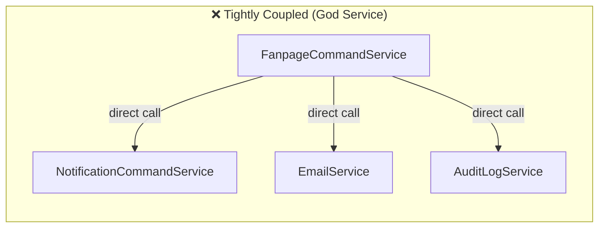
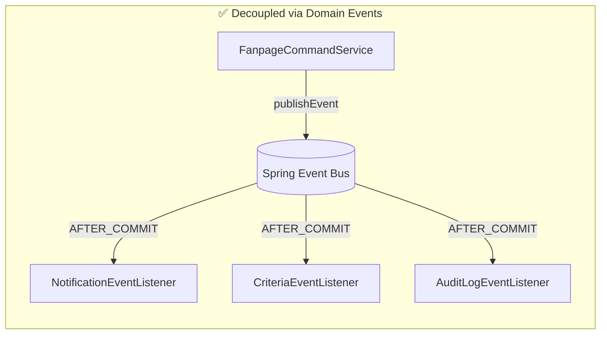
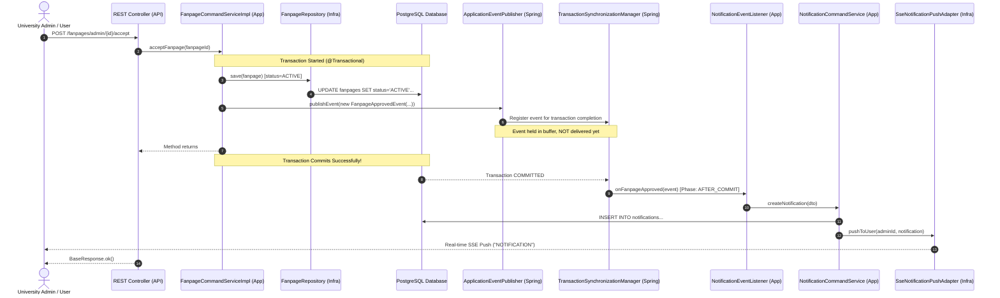

# Spring ApplicationEventPublisher & Event Listener: Architecture, Mechanics & Implementation

> **Artifact Location**: `docs/artifact/application_event_publisher_and_listener_architecture.md`  
> **Target Subsystem**: Event-Driven Decoupling across Bounded Contexts  
> **Architectural Pattern**: Publish-Subscribe / Observer Pattern, Domain-Driven Design (DDD), Transaction-Synchronized Events  
> **Branch**: `fea/notification`

---

## 1. Executive Summary

This document explains the architecture, internal runtime mechanics, lifecycle, and concrete implementation of Spring's **`ApplicationEventPublisher`** and **`@TransactionalEventListener`** in this project.

In a Domain-Driven Design (DDD) multi-module system, core business services (`FanpageCommandService`, `RegistrationCommandService`) must remain strictly focused on their own domain boundaries without directly depending on auxiliary subsystems (such as notifications, email dispatch, criteria point awards, or auditing). Domain events and listeners provide this clean separation.

---

## 2. Architectural Overview: The Observer Pattern in DDD

### 2.1 The Problem: Tightly Coupled Side-Effects (Anti-Pattern)



Without an event mechanism:
- If `NotificationCommandService` fails (e.g., SSE socket disconnect), the core fanpage approval transaction could inadvertently roll back.
- Adding a new side-effect requires editing the core business service, violating the **Open/Closed Principle**.

### 2.2 The Solution: Event-Driven Decoupling



The publisher only announces *what happened in the past* (e.g., `FanpageApprovedEvent`). It has **zero awareness** of who listens to the event or what side-effects are executed.

---

## 3. End-to-End Sequence Diagram

The diagram below illustrates how an event flows from a business service, pauses during database transaction execution, and triggers the listener **only after** the transaction commits successfully:



---

## 4. Core Technical Mechanics: Under the Hood

### 4.1 How `ApplicationEventPublisher.publishEvent()` Works

Spring's `ApplicationEventPublisher` is an interface implemented directly by Spring's `ApplicationContext`.

When `publishEvent(event)` is called:
1. Spring inspects the event object type (`FanpageApprovedEvent`, `EventCheckoutAwardedEvent`, etc.).
2. It queries its internal `ListenerRetriever` cache to find beans with methods annotated with `@EventListener` or `@TransactionalEventListener` matching the event's class signature.
3. For standard `@EventListener`, the listener executes **immediately and synchronously** on the current thread.
4. For `@TransactionalEventListener`, execution is deferred to the specified transaction phase.

---

### 4.2 Why `@TransactionalEventListener(phase = AFTER_COMMIT)` is Critical

In notification and side-effect processing, using standard `@EventListener` is dangerous:

| Dimension | Standard `@EventListener` | `@TransactionalEventListener(phase = AFTER_COMMIT)` |
|:---|:---|:---|
| **Execution Timing** | Immediately when `publishEvent()` is called, **before** DB commit | **Only after** the database transaction has committed |
| **If DB Transaction Fails/Rolls Back** | **Phantom Alert Bug**: User receives a notification saying *"Fanpage Approved"*, but the database write rolled back! | **Safe**: Listener is skipped entirely. Zero false notifications. |
| **If Notification Logic Throws Error** | Can cause the parent database transaction to roll back | Core business state is already safely committed in the DB |

#### How Spring Enforces `AFTER_COMMIT`
Spring uses `TransactionSynchronizationManager.registerSynchronization(...)`.  
When the database connection completes `connection.commit()`, the transaction manager invokes `TransactionSynchronization.afterCommit()`, which triggers the registered listener methods.

---

### 4.3 Database Modifications inside `AFTER_COMMIT`

Because the parent transaction has **already committed**, its database connection is either closed or returned to the connection pool.

If the listener invokes another command service (like `NotificationCommandService.createNotification`):
- `NotificationCommandServiceImpl` has `@Transactional`.
- Spring automatically begins a **brand new transaction** for inserting the notification record into the `notifications` table.

---

## 5. Implementation in This Project

### 5.1 Domain Event Definitions (`ddd-domain`)
Pure Java records in `com.ddd.domain.event`:

```java
// 1. Fanpage Lifecycle Events
public record FanpageApprovedEvent(Long fanpageId, String fanpageName, String fanpageAvatarUrl, Long userId) {}
public record FanpageRejectedEvent(Long fanpageId, String fanpageName, String fanpageAvatarUrl, Long userId) {}

// 2. Member & Membership Events
public record FanpageMemberInvitedEvent(Long fanpageId, String fanpageName, String fanpageAvatarUrl, String inviterName, Long invitedUserId) {}
public record FanpageInvitationAcceptedEvent(Long fanpageId, Long acceptedUserId, String acceptedUserName, String acceptedUserAvatarUrl) {}
public record FanpageInvitationRejectedEvent(Long fanpageId, Long rejectedUserId, String rejectedUserName, String rejectedUserAvatarUrl) {}
public record FanpageMemberAppointedEvent(Long fanpageId, String fanpageName, String fanpageAvatarUrl, String appointerUserName, Long appointedUserId) {}

// 3. Event & Attendance Events
public record EventCheckoutAwardedEvent(Long eventId, String eventName, String eventAvatarUrl, List<Long> userIds) {}
```

---

### 5.2 Publisher Integration in Application Services (`ddd-application`)

#### 1. In `FanpageCommandServiceImpl`
```java
@Service
@RequiredArgsConstructor
@Transactional
public class FanpageCommandServiceImpl implements FanpageCommandService {

    private final FanpageRepository fanpageRepository;
    private final ApplicationEventPublisher applicationEventPublisher; // <-- Injected

    @Override
    public void acceptFanpage(Long fanpageId) {
        Fanpage fanpage = fanpageRepository.findById(fanpageId)
                .orElseThrow(() -> new ResourceNotFoundException("Fanpage not found"));
        fanpage.setStatus(FanpageStatusEnum.ACTIVE.name());
        fanpageRepository.save(fanpage);

        // Publish event
        applicationEventPublisher.publishEvent(new FanpageApprovedEvent(
                fanpage.getId(),
                fanpage.getName(),
                fanpage.getAvatarUrl(),
                fanpage.getCreatedBy()
        ));
    }
}
```

#### 2. In `FanpageMemberInvitationCommandServiceImpl`
```java
@Override
public void acceptInvitation(Long invitationId, String userEmail) {
    // ... update invitation status and add member ...
    invitationRepository.save(invitation);

    User user = userRepository.findById(userId)
            .orElseThrow(() -> new ResourceNotFoundException("User not found"));

    applicationEventPublisher.publishEvent(new FanpageInvitationAcceptedEvent(
            fanpageId,
            user.getId(),
            user.getFullName(),
            user.getAvatarUrl()
    ));
}
```

#### 3. In `RegistrationCommandServiceImpl`
```java
@Override
public void checkOut(Long eventId, String proofUrl) {
    // ... validate and mark registration COMPLETED ...
    registrationRepository.save(registration, userId, eventId);
    awardPointsForStudents(event, List.of(userId), now);

    // Publish checkout points award event
    applicationEventPublisher.publishEvent(new EventCheckoutAwardedEvent(
            eventId,
            event.getName(),
            event.getBannerUrl(),
            List.of(userId)
    ));
}
```

---

### 5.3 Listener Processing in `NotificationEventListener` (`ddd-application`)

File: [`NotificationEventListener.java`](file:///home/shrimp/code/ddd/ddd-application/src/main/java/com/ddd/application/listener/NotificationEventListener.java)

```java
@Component
@RequiredArgsConstructor
@Slf4j
public class NotificationEventListener {

    private final NotificationCommandService notificationCommandService;

    @TransactionalEventListener(phase = TransactionPhase.AFTER_COMMIT)
    public void onFanpageApproved(FanpageApprovedEvent event) {
        notificationCommandService.createNotification(new CreateNotificationDto(
                event.userId(),
                "Fanpage Approved",
                "Your fanpage \"" + event.fanpageName() + "\" has been approved by the university admin!",
                event.fanpageAvatarUrl(),
                "" + event.fanpageId()
        ));
    }

    @TransactionalEventListener(phase = TransactionPhase.AFTER_COMMIT)
    public void onCheckoutAwarded(EventCheckoutAwardedEvent event) {
        for (Long userId : event.userIds()) {
            notificationCommandService.createNotification(new CreateNotificationDto(
                    userId,
                    "Event Completed & Points Awarded",
                    "Congratulations! You completed attendance for \"" + event.eventName() + "\" and your criteria points have been awarded.",
                    event.eventAvatarUrl(),
                    "/events/" + event.eventId()
            ));
        }
    }
}
```

---

## 6. Best Practices & Troubleshooting

### 1. What happens if a listener method fails?
Since the listener runs in `AFTER_COMMIT`, any exception in `NotificationEventListener` will **not** affect the primary transaction. The fanpage remains approved, or the student remains checked out. The error is logged cleanly without degrading core business availability.

### 2. Can listeners run asynchronously in the background?
Yes. If you add `@Async` above `@TransactionalEventListener(phase = TransactionPhase.AFTER_COMMIT)` and enable `@EnableAsync` on Spring Boot:
- The HTTP response to the caller finishes immediately.
- The notification insertion and SSE push are executed on a separate worker thread pool.

### 3. Scaling Beyond a Single JVM (Evolution to Kafka / RabbitMQ)
Because the services depend only on the event payload contract (`FanpageApprovedEvent`, etc.), migrating to a distributed message queue in the future is straightforward:
- You create an adapter listener that serializes the event to JSON and sends it to a Kafka topic.
- No changes are needed in `FanpageCommandServiceImpl` or `RegistrationCommandServiceImpl`.
