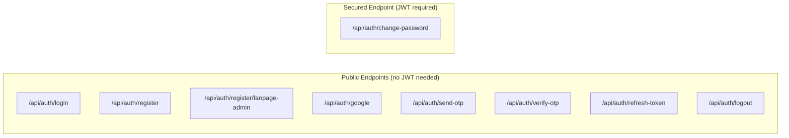
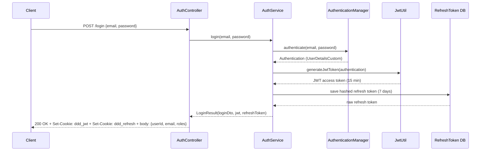
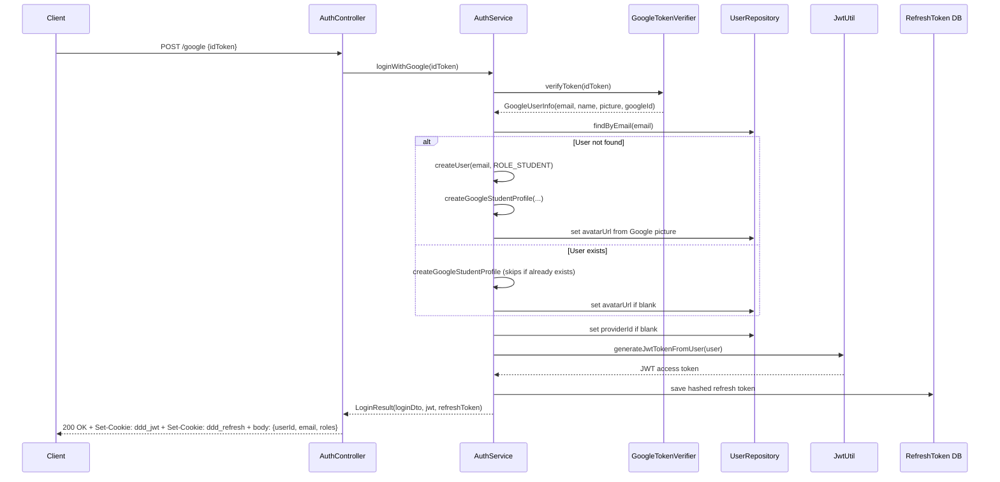
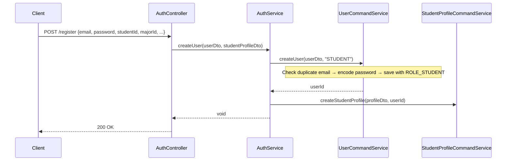
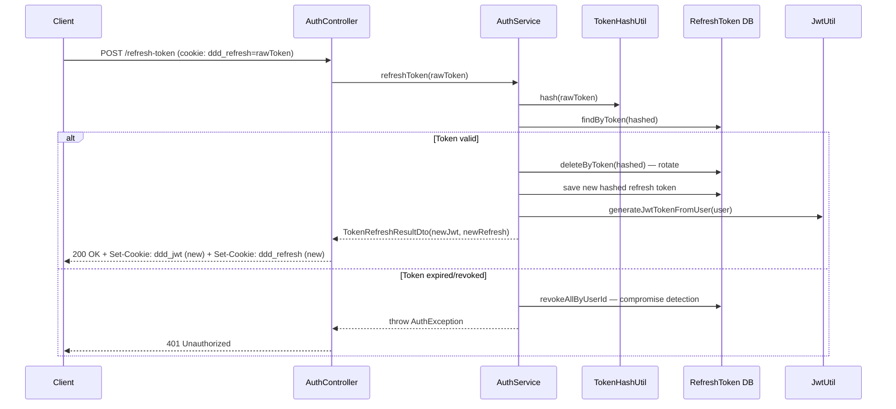
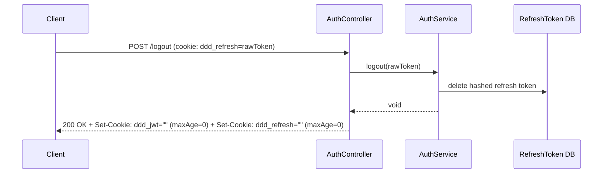
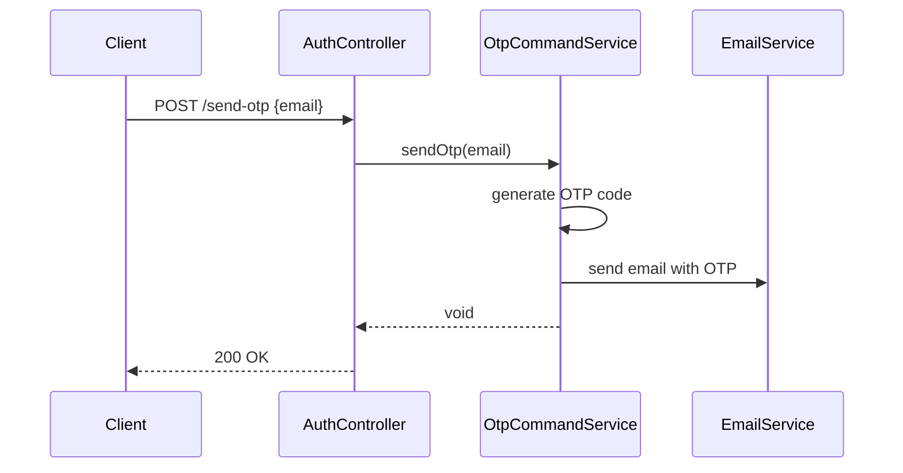
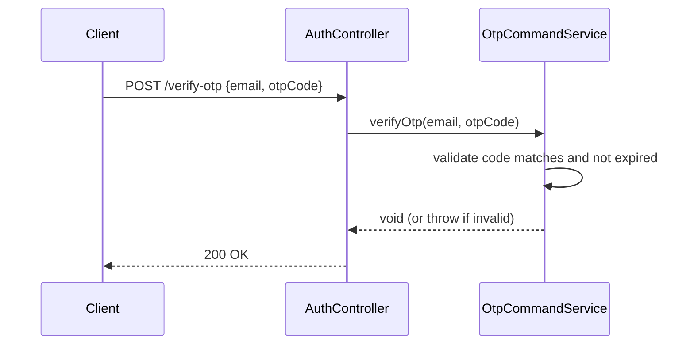
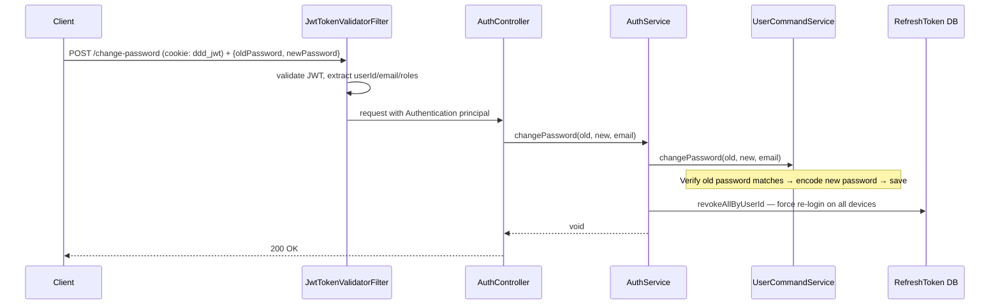

# Authentication Flows in AuthController

All endpoints live under `/auth` (mapped via `@RequestMapping("/auth")` but accessed as `/api/auth/*` through the API prefix).

---

## Overview

---

## 1. Email/Password Login — `POST /api/auth/login`

**What happens:**
1. Spring Security's `AuthenticationManager` validates credentials against the database (via `UserServiceCustom` → `UserDetailsCustom`).
2. A **short-lived JWT access token** (15 min / `900000ms`) is generated containing `userId`, `email`, and `roles` claims.
3. A **long-lived refresh token** (7 days / `604800000ms`) is generated as a random UUID, **hashed** with `TokenHashUtil` before storing in DB.
4. Both tokens are returned as **HTTP-only, Secure cookies** (`ddd_jwt` on path `/`, `ddd_refresh` on path `/api/auth`).

---

## 2. Google OAuth Login — `POST /api/auth/google`

**What happens:**
1. The Google ID token (obtained client-side via Google Sign-In) is verified server-side using `GoogleTokenVerifier` (Google API Client library).
2. If the user **doesn't exist**, they are auto-registered with `ROLE_STUDENT`, a `StudentProfile` is created, and Google profile data (name, avatar) is stored on the `User` entity.
3. If the user **already exists**, their student profile is idempotently ensured (skipped if it already exists), and the avatar is updated only if currently blank.
4. The `providerId` field on `User` is set to the Google account ID for future reference.
5. JWT and refresh tokens are generated **without going through `AuthenticationManager`** (since there's no password). The JWT is built directly from the domain `User` object via `generateJwtTokenFromUser()`.

> [!IMPORTANT]
> Unlike email/password login, Google login **bypasses** `AuthenticationManager` entirely — there's no password to validate. The trust comes from Google's verified ID token.

---

## 3. Student Registration — `POST /api/auth/register`

**What happens:**
1. Validates the email isn't already taken.
2. Password is **bcrypt-encoded** before storage.
3. User is saved with `ROLE_STUDENT` via the multi-role `UserRepository.save(user, Set<String> roleNames)`.
4. A `StudentProfile` is created linking to the new user.
5. **No tokens are returned** — the user must call `/login` separately after registration.

---

## 4. Fanpage Admin Registration — `POST /api/auth/register/fanpage-admin`

Same pattern as student registration but assigns `ROLE_FANPAGE_ADMIN` and creates a `FanpageAdminProfile` instead of a `StudentProfile`.

---

## 5. Token Refresh — `POST /api/auth/refresh-token`

**What happens:**
1. The raw refresh token is extracted from the `ddd_refresh` HTTP-only cookie.
2. It's **hashed** and looked up in the database.
3. **Token Rotation**: the old refresh token is deleted and a new one is issued. This means each refresh token can only be used **once**.
4. **Compromise Detection**: if a revoked/expired token is submitted, **all sessions for that user are revoked** (`revokeAllByUserId`). This protects against stolen refresh tokens being replayed.

> [!CAUTION]
> If an attacker replays a previously-used refresh token, **all** of that user's sessions are immediately invalidated as a security measure.

---

## 6. Logout — `POST /api/auth/logout`

**What happens:**
1. The refresh token is deleted from the database (server-side invalidation).
2. Both cookies (`ddd_jwt` and `ddd_refresh`) are **cleared** by setting `maxAge=0`.
3. The JWT access token will naturally expire within 15 minutes; there's no server-side JWT blacklist.

---

## 7. Send OTP — `POST /api/auth/send-otp`

**What happens:**
1. An OTP code is generated and stored (linked to the email).
2. The code is sent to the user's email via `EmailService` (Spring Boot Mail).
3. This is typically used as a **pre-step before password reset** — verify identity via OTP, then allow password change.

---

## 8. Verify OTP — `POST /api/auth/verify-otp`

**What happens:**
1. The submitted OTP code is compared against the stored one for that email.
2. If valid and not expired, verification succeeds.
3. If invalid, an exception is thrown.

---

## 9. Change Password — `POST /api/auth/change-password` 🔒

> [!NOTE]
> This is the **only secured endpoint** — it requires a valid JWT (the user must be logged in).

**What happens:**
1. The JWT is validated by `JwtTokenValidatorFilter` (extracts `Authentication` from the cookie).
2. The old password is verified against the stored bcrypt hash.
3. The new password is bcrypt-encoded and saved.
4. **All refresh tokens for this user are revoked** — forcing re-authentication on every device/session. This is a security best practice after credential changes.

---

## Token Architecture Summary

| Token | Type | Storage | Lifetime | Cookie |
|-------|------|---------|----------|--------|
| **Access Token (JWT)** | Stateless | Client-side cookie only | 15 min (`900000ms`) | `ddd_jwt`, path `/`, HttpOnly, Secure, SameSite=Lax |
| **Refresh Token** | Stateful (hashed in DB) | Server DB + client cookie | 7 days (`604800000ms`) | `ddd_refresh`, path `/api/auth`, HttpOnly, Secure, SameSite=Strict |

> [!TIP]
> The refresh cookie uses `path="/api/auth"` so it's **only sent on auth endpoints** (refresh, logout), reducing attack surface. The access cookie uses `path="/"` so it's sent on every API request.
