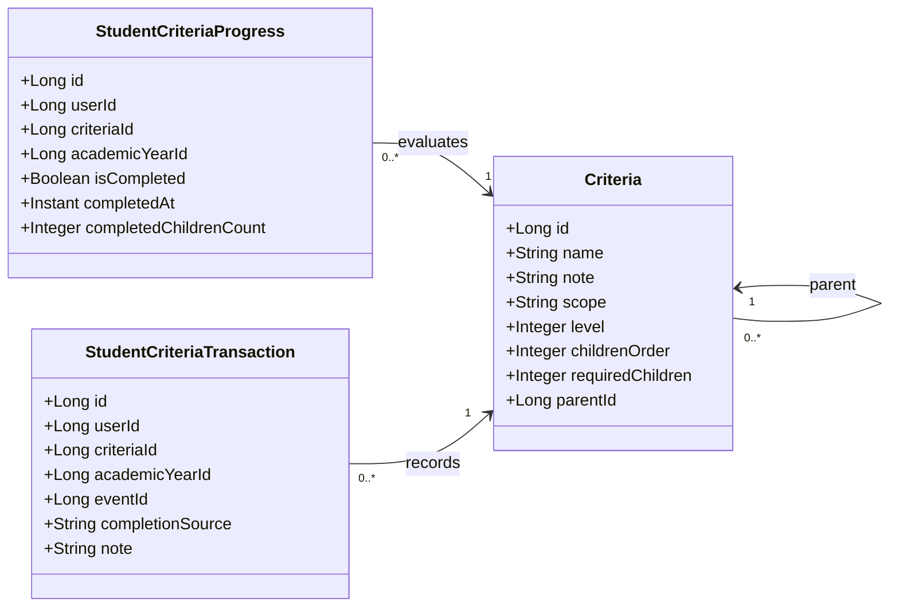
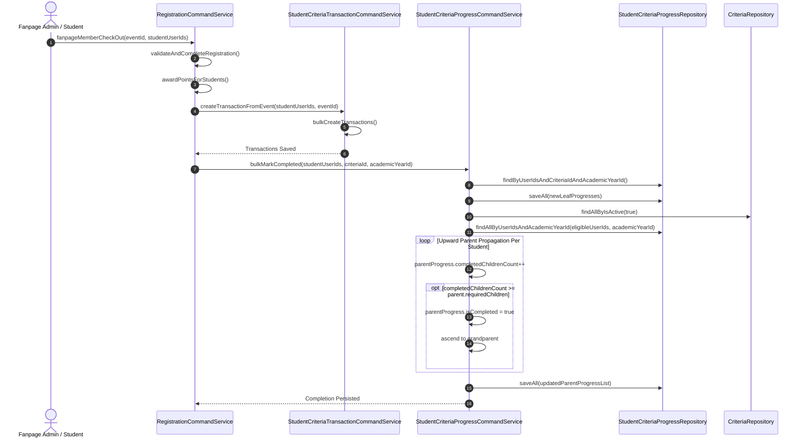
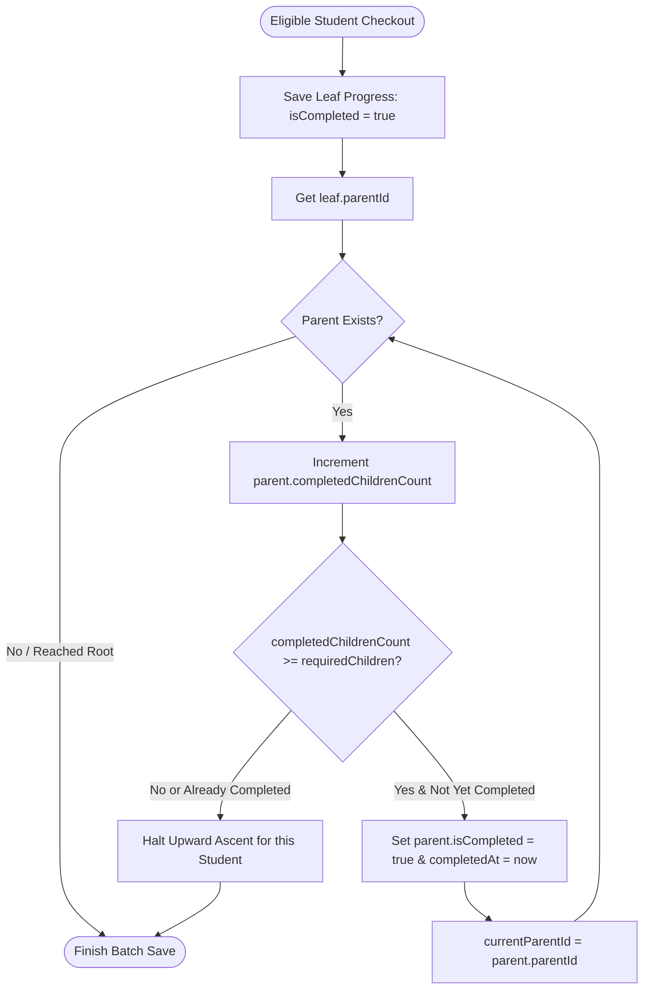
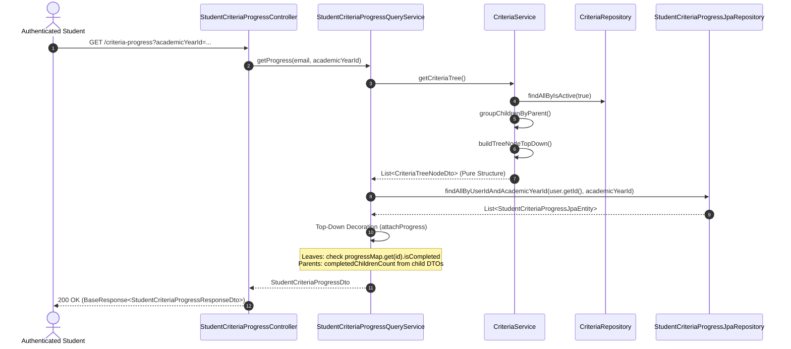

# Criteria Record and Retrieve Architectural Flow

This document details the architectural design, domain models, workflows, and execution paths for **recording student criteria progress** (e.g., during event checkout) and **retrieving criteria progress hierarchies** in the DDD system.

---

## 1. Domain Model Architecture & Separation of Concerns

The criteria system separates structural criteria metadata, student evaluation states, and immutable completion audit trails.



### Responsibility Breakdown

| Component | Responsibility | Database Table |
| :--- | :--- | :--- |
| **`Criteria`** | Defines criteria hierarchy, ordering, required child counts, and descriptions. Managed by [`CriteriaService`](file:///home/shrimp/code/ddd/ddd-application/src/main/java/com/ddd/application/service/criteria/CriteriaService.java). | `criterias` |
| **`StudentCriteriaProgress`** | Maintains the student's evaluated state for both leaf and ancestor criteria per academic year (`isCompleted`, `completedChildrenCount`). | `student_criteria_progress` |
| **`StudentCriteriaTransaction`** | Append-only event/manual transaction log preserving checkout evidence, event references, notes, and sources (`EVENT_CHECKOUT`, `MANUAL`). | `student_criteria_transactions` |

---

## 2. Criteria Recording Flow (Event Checkout)

When one or more students complete checkout from an event (self check-out or fanpage admin batch check-out), two write operations execute in coordinated sequence:

1. **Transaction Logging**: Records an immutable `StudentCriteriaTransaction` for each student.
2. **Progress Propagation**: Evaluates and persists `StudentCriteriaProgress` bottom-up through the criteria hierarchy.



### Hierarchical Propagation Logic

The propagation algorithm implemented in [`StudentCriteriaProgressCommandServiceImpl.java`](file:///home/shrimp/code/ddd/ddd-application/src/main/java/com/ddd/application/service/criteriaprogress/impl/StudentCriteriaProgressCommandServiceImpl.java) operates bottom-up:



> [!NOTE]
> `bulkMarkCompleted` runs in batches:
> - Evaluates existing completions in one query: `findByUserIdsAndCriteriaIdAndAcademicYearId`.
> - Fetches all existing student progress records across the batch in one query: `findAllByUserIdsAndAcademicYearId`.
> - Saves leaf and ancestor entities using `saveAll(...)`, avoiding N+1 roundtrips.

---

## 3. Criteria Retrieval Flow

To ensure high performance and maintain clean DDD boundaries, retrieval decouples structural tree definitions from student completion evaluations.



### Two-Phase Retrieval Mechanics

1. **Phase 1: Structural Tree Generation ([`CriteriaService.getCriteriaTree()`](file:///home/shrimp/code/ddd/ddd-application/src/main/java/com/ddd/application/service/criteria/impl/CriteriaServiceImpl.java#L99-L127))**:
   - Queries all active criteria using the domain repository [`CriteriaRepository`](file:///home/shrimp/code/ddd/ddd-domain/src/main/java/com/ddd/domain/repository/CriteriaRepository.java).
   - Groups criteria by `parentId`.
   - Identifies top roots (`parentId == null`). If a single container root exists, unrolls its children as the top-level main criteria.
   - Recursively builds `CriteriaTreeNodeDto` top-down with siblings sorted by `childrenOrder` and `id`.

2. **Phase 2: Completion Decoration ([`StudentCriteriaProgressQueryServiceImpl.getProgress()`](file:///home/shrimp/code/ddd/ddd-application/src/main/java/com/ddd/application/service/criteriaprogress/impl/StudentCriteriaProgressQueryServiceImpl.java#L37-L69))**:
   - Loads the student's progress records for the academic year in a single query via `@EntityGraph(attributePaths = {"criteria"})`.
   - Traverses the `CriteriaTreeNodeDto` hierarchy top-down:
     - **Leaf nodes**: Status resolved directly from `progressMap.get(node.id()).getIsCompleted()`.
     - **Parent nodes**: First aggregates child completion states; then evaluates:
       $$\text{completedChildrenCount} = \sum (\text{child.isCompleted} == \text{true})$$
       $$\text{isCompleted} = (\text{completedChildrenCount} \ge \text{requiredChildren})$$
   - Computes overall statistics (`completedMainCriteria`, `totalMainCriteria`) and returns [`StudentCriteriaProgressDto`](file:///home/shrimp/code/ddd/ddd-application/src/main/java/com/ddd/application/dto/criteria/StudentCriteriaProgressDto.java).

---

## 4. Key DTO Interfaces & Contracts

### Pure Structural Tree Node
[`CriteriaTreeNodeDto.java`](file:///home/shrimp/code/ddd/ddd-application/src/main/java/com/ddd/application/dto/criteria/CriteriaTreeNodeDto.java):
```java
public record CriteriaTreeNodeDto(
        Long id,
        String name,
        String note,
        String scope,
        Integer level,
        Integer childrenOrder,
        Integer requiredChildren,
        List<CriteriaTreeNodeDto> children
) {}
```

### Progress-Decorated Tree Node
[`CriteriaProgressItemDto.java`](file:///home/shrimp/code/ddd/ddd-application/src/main/java/com/ddd/application/dto/criteria/CriteriaProgressItemDto.java):
```java
public record CriteriaProgressItemDto(
        Long id,
        String name,
        String note,
        String scope,
        Integer level,
        Integer childrenOrder,
        Integer requiredChildren,
        int completedChildrenCount,
        boolean isCompleted,
        List<CriteriaProgressItemDto> children
) {}
```

### Response Payload
[`StudentCriteriaProgressResponseDto.java`](file:///home/shrimp/code/ddd/ddd-api/src/main/java/com/ddd/api/dto/criteria/res/StudentCriteriaProgressResponseDto.java):
```java
public record StudentCriteriaProgressResponseDto(
        Long academicYearId,
        String academicYear,
        int completedMainCriteria,
        int totalMainCriteria,
        List<CriteriaProgressItemResponseDto> criterias
) {}
```

> [!IMPORTANT]
> Detailed transaction histories (e.g., event evidence, completion timestamps, manual notes) are retrieved via the dedicated `StudentCriteriaTransactionQueryService` endpoints to maintain strict separation of concerns and keep progress tree retrieval lightweight.
