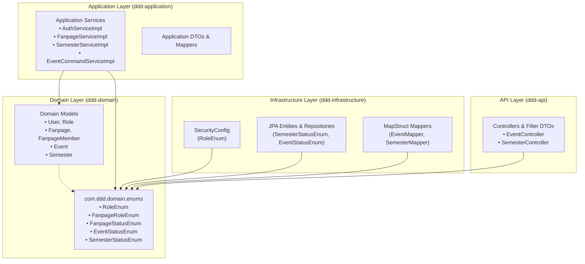

# Domain Layer Enum Package Documentation (`com.ddd.domain.enums`)

## 1. Executive Summary

In Domain-Driven Design (DDD), the **Domain Layer** contains the core business logic, business rules, and domain models that reflect the problem space. The [`com.ddd.domain.enums`](file:///home/shrimp/code/ddd/ddd-domain/src/main/java/com/ddd/domain/enums) package encapsulates the **Ubiquitous Language** for system-wide access controls, organizational lifecycles, activity publishing states, and academic temporal progression.

In accordance with clean architecture and DDD principles:
- **Zero Outward Dependencies:** Enums are pure Java structures devoid of framework dependencies (e.g., no Spring Framework, Jakarta Persistence, or Hibernate annotations).
- **Domain Centricity:** They serve as foundational value specifications for aggregates, business rule validations, repository query parameters, and security policies.

---

## 2. Enums Summary Matrix

| Enum Name | File Location | Constants | Aggregate / Domain Context |
| :--- | :--- | :--- | :--- |
| [`RoleEnum`](file:///home/shrimp/code/ddd/ddd-domain/src/main/java/com/ddd/domain/enums/RoleEnum.java#L3-L5) | [`RoleEnum.java`](file:///home/shrimp/code/ddd/ddd-domain/src/main/java/com/ddd/domain/enums/RoleEnum.java) | `ADMIN`, `STUDENT`, `FANPAGE_ADMIN` | Global Identity, Authentication & Authorization (`User`, `Role`) |
| [`FanpageRoleEnum`](file:///home/shrimp/code/ddd/ddd-domain/src/main/java/com/ddd/domain/enums/FanpageRoleEnum.java#L3-L5) | [`FanpageRoleEnum.java`](file:///home/shrimp/code/ddd/ddd-domain/src/main/java/com/ddd/domain/enums/FanpageRoleEnum.java) | `ADMIN`, `MEMBER` | Club / Organization Internal Membership (`FanpageMember`) |
| [`FanpageStatusEnum`](file:///home/shrimp/code/ddd/ddd-domain/src/main/java/com/ddd/domain/enums/FanpageStatusEnum.java#L3-L5) | [`FanpageStatusEnum.java`](file:///home/shrimp/code/ddd/ddd-domain/src/main/java/com/ddd/domain/enums/FanpageStatusEnum.java) | `PENDING`, `ACTIVE`, `BANNED` | Organization Moderation & Governance (`Fanpage`) |
| [`EventStatusEnum`](file:///home/shrimp/code/ddd/ddd-domain/src/main/java/com/ddd/domain/enums/EventStatusEnum.java#L3-L8) | [`EventStatusEnum.java`](file:///home/shrimp/code/ddd/ddd-domain/src/main/java/com/ddd/domain/enums/EventStatusEnum.java) | `DRAFT`, `PUBLISHED`, `CLOSED`, `CANCELLED` | Activity Management & Student Events (`Event`) |
| [`SemesterStatusEnum`](file:///home/shrimp/code/ddd/ddd-domain/src/main/java/com/ddd/domain/enums/SemesterStatusEnum.java#L3-L7) | [`SemesterStatusEnum.java`](file:///home/shrimp/code/ddd/ddd-domain/src/main/java/com/ddd/domain/enums/SemesterStatusEnum.java) | `COMPLETED`, `ONGOING`, `UPCOMING` | Academic Temporal Progress & Criteria Evaluation (`Semester`) |

---

## 3. Detailed Enum Specifications

### 3.1. `RoleEnum`

- **Declaration:**
  ```java
  package com.ddd.domain.enums;

  public enum RoleEnum {
      ADMIN, STUDENT, FANPAGE_ADMIN
  }
  ```

- **Domain Semantics:**
  - `ADMIN`: University system administrator. Exercises global control over fanpage approvals, system users, master data (academic years, evaluation criteria), and security auditing.
  - `STUDENT`: Enrolled student user. Authenticates via Google OAuth2 or local credentials, browses activities, registers for events, performs self check-in via photo, earns criteria points, and receives e-certificates.
  - `FANPAGE_ADMIN`: Club or faculty organization administrator. Responsible for managing their organization's fanpage profile, member roster, and event submissions.

- **Cross-Layer Tracing:**
  - **Application Layer:** [`AuthServiceImpl`](file:///home/shrimp/code/ddd/ddd-application/src/main/java/com/ddd/application/service/impl/AuthServiceImpl.java) uses `RoleEnum.STUDENT.name()` and `RoleEnum.FANPAGE_ADMIN.name()` when registering new user accounts and onboarding profiles.
  - **Infrastructure Layer:** [`SecurityConfig`](file:///home/shrimp/code/ddd/ddd-infrastructure/src/main/java/com/ddd/infrastructure/config/security/SecurityConfig.java) configures Spring Security HTTP route matching:
    ```java
    .requestMatchers(SecurityConstant.ADMIN_ENDPOINTS).hasRole(RoleEnum.ADMIN.name())
    .requestMatchers(SecurityConstant.FANPAGE_ADMIN_ENDPOINTS).hasRole(RoleEnum.FANPAGE_ADMIN.name())
    ```

---

### 3.2. `FanpageRoleEnum`

- **Declaration:**
  ```java
  package com.ddd.domain.enums;

  public enum FanpageRoleEnum {
      ADMIN, MEMBER
  }
  ```

- **Domain Semantics:**
  - `ADMIN`: Manager/Leader of a specific fanpage. Grants authorization to edit club details, add/remove members, and create/manage events.
  - `MEMBER`: Regular registered member of the fanpage organization.

- **Cross-Layer Tracing:**
  - **Domain Model:** [`FanpageMember`](file:///home/shrimp/code/ddd/ddd-domain/src/main/java/com/ddd/domain/model/FanpageMember.java) associates a `userId`, `fanpageId`, and `role`.
  - **Application Layer:** [`FanpageServiceImpl`](file:///home/shrimp/code/ddd/ddd-application/src/main/java/com/ddd/application/service/fanpage/impl/FanpageServiceImpl.java) assigns `ADMIN` on fanpage creation and `MEMBER` on member invitation.
  - **Infrastructure Layer:** [`FanpageMemberRepositoryImpl`](file:///home/shrimp/code/ddd/ddd-infrastructure/src/main/java/com/ddd/infrastructure/repository/FanpageMemberRepositoryImpl.java) executes authorization checks (`isAdminOfFanpage`) using this role value.

---

### 3.3. `FanpageStatusEnum`

- **Declaration:**
  ```java
  package com.ddd.domain.enums;

  public enum FanpageStatusEnum {
      PENDING, ACTIVE, BANNED
  }
  ```

- **State Machine:**
  ```mermaid
  stateDiagram-v2
      [*] --> PENDING: createFanpage()
      PENDING --> ACTIVE: acceptFanpage() by Admin
      ACTIVE --> BANNED: banFanpage() by Admin
      BANNED --> ACTIVE: unbanFanpage() by Admin
  ```

- **Domain Semantics:**
  - `PENDING`: Fanpage newly registered by a student club representative; queued for university admin moderation.
  - `ACTIVE`: Approved fanpage in good standing, eligible to host events and engage students.
  - `BANNED`: Administratively suspended fanpage due to conduct/policy violations.

- **Cross-Layer Tracing:**
  - **Domain Model:** Stored on the [`Fanpage`](file:///home/shrimp/code/ddd/ddd-domain/src/main/java/com/ddd/domain/model/Fanpage.java) model.
  - **Application Layer:** Handled by [`FanpageServiceImpl`](file:///home/shrimp/code/ddd/ddd-application/src/main/java/com/ddd/application/service/fanpage/impl/FanpageServiceImpl.java) methods: `createFanpage`, `acceptFanpage`, `banFanpage`, and `unbanFanpage`.
  - **Infrastructure Layer:** Managed in `FanpageJpaEntity` and queried by JPA specifications to exclude unapproved fanpages from public listings.

---

### 3.4. `EventStatusEnum`

- **Declaration:**
  ```java
  package com.ddd.domain.enums;

  public enum EventStatusEnum {
      DRAFT,
      PUBLISHED,
      CLOSED,
      CANCELLED
  }
  ```

- **State Machine:**
  ```mermaid
  stateDiagram-v2
      [*] --> DRAFT: Organizer Creates Event
      DRAFT --> PUBLISHED: Event Published / Open for Registration
      PUBLISHED --> CLOSED: Event Concluded / Registration Closed
      DRAFT --> CANCELLED: Organizer Aborts
      PUBLISHED --> CANCELLED: Admin / Organizer Cancels
  ```

- **Domain Semantics:**
  - `DRAFT`: Event being composed by organizers. Hidden from general student discovery and registration.
  - `PUBLISHED`: Event published and live for student browsing, self-registration, and attendance.
  - `CLOSED`: Event timeline or registration capacity completed; prevents further sign-ups.
  - `CANCELLED`: Event terminated prior to or during execution.

- **Cross-Layer Tracing:**
  - **Infrastructure Layer:** [`EventMapper`](file:///home/shrimp/code/ddd/ddd-infrastructure/src/main/java/com/ddd/infrastructure/mapper/EventMapper.java) provides conversion logic between String representations and `EventStatusEnum`, with a fallback to `DRAFT`.
  - **API Layer:** Used in [`EventController`](file:///home/shrimp/code/ddd/ddd-api/src/main/java/com/ddd/api/controller/EventController.java) endpoints (`changeEventStatus`) and [`EventFilterRequestDto`](file:///home/shrimp/code/ddd/ddd-api/src/main/java/com/ddd/api/dto/event/req/EventFilterRequestDto.java) for type-safe query filtering.

---

### 3.5. `SemesterStatusEnum`

- **Declaration:**
  ```java
  package com.ddd.domain.enums;

  public enum SemesterStatusEnum {
      COMPLETED,
      ONGOING,
      UPCOMING
  }
  ```

- **Domain Semantics:**
  - `UPCOMING`: Future academic semester whose start date is ahead of the current date (`startDate > now`).
  - `ONGOING`: Currently active semester (`startDate <= now <= endDate`). Crucial system-wide anchor for point accrual, criteria progress tracking, and current semester queries.
  - `COMPLETED`: Finished historical semester (`endDate < now`).

- **Cross-Layer Tracing:**
  - **Domain Model:** Strongly typed property on [`Semester`](file:///home/shrimp/code/ddd/ddd-domain/src/main/java/com/ddd/domain/model/Semester.java#L16).
  - **Application Layer:** [`SemesterServiceImpl.resolveStatus(startDate, endDate)`](file:///home/shrimp/code/ddd/ddd-application/src/main/java/com/ddd/application/service/academicyear/impl/SemesterServiceImpl.java#L104-L113) dynamically resolves status against `LocalDate.now()` upon semester creation or modification:
    ```java
    LocalDate now = LocalDate.now();
    if (startDate.isAfter(now)) {
        return SemesterStatusEnum.UPCOMING;
    } else if (endDate.isBefore(now)) {
        return SemesterStatusEnum.COMPLETED;
    } else {
        return SemesterStatusEnum.ONGOING;
    }
    ```
  - **Infrastructure Layer:** [`SemesterJpaRepository.findByStatus(SemesterStatusEnum.ONGOING)`](file:///home/shrimp/code/ddd/ddd-infrastructure/src/main/java/com/ddd/infrastructure/repository/jpaRepository/SemesterJpaRepository.java#L20) powers the [`SemesterRepositoryImpl.getCurrent()`](file:///home/shrimp/code/ddd/ddd-infrastructure/src/main/java/com/ddd/infrastructure/repository/SemesterRepositoryImpl.java#L49-L53) retrieval.

---

## 4. Architectural Interactions Across Layers



---

## 5. DDD Architectural Observations & Recommendations

1. **Clean Dependency Inversion:** The `com.ddd.domain.enums` package strictly observes the DDD dependency rule. Outer layers depend on inner domain enums; domain enums have zero incoming dependencies from application or infrastructure layers.
2. **Promote Strong Typing across Aggregate Roots:**
   - While [`Semester`](file:///home/shrimp/code/ddd/ddd-domain/src/main/java/com/ddd/domain/model/Semester.java#L16) strongly types `private SemesterStatusEnum status;`, aggregates such as [`Event`](file:///home/shrimp/code/ddd/ddd-domain/src/main/java/com/ddd/domain/model/Event.java#L23) (`private String status;`) and [`Fanpage`](file:///home/shrimp/code/ddd/ddd-domain/src/main/java/com/ddd/domain/model/Fanpage.java#L12) (`private String status;`) currently store status as raw `String` properties.
   - **Recommendation:** Refactor [`Event`](file:///home/shrimp/code/ddd/ddd-domain/src/main/java/com/ddd/domain/model/Event.java) and [`Fanpage`](file:///home/shrimp/code/ddd/ddd-domain/src/main/java/com/ddd/domain/model/Fanpage.java) to use `EventStatusEnum` and `FanpageStatusEnum` directly. This eliminates arbitrary string manipulation, ensures compile-time safety, and enforces domain invariants at the entity boundary.
