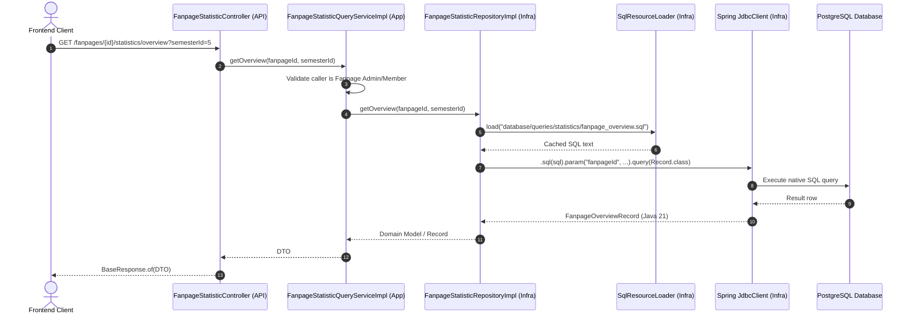

# Effective Analytics & Statistics Implementation Guide with Spring 6 `JdbcClient` and External SQL

> **Document Version**: 1.0.0  
> **Status**: Approved Architectural Standard  
> **Target Audience**: Backend Engineers, Tech Leads, Code Reviewers  
> **Storage Path**: `docs/artifact/effective_statistic_implementation_with_jdbcclient.md`

---

## Table of Contents
1. [Why Approach 1: The Problem with `@Query("""...""")` for Analytics](#1-why-approach-1-the-problem-with-query-for-analytics)
2. [High-Level Architecture & Component Flow](#2-high-level-architecture--component-flow)
3. [Directory Layout Across DDD Modules](#3-directory-layout-across-ddd-modules)
4. [Step-by-Step Implementation Blueprint](#4-step-by-step-implementation-blueprint)
   - [4.1 SQL Resource Loader Utility](#41-sql-resource-loader-utility)
   - [4.2 External `.sql` Query Definitions](#42-external-sql-query-definitions)
   - [4.3 Projection Records (Java 21)](#43-projection-records-java-21)
   - [4.4 Domain Repository Interface (Port)](#44-domain-repository-interface-port)
   - [4.5 Infrastructure Repository Implementation (Adapter)](#45-infrastructure-repository-implementation-adapter)
   - [4.6 Application Query Service](#46-application-query-service)
   - [4.7 API Controller](#47-api-controller)
5. [Handling Optional & Dynamic Filters Cleanly](#5-handling-optional--dynamic-filters-cleanly)
6. [Database Indexing & Performance Tuning](#6-database-indexing--performance-tuning)
7. [Unit & Integration Testing Strategy](#7-unit--integration-testing-strategy)
8. [Summary Checklist](#8-summary-checklist)

---

## 1. Why Approach 1: The Problem with `@Query("""...""")` for Analytics

In transactional operations (CRUD), Spring Data JPA and Hibernate shine. However, for **analytics, aggregations, and statistics dashboards**, using `@Query("""...""")` in Spring Data JPA interfaces leads to critical developer friction:

| Dimension | Annotation `@Query("""...""")` | `JdbcClient` + External `.sql` Files |
|---|---|---|
| **IDE Support** | Treated as a raw Java string. No native SQL linting or auto-complete. | Full native SQL syntax highlighting, formatting, and auto-completion. |
| **Testing & Tuning** | Must run the entire Spring context. Painful to copy-paste escaped strings into DBeaver/pgAdmin. | Open `.sql` directly in DBeaver/pgAdmin, execute `EXPLAIN ANALYZE`, and tune. |
| **Java Code Cleanliness** | 50-line SQL blobs clutter repository interfaces and dilute business methods. | Java code is 3-5 lines per method. Pure separation of concerns. |
| **Mapping Overhead** | Complex nested JPA entities or cumbersome interface projections. | Automatically maps SQL columns (`snake_case`) directly into Java 21 `record` (`camelCase`). |
| **Memory / N+1 Risk** | High risk of unintended entity graph loading or Cartesian joins. | Zero JPA entity lifecycle overhead. Reads raw rows directly into memory buffers. |
| **Third-Party Dependencies** | None. | **Zero** (Native to Spring Boot 3 / Spring 6 and Java 21). |

---

## 2. High-Level Architecture & Component Flow



---

## 3. Directory Layout Across DDD Modules

```
ddd/
├── ddd-domain/
│   └── src/main/java/com/ddd/domain/
│       ├── model/statistic/               # Pure Java domain models/records
│       │   ├── FanpageOverviewStatistic.java
│       │   ├── FanpageMonthlyTrend.java
│       │   └── CategoryDistribution.java
│       └── repository/
│           └── FanpageStatisticRepository.java # Domain Port interface
│
├── ddd-infrastructure/
│   ├── src/main/resources/
│   │   └── database/queries/statistics/   # External pure SQL files
│   │       ├── fanpage_overview.sql
│   │       ├── monthly_trends.sql
│   │       ├── event_type_distribution.sql
│   │       ├── event_status_distribution.sql
│   │       ├── demographics_majors.sql
│   │       ├── demographics_cohorts.sql
│   │       └── top_events.sql
│   └── src/main/java/com/ddd/infrastructure/
│       ├── util/
│       │   └── SqlResourceLoader.java      # Caching SQL file loader
│       └── repository/
│           ├── projection/statistic/       # Raw projection records
│           │   ├── FanpageOverviewRecord.java
│           │   └── MonthlyTrendRecord.java
│           └── FanpageStatisticRepositoryImpl.java # Adapter implementing Domain Port
│
├── ddd-application/
│   └── src/main/java/com/ddd/application/
│       ├── dto/statistic/                  # Application DTOs
│       └── service/statistic/              # Query Service interface & impl
│
└── ddd-api/
    └── src/main/java/com/ddd/api/
        ├── controller/
        │   └── FanpageStatisticController.java
        └── dto/statistic/res/              # API Response DTOs
```

---

## 4. Step-by-Step Implementation Blueprint

### 4.1 SQL Resource Loader Utility
Store this inside `ddd-infrastructure/src/main/java/com/ddd/infrastructure/util/SqlResourceLoader.java`.  
It caches file reads in memory using `ConcurrentHashMap` so disk I/O only occurs once on the first query execution:

```java
package com.ddd.infrastructure.util;

import lombok.extern.slf4j.Slf4j;
import org.springframework.core.io.ClassPathResource;
import org.springframework.stereotype.Component;

import java.io.IOException;
import java.io.InputStream;
import java.nio.charset.StandardCharsets;
import java.util.Map;
import java.util.concurrent.ConcurrentHashMap;

@Component
@Slf4j
public class SqlResourceLoader {

    private final Map<String, String> sqlCache = new ConcurrentHashMap<>();

    public String load(String path) {
        return sqlCache.computeIfAbsent(path, p -> {
            try {
                ClassPathResource resource = new ClassPathResource(p);
                try (InputStream is = resource.getInputStream()) {
                    log.debug("Loaded SQL query file from classpath: {}", p);
                    return new String(is.readAllBytes(), StandardCharsets.UTF_8);
                }
            } catch (IOException e) {
                log.error("Failed to load SQL file at path: {}", p, e);
                throw new IllegalStateException("Could not load SQL file: " + p, e);
            }
        });
    }
}
```

---

### 4.2 External `.sql` Query Definitions

Place these files in `ddd-infrastructure/src/main/resources/database/queries/statistics/`.

#### File 1: `fanpage_overview.sql`
Computes all KPI summary counts in a single round-trip:
```sql
-- fanpage_overview.sql
SELECT 
    COUNT(DISTINCT e.id)                                          AS total_events,
    COUNT(r.user_id)                                             AS total_registrations,
    COUNT(DISTINCT CASE 
        WHEN r.check_in_at IS NOT NULL OR r.status IN ('CHECKED_IN', 'CHECKED_OUT') 
        THEN r.user_id 
    END)                                                         AS total_attendees,
    COALESCE(SUM(CASE 
        WHEN r.status = 'CHECKED_OUT' 
        THEN ep.point 
        ELSE 0 
    END), 0)                                                     AS total_points_awarded
FROM events e
LEFT JOIN registrations r ON r.event_id = e.id
LEFT JOIN event_points ep ON ep.event_id = e.id
WHERE e.fanpage_id = :fanpageId
  AND (:semesterId IS NULL OR e.semester_id = :semesterId)
  AND e.is_active = true;
```

#### File 2: `monthly_trends.sql`
Aggregates activity grouped by `YYYY-MM`:
```sql
-- monthly_trends.sql
SELECT 
    TO_CHAR(e.date_happen, 'YYYY-MM') AS month_year,
    COUNT(DISTINCT e.id)               AS event_count,
    COUNT(r.user_id)                  AS registration_count,
    COUNT(CASE 
        WHEN r.check_in_at IS NOT NULL OR r.status IN ('CHECKED_IN', 'CHECKED_OUT') 
        THEN 1 
    END)                              AS attendee_count
FROM events e
LEFT JOIN registrations r ON r.event_id = e.id
WHERE e.fanpage_id = :fanpageId
  AND EXTRACT(YEAR FROM e.date_happen) = :year
  AND e.is_active = true
GROUP BY TO_CHAR(e.date_happen, 'YYYY-MM')
ORDER BY month_year ASC;
```

#### File 3: `demographics_majors.sql`
Breaks down attendees across majors:
```sql
-- demographics_majors.sql
SELECT 
    COALESCE(m.name, 'Other') AS name,
    COUNT(DISTINCT u.id)     AS count
FROM registrations r
JOIN users u ON u.id = r.user_id
JOIN student_profiles sp ON sp.user_id = u.id
LEFT JOIN majors m ON m.id = sp.major_id
JOIN events e ON e.id = r.event_id
WHERE e.fanpage_id = :fanpageId
  AND (:semesterId IS NULL OR e.semester_id = :semesterId)
  AND (:eventId IS NULL OR e.id = :eventId)
  AND (r.check_in_at IS NOT NULL OR r.status IN ('CHECKED_IN', 'CHECKED_OUT'))
GROUP BY m.name
ORDER BY count DESC;
```

---

### 4.3 Projection Records (Java 21)

Define simple, immutable Java records in `ddd-infrastructure/src/main/java/com/ddd/infrastructure/repository/projection/statistic/`:

```java
package com.ddd.infrastructure.repository.projection.statistic;

public record FanpageOverviewRecord(
        Long totalEvents,
        Long totalRegistrations,
        Long totalAttendees,
        Long totalPointsAwarded
) {}

public record MonthlyTrendRecord(
        String monthYear,
        Long eventCount,
        Long registrationCount,
        Long attendeeCount
) {}

public record DistributionRecord(
        String name,
        Long count
) {}
```

> [!NOTE]
> Spring Boot 3 `JdbcClient` automatically handles snake_case to camelCase mapping (e.g. `total_events` $\rightarrow$ `totalEvents`).

---

### 4.4 Domain Repository Interface (Port)

In `ddd-domain/src/main/java/com/ddd/domain/repository/FanpageStatisticRepository.java`:

```java
package com.ddd.domain.repository;

import com.ddd.domain.model.statistic.FanpageMonthlyTrend;
import com.ddd.domain.model.statistic.FanpageOverviewStatistic;
import com.ddd.domain.model.statistic.CategoryDistribution;

import java.util.List;

public interface FanpageStatisticRepository {
    FanpageOverviewStatistic getOverview(Long fanpageId, Long semesterId);
    List<FanpageMonthlyTrend> getMonthlyTrends(Long fanpageId, Integer year);
    List<CategoryDistribution> getMajorDistribution(Long fanpageId, Long semesterId, Long eventId);
}
```

---

### 4.5 Infrastructure Repository Implementation (Adapter)

In `ddd-infrastructure/src/main/java/com/ddd/infrastructure/repository/FanpageStatisticRepositoryImpl.java`:

```java
package com.ddd.infrastructure.repository;

import com.ddd.domain.model.statistic.CategoryDistribution;
import com.ddd.domain.model.statistic.FanpageMonthlyTrend;
import com.ddd.domain.model.statistic.FanpageOverviewStatistic;
import com.ddd.domain.repository.FanpageStatisticRepository;
import com.ddd.infrastructure.repository.jpaRepository.FollowingJpaRepository;
import com.ddd.infrastructure.repository.projection.statistic.DistributionRecord;
import com.ddd.infrastructure.repository.projection.statistic.FanpageOverviewRecord;
import com.ddd.infrastructure.repository.projection.statistic.MonthlyTrendRecord;
import com.ddd.infrastructure.util.SqlResourceLoader;
import lombok.RequiredArgsConstructor;
import org.springframework.jdbc.core.simple.JdbcClient;
import org.springframework.stereotype.Repository;

import java.util.List;

@Repository
@RequiredArgsConstructor
public class FanpageStatisticRepositoryImpl implements FanpageStatisticRepository {

    private final JdbcClient jdbcClient;
    private final SqlResourceLoader sqlLoader;
    private final FollowingJpaRepository followingJpaRepository;

    private static final String BASE_PATH = "database/queries/statistics/";

    @Override
    public FanpageOverviewStatistic getOverview(Long fanpageId, Long semesterId) {
        String sql = sqlLoader.load(BASE_PATH + "fanpage_overview.sql");

        FanpageOverviewRecord rec = jdbcClient.sql(sql)
                .param("fanpageId", fanpageId)
                .param("semesterId", semesterId)
                .query(FanpageOverviewRecord.class)
                .single();

        long followers = followingJpaRepository.countByFanpage_IdAndIsActiveTrue(fanpageId);

        long regs = rec.totalRegistrations() != null ? rec.totalRegistrations() : 0L;
        long attendees = rec.totalAttendees() != null ? rec.totalAttendees() : 0L;
        double rate = regs > 0 ? ((double) attendees / regs) * 100.0 : 0.0;

        return new FanpageOverviewStatistic(
                rec.totalEvents() != null ? rec.totalEvents() : 0L,
                followers,
                regs,
                attendees,
                Math.round(rate * 100.0) / 100.0,
                rec.totalPointsAwarded() != null ? rec.totalPointsAwarded() : 0L
        );
    }

    @Override
    public List<FanpageMonthlyTrend> getMonthlyTrends(Long fanpageId, Integer year) {
        String sql = sqlLoader.load(BASE_PATH + "monthly_trends.sql");
        int targetYear = (year != null) ? year : java.time.Year.now().getValue();

        List<MonthlyTrendRecord> records = jdbcClient.sql(sql)
                .param("fanpageId", fanpageId)
                .param("year", targetYear)
                .query(MonthlyTrendRecord.class)
                .list();

        return records.stream()
                .map(r -> new FanpageMonthlyTrend(
                        r.monthYear(),
                        r.eventCount(),
                        r.registrationCount(),
                        r.attendeeCount()
                ))
                .toList();
    }

    @Override
    public List<CategoryDistribution> getMajorDistribution(Long fanpageId, Long semesterId, Long eventId) {
        String sql = sqlLoader.load(BASE_PATH + "demographics_majors.sql");

        List<DistributionRecord> records = jdbcClient.sql(sql)
                .param("fanpageId", fanpageId)
                .param("semesterId", semesterId)
                .param("eventId", eventId)
                .query(DistributionRecord.class)
                .list();

        long total = records.stream().mapToLong(DistributionRecord::count).sum();

        return records.stream()
                .map(r -> new CategoryDistribution(
                        r.name(),
                        r.count(),
                        total > 0 ? Math.round(((double) r.count() / total * 100.0) * 100.0) / 100.0 : 0.0
                ))
                .toList();
    }
}
```

---

### 4.6 Application Query Service

In `ddd-application/src/main/java/com/ddd/application/service/statistic/impl/FanpageStatisticQueryServiceImpl.java`:

```java
package com.ddd.application.service.statistic.impl;

import com.ddd.application.dto.statistic.FanpageOverviewStatisticDto;
import com.ddd.application.service.statistic.FanpageStatisticQueryService;
import com.ddd.domain.exception.AuthException;
import com.ddd.domain.exception.UnauthorizedException;
import com.ddd.domain.model.port.security.SecurityContextPort;
import com.ddd.domain.model.statistic.FanpageOverviewStatistic;
import com.ddd.domain.repository.FanpageMemberRepository;
import com.ddd.domain.repository.FanpageStatisticRepository;
import lombok.RequiredArgsConstructor;
import org.springframework.stereotype.Service;
import org.springframework.transaction.annotation.Transactional;

@Service
@RequiredArgsConstructor
@Transactional(readOnly = true)
public class FanpageStatisticQueryServiceImpl implements FanpageStatisticQueryService {

    private final FanpageStatisticRepository statisticRepository;
    private final FanpageMemberRepository fanpageMemberRepository;
    private final SecurityContextPort securityContextPort;

    @Override
    public FanpageOverviewStatisticDto getOverview(Long fanpageId, Long semesterId) {
        validateAccess(fanpageId);

        FanpageOverviewStatistic stat = statisticRepository.getOverview(fanpageId, semesterId);
        return new FanpageOverviewStatisticDto(
                stat.totalEvents(),
                stat.totalFollowers(),
                stat.totalRegistrations(),
                stat.totalAttendees(),
                stat.attendanceRate(),
                stat.totalPointsAwarded()
        );
    }

    private void validateAccess(Long fanpageId) {
        Long currentUserId = securityContextPort.getCurrentUserId();
        if (currentUserId == null) {
            throw new UnauthorizedException("User not authenticated");
        }

        if (!fanpageMemberRepository.isActiveMember(fanpageId, currentUserId)) {
            throw new AuthException("You do not have permission to view statistics for this fanpage");
        }
    }
}
```

---

### 4.7 API Controller

In `ddd-api/src/main/java/com/ddd/api/controller/FanpageStatisticController.java`:

```java
package com.ddd.api.controller;

import com.ddd.api.common.BaseResponse;
import com.ddd.api.dto.statistic.res.FanpageOverviewResponseDto;
import com.ddd.application.dto.statistic.FanpageOverviewStatisticDto;
import com.ddd.application.service.statistic.FanpageStatisticQueryService;
import lombok.RequiredArgsConstructor;
import org.springframework.web.bind.annotation.*;

@RestController
@RequestMapping("/fanpages/{fanpageId}/statistics")
@RequiredArgsConstructor
public class FanpageStatisticController {

    private final FanpageStatisticQueryService statisticQueryService;

    @GetMapping("/overview")
    public BaseResponse<FanpageOverviewResponseDto> getOverview(
            @PathVariable Long fanpageId,
            @RequestParam(required = false) Long semesterId) {
        
        FanpageOverviewStatisticDto dto = statisticQueryService.getOverview(fanpageId, semesterId);
        
        return BaseResponse.of(new FanpageOverviewResponseDto(
                dto.totalEvents(),
                dto.totalFollowers(),
                dto.totalRegistrations(),
                dto.totalAttendees(),
                dto.attendanceRate(),
                dto.totalPointsAwarded()
        ));
    }
}
```

---

## 5. Handling Optional & Dynamic Filters Cleanly

When a query accepts multiple optional criteria (e.g. `semesterId`, `eventId`, `startDate`, `endDate`), SQL parameter coalescing is the cleanest approach:

```sql
WHERE e.fanpage_id = :fanpageId
  AND (:semesterId IS NULL OR e.semester_id = :semesterId)
  AND (:eventId IS NULL OR e.id = :eventId)
  AND (:startDate IS NULL OR e.date_happen >= :startDate)
  AND (:endDate IS NULL OR e.date_happen <= :endDate)
```

In `JdbcClient`, simply pass the parameter object (or `null` when omitted). Spring translates `null` into standard SQL `NULL`, which satisfies `:param IS NULL` evaluation effortlessly.

---

## 6. Database Indexing & Performance Tuning

For analytics queries doing joins and group-by calculations on large datasets, ensure these composite indexes exist:

```sql
-- 1. Fast event filtering by fanpage and semester
CREATE INDEX IF NOT EXISTS idx_events_fanpage_semester_date 
    ON events (fanpage_id, semester_id, date_happen) 
    WHERE is_active = true;

-- 2. Fast registration aggregation by event and attendance status
CREATE INDEX IF NOT EXISTS idx_registrations_event_checkin 
    ON registrations (event_id, status) 
    INCLUDE (check_in_at, user_id);

-- 3. Student major resolution
CREATE INDEX IF NOT EXISTS idx_student_profiles_user_major 
    ON student_profiles (user_id, major_id, k_number);
```

> [!TIP]
> **Performance Verification**: Open your external `.sql` file in DBeaver/pgAdmin and prepend `EXPLAIN ANALYZE`. Verify that PostgreSQL uses **Index Scan** or **Bitmap Index Scan** rather than **Seq Scan** across the `registrations` table.

---

## 7. Unit & Integration Testing Strategy

Testing `JdbcClient` queries is straightforward because we can test both the repository and query service independently:

### A. Repository Integration Test with `@JdbcTest`
```java
@JdbcTest
@AutoConfigureTestDatabase(replace = AutoConfigureTestDatabase.Replace.NONE)
class FanpageStatisticJdbcRepositoryTest {

    @Autowired
    private JdbcClient jdbcClient;

    private FanpageStatisticRepositoryImpl repository;

    @BeforeEach
    void setUp() {
        SqlResourceLoader loader = new SqlResourceLoader();
        repository = new FanpageStatisticRepositoryImpl(jdbcClient, loader, mockFollowingRepo);
    }

    @Test
    void shouldReturnCorrectOverviewMetrics() {
        FanpageOverviewStatistic result = repository.getOverview(1L, null);
        assertNotNull(result);
        assertTrue(result.totalEvents() >= 0);
    }
}
```

### B. Application Service Unit Test (Mockito)
Unit tests for `FanpageStatisticQueryServiceImplTest` mock `FanpageStatisticRepository` and `SecurityContextPort` to verify authentication boundaries without needing a database connection.

---

## 8. Summary Checklist

When implementing new statistic endpoints with this pattern:

- [ ] Write the query in a pure `.sql` file in `src/main/resources/database/queries/statistics/`.
- [ ] Test the `.sql` script in DBeaver / pgAdmin using `EXPLAIN ANALYZE`.
- [ ] Define a lightweight Java 21 `record` projection in `com.ddd.infrastructure.repository.projection.statistic`.
- [ ] Call `jdbcClient.sql(sqlLoader.load(...)).param(...).query(...).list()` in `FanpageStatisticRepositoryImpl`.
- [ ] Map the projection into the domain value object.
- [ ] Expose via `FanpageStatisticQueryService` with `SecurityContextPort` active member validation.
- [ ] Return via `FanpageStatisticController` wrapped in `BaseResponse<T>`.
