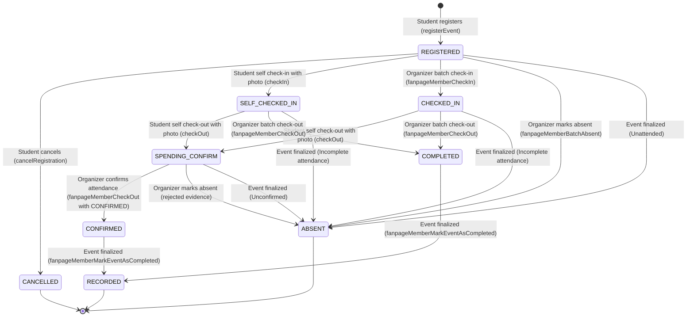
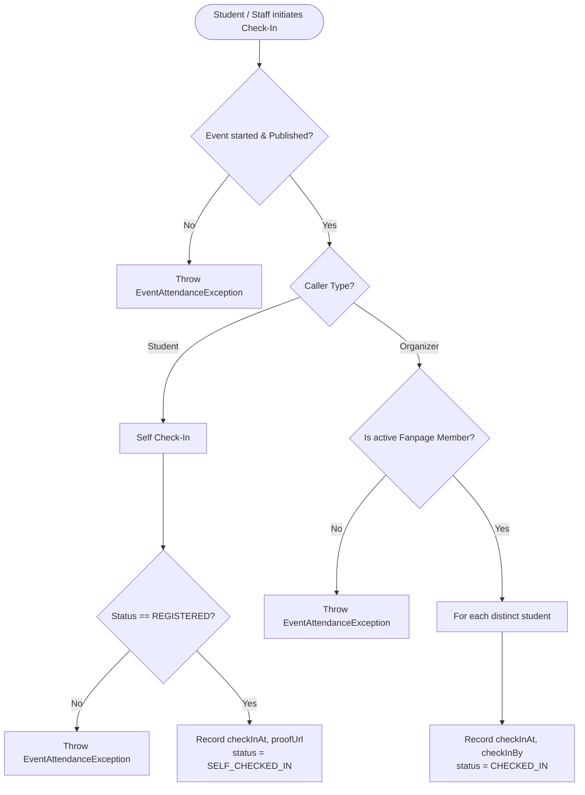
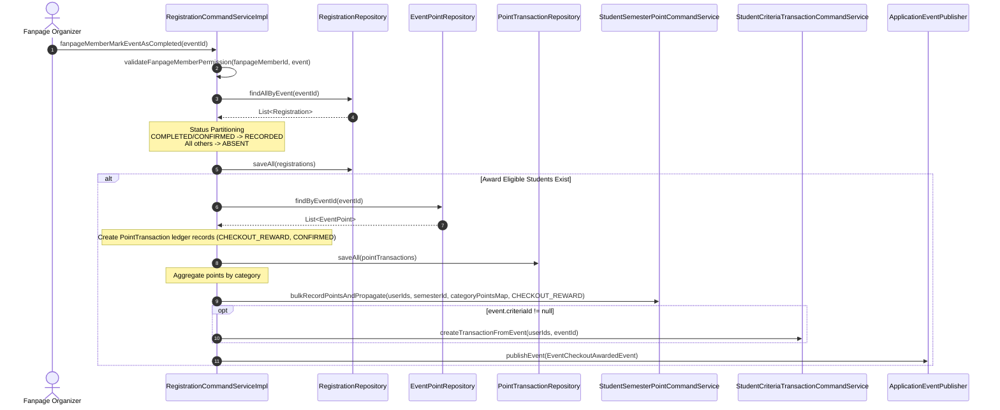

# Event Check-In, Check-Out, and Award Recording Flow Specification

> **Target Service**: [`RegistrationCommandServiceImpl`](file:///home/shrimp/code/ddd/ddd-application/src/main/java/com/ddd/application/service/registration/impl/RegistrationCommandServiceImpl.java)  
> **Architecture Pattern**: Domain-Driven Design (DDD) with CQRS and Event-Driven Architecture  
> **Status**: Production Reference Document  

---

## 1. Executive Summary

In this application, the attendance and reward lifecycle models a student's participation in an event from initial registration to point and criteria attainment. The flow enforces a multi-tier verification process:
1. **Registration & Readiness**: Validates event publication, registration time windows, and user duplicate registration checks.
2. **Dual Check-In Modality**: Supports student photo self-verification (`SELF_CHECKED_IN`) or staff-assisted batch check-in (`CHECKED_IN`).
3. **Dual Check-Out & Confirmation**: Enforces evidence collection (`SPENDING_CONFIRM`) requiring staff verification (`CONFIRMED`), or direct staff batch check-out (`COMPLETED`).
4. **Automated Award Engine & Ledger**: When an event is marked completed, valid attendees are set to `RECORDED`, immutable point transactions are generated, category points are propagated through hierarchical category trees, evaluation criteria progress is advanced, and domain events are emitted.

---

## 2. Registration State Machine

---

## 3. Detailed Phase Breakdown

### Phase 1: Event Registration & Cancellation

* **Methods**: `registerEvent(Long eventId)`, `cancelRegistration(Long eventId, String reason)`
* **Business Invariants**:
  * An event must have status `PUBLISHED`.
  * The current timestamp must fall strictly within `[dateOpen, dateClose]`.
  * If a student was previously `CANCELLED`, their record is revived to `REGISTERED`; active registrations throw `DuplicateResourceException`.
  * Cancellations are forbidden once `dateClose` has elapsed.

---

### Phase 2: Check-In Execution

* **Guard Method**: `validateEventAttendanceReadiness(Event event)`
  * Ensures `event.isActive() == true` and `event.getStatus().equals("PUBLISHED")`.
  * Enforces `now >= event.getDateHappen()` (cannot check in before start time).

---

### Phase 3: Check-Out & Attendance Confirmation

Handled by the internal validator `validateAndCompleteRegistration(...)`:

| Operation | Trigger Method | Required Source Status | Resulting Status | Description |
|---|---|---|---|---|
| **Student Self Check-Out** | `checkOut(eventId, proofUrl)` | `CHECKED_IN` or `SELF_CHECKED_IN` | `SPENDING_CONFIRM` | Attaches check-out proof photo. Enters review queue. |
| **Organizer Batch Check-Out** | `fanpageMemberCheckOut(eventId, ids, COMPLETED)` | `CHECKED_IN` or `SELF_CHECKED_IN` | `COMPLETED` | Direct attendance completion by staff on site. |
| **Organizer Confirmation** | `fanpageMemberCheckOut(eventId, ids, CONFIRMED)` | `SPENDING_CONFIRM` | `CONFIRMED` | Staff reviews evidence and approves attendance. |
| **Organizer Absence Marking** | `fanpageMemberBatchAbsent(eventId, ids)` | `REGISTERED` or `CHECKED_IN` | `ABSENT` | Marks student absent. Blocked if `SPENDING_CONFIRM` or `COMPLETED`. |

---

### Phase 4: Event Finalization & Award Engine

When organizers invoke `fanpageMemberMarkEventAsCompleted(Long eventId)`:

#### Award Engine Subcomponents

1. **Status Finalization**:
   * Eligible: `COMPLETED` and `CONFIRMED` &rarr; `RECORDED` (terminal success).
   * Ineligible: Unchecked-out or unconfirmed registrations &rarr; `ABSENT` (terminal failure).
   * Event status is updated to `EventStatusEnum.COMPLETED`.

2. **Immutable Point Ledger**:
   * For every `(Student, EventPoint)` pair, a `PointTransaction` record is persisted with:
     * `type = PointTransactionTypeEnum.CHECKOUT_REWARD`
     * `status = PointTransactionStatusEnum.CONFIRMED`
     * `points`, `pointCategoryId`, `semesterId`, `eventId`, and description.

3. **Hierarchical Point Propagation**:
   * Invokes `StudentSemesterPointCommandService.bulkRecordPointsAndPropagate(...)`.
   * Automatically rolls point increments upward from child categories to parent category nodes in the student's semester ledger.

4. **Training Criteria Advancement**:
   * If `event.getCriteriaId() != null`, invokes `StudentCriteriaTransactionCommandService.createTransactionFromEvent(...)` to update university graduation criteria indicators.

5. **Domain Event Publication**:
   * Emits `EventCheckoutAwardedEvent` containing event metadata and the list of awarded student user IDs for asynchronous listeners (notifications, certificate generator, etc.).

---

## 4. Key Security & Boundary Safeguards

> [!IMPORTANT]
> - **Zero-Trust Identity**: User identity is resolved server-side via `SecurityContextPort.getCurrentUserId()`, never accepted from request payloads.
> - **Fanpage Permission Enforcement**: Every administrative attendance operation requires `fanpageMemberRepository.isActiveMember(fanpageId, memberId) == true`.
> - **Temporal Protection**: `validateEventAttendanceReadiness` prohibits attendance recording before `event.dateHappen`.
> - **Idempotency & Replay Defense**: Status checks guarantee students cannot check in multiple times, check out before checking in, or re-award points after event completion.
