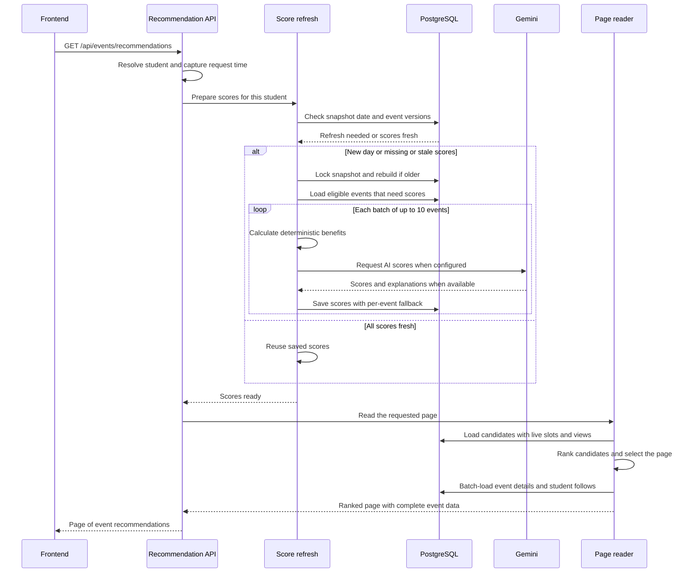
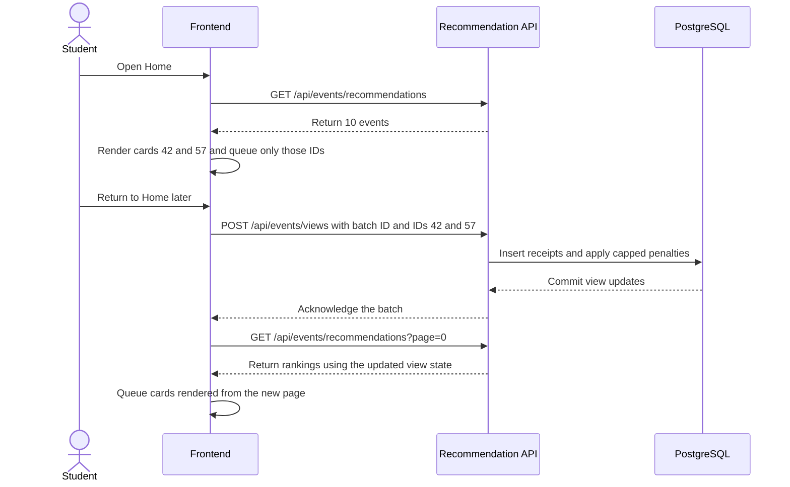

# Event recommendation flow

The API returns event cards ranked for the signed-in student. It saves the part of the score that can be reused during the day and recalculates availability, deadline urgency, and view penalties when the student requests the list.

## 1. What the backend stores

| Table | What it holds | When it changes |
|---|---|---|
| `event_recommendation_summary` | One versioned set of scoring inputs per event, including the offered points, criterion, award period, type, fanpage, and event text. | The migration backfills existing events in one bulk operation. PostgreSQL triggers synchronize affected summaries after relevant edits. |
| `student_recommendation_summary` | One snapshot per student. It includes points by semester, completed criteria by academic year, fanpage affiliations, and registration counts by event type. | Built on the first recommendation request of a new calendar day in Vietnam. |
| `student_event_recommendation` | Saved score, evaluated event version, score date, last reported view time, and read penalty for one student–event pair. | A score refresh updates score fields. A view batch updates view fields. |
| `recommendation_view_receipt` | The student, event, and batch ID for an accepted view. | Inserted once per student–event–batch combination so a transport retry cannot apply a second penalty. |

An event edit updates its shared summary. The next time a student requests recommendations, the backend compares that event’s current version with the version used to score it. Only the requesting student’s missing or stale scores are refreshed. A deadline-only change is read live.

## 2. What happens on a recommendation request



1. **Capture a consistent time.** `DailyEventRecommendationServiceImpl` passes one instant to the refresh and read phases. Both use the Vietnam calendar date.
2. **Check score freshness.** `RecommendationRefreshService` skips the snapshot lock, student-history aggregation, and Gemini when all eligible scores are fresh. When refresh is required, it locks the student’s snapshot row. It builds a snapshot if the saved date is older, then scores only the eligible events with missing scores, an older score date, or a changed event version.
3. **Use the event’s award period.** When simulating a benefit, look up point balances in the event’s semester and completed criteria in its academic year. Progress changes made after the daily snapshot enter personalization on the next local day. Current registrations and slots are checked during the read.
4. **Check eligibility.** Consider active, published events whose happen date is today or later in Vietnam. Exclude events whose registration has yet to open, events with missing required happen or close dates, and events for which the student has a non-cancelled registration. An event that happened earlier today remains eligible through the end of the day.
5. **Rank and return the page.** `RecommendationPageReader` uses live deadlines, slots, and view state. It sorts before pagination, then batch-loads the detail fields for the selected cards and keeps their ranked order.

[Refresh service](../../ddd-application/src/main/java/com/ddd/application/service/event/impl/RecommendationRefreshService.java) · [PostgreSQL repository](../../ddd-infrastructure/src/main/java/com/ddd/infrastructure/repository/RecommendationRepositoryImpl.java) · [Page reader](../../ddd-application/src/main/java/com/ddd/application/service/event/impl/RecommendationPageReader.java)

## 3. How an event earns its score

| Signal | Calculation |
|---|---|
| Useful category points | Simulate the award and propagate balances through the category tree using each parent’s sum or maximum-child rule. For each affected root, compare the capped balance before and after the award. Each useful point adds 10 ranking points, up to 50 total. |
| Criterion progress | An active, unmet criterion contributes 25. It contributes 50 total if adding that criterion completes an active, unmet immediate parent at its required-child threshold. |
| Fanpage affinity | A follow or active membership contributes 3. Membership can affect the score even if the user does not follow the page. |
| Event-type interest | Prior registrations of the same type contribute 1 each, up to 3. Cancelled and absent registrations are excluded. |
| Gemini | A valid score of 0–100 contributes 0–4 ranking points. Stale events are submitted in batches of up to 10. If an event has no usable AI result, the backend scales its interest contribution into 0–4 and generates a deterministic explanation. |

```text
academic = useful-point contribution + criterion contribution
personalizedScore = academic + fanpage affinity + event-type interest + Gemini contribution
effectiveScore = personalizedScore + urgencyScore - readPenalty
```

**Useful points example.** Two children of a maximum-child category have balances of 10 and 4. An event awards 5 to the second child. Its balance rises to 9 and the parent remains at 10, so the useful gain is zero.

**Urgency example.** An event adds two useful points and completes an unmet parent criterion. Its academic subtotal is 70. With 36 hours left and slots available, urgency adds 5% of 70, or 3.5. The boost rises from zero at 72 hours to nearly 10% just before registration closes. A closed or full event gets zero urgency.

[Scoring policy](../../ddd-domain/src/main/java/com/ddd/domain/model/recommendation/RecommendationScoringPolicy.java) · [Score records and formulas](../../ddd-domain/src/main/java/com/ddd/domain/model/recommendation/RecommendationFeatures.java)

## 4. How the backend orders candidates

| Priority | Group |
|---|---|
| 1 | Registration open, slots available, and the event has no reported view |
| 2 | Registration open, slots available, and the event has a reported view |
| 3 | The registration deadline has been reached or the event is full |

Group takes precedence over score. Within each group, order by effective score descending, then earlier registration deadline, then event ID. A full event can move back into an open group as soon as a slot becomes available. A view can move an event into the viewed group as soon as the frontend’s batch commits. Neither change requires a new personalized score.

## 5. How the frontend closes the loop



1. Fetch `GET /api/events/recommendations?page=0&size=10` and render cards from each item’s full `event` object. Read `item.explain` and `item.viewed` for the recommendation display.
2. Queue IDs only for cards that render in the student’s UI. If the response contains ten items and only cards 42 and 57 render, queue `[42, 57]`. Clicking a card or opening details is unnecessary.
3. When the student returns to Home or explicitly refreshes recommendations, send the queued IDs to `POST /api/events/views` with a UUID `batchId`. After acknowledgment, request page 0 again. Cards rendered from the new list enter the next batch.
4. Retry an unacknowledged POST with the same UUID and IDs. Every newly accepted batch adds five penalty points per reported event, up to twenty. The backend preserves penalties across days.

The nested event includes `event.registeredCount`, `event.isFull`, `event.registrationClosed`, and `event.isFollowFanpage`. The follow flag comes from the student’s current follow status. The wrapper also carries the existing slots, benefit, and score fields. Preserve the server’s order when rendering the list.

[Response DTO](../../ddd-api/src/main/java/com/ddd/api/dto/event/res/EventRecommendationResponseDto.java) · [View batch persistence](../../ddd-infrastructure/src/main/java/com/ddd/infrastructure/repository/EventViewRepositoryImpl.java)
