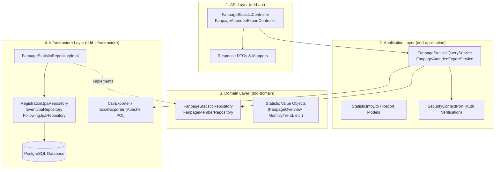
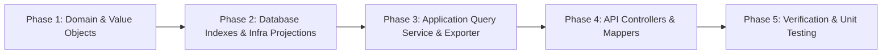

# Fanpage Statistics & Attendee Analytics: Architecture & Implementation Plan

> **Document Version**: 1.0.0  
> **Target Audience**: Backend Engineers, Frontend Engineers, Tech Leads  
> **Status**: Ready for Implementation  
> **Storage Path**: `docs/artifact/fanpage_statistic_architecture_and_implementation_plan.md`

---

## Table of Contents
1. [Executive Summary & Purpose](#1-executive-summary--purpose)
2. [Metric Definitions & Business Logic](#2-metric-definitions--business-logic)
3. [Domain-Driven Architecture (DDD) & Boundaries](#3-domain-driven-architecture-ddd--boundaries)
4. [High-Performance Aggregation & Database Strategy](#4-high-performance-aggregation--database-strategy)
5. [REST API Specification](#5-rest-api-specification)
6. [Attendee Export Module (CSV & Excel)](#6-attendee-export-module-csv--excel)
7. [Security & Access Control Matrix](#7-security--access-control-matrix)
8. [Step-by-Step Implementation Roadmap](#8-step-by-step-implementation-roadmap)

---

## 1. Executive Summary & Purpose

In university event and club management, fanpage administrators (club presidents, event heads) need real-time data to measure student participation, assess event success, and satisfy university reporting standards.

This document outlines the architectural blueprint and execution plan to implement:
1. **Fanpage Statistics Dashboard**: High-level KPIs, monthly/semester trends, event category breakdowns, and attendee demographics.
2. **Event Attendee Data Export**: On-demand extraction of attendee rosters with check-in/out timestamps and proof statuses into CSV and Excel formats.

---

## 2. Metric Definitions & Business Logic

### 2.1 Top-Level KPI Summary Cards
- **Total Events**: Count of events hosted by the fanpage (excluding deleted/draft if specified by filter).
- **Total Followers**: Active follower count of the fanpage (`following.is_active = true`).
- **Total Registrations**: Sum of all student registrations across the fanpage's events.
- **Actual Attendees**: Count of registrations reaching `CHECKED_IN` or `CHECKED_OUT` (verified presence).
- **Attendance Rate (%)**: $\frac{\text{Actual Attendees}}{\text{Total Registrations}} \times 100\%$
- **Criteria Points Awarded**: Total student development / training points distributed across completed events.

### 2.2 Time-Series & Trend Analysis
- **Monthly / Semester Engagement**:
  - `eventCount`: Number of events occurring in that timeframe (`events.date_happen`).
  - `registrationCount`: Students who registered during that period.
  - `attendeeCount`: Students who verified attendance during that period.
- **Follower Growth**: Net new followers accumulated per month.

### 2.3 Event Performance & Distribution
- **Status Funnel**: Breakdown by `DRAFT`, `PENDING`, `APPROVED`, `UPCOMING`, `HAPPENING`, `COMPLETED`, `CANCELLED`.
- **Event Category Distribution**: Count and percentage of events categorized by `EventType` (Academic, Workshop, Sports, Volunteer, Cultural).
- **Capacity Utilization**: Ratio of registrations to allocated event capacity ($\frac{\text{Registrations}}{\text{Capacity}} \times 100\%$).

### 2.4 Attendee Demographics
- **Cohort Breakdown (`kNumber`)**: Distribution of attendees across academic batches (K17, K18, K19, K20, etc.).
- **Major / Faculty Breakdown**: Distribution of attendees by major (e.g., Software Engineering, Business Administration).
- **Gender Ratio**: Breakdown of attendees by gender.

### 2.5 Actionable Alerts
- **Pending Photo Verifications**: Count of attendees with uploaded check-in/check-out photo evidence awaiting admin review.
- **Urgent Registration Deadlines**: Events closing registration within 24 hours that are below 50% capacity.

---

## 3. Domain-Driven Architecture (DDD) & Boundaries

The module strictly follows the project's multi-module DDD layout:



### Module Responsibilities:
- **`ddd-domain`**: Zero framework dependencies. Houses pure domain value objects and repository interface contracts (`FanpageStatisticRepository`).
- **`ddd-infrastructure`**: Implements aggregation queries using Spring Data JPA, projections, and raw streaming utilities (OpenCSV, Apache POI).
- **`ddd-application`**: Handles security authorization (verifying the caller is an admin/member of the fanpage) and orchestrates data aggregation and DTO transformations.
- **`ddd-api`**: Exposes HTTP endpoints, returns `BaseResponse<T>`, and streams binary/text files for exports.

---

## 4. High-Performance Aggregation & Database Strategy

> [!IMPORTANT]
> **Anti-Pattern Prevention**: Never fetch full JPA entity collections into memory to perform `.stream().count()` or `.stream().filter()`. All counts, sums, and groupings must execute inside PostgreSQL via optimized aggregate SQL/JPQL queries.

### 4.1 Required Indexes
Ensure the following composite indexes exist in `ddd-infrastructure/src/main/resources/database/schema.sql` (or migration scripts):
```sql
-- Fast event filtering by fanpage, status, and semester
CREATE INDEX IF NOT EXISTS idx_events_fanpage_status_semester 
    ON events (fanpage_id, status, semester_id);

-- Fast registration aggregation by event and attendance status
CREATE INDEX IF NOT EXISTS idx_registrations_event_status 
    ON registrations (event_id, status);

-- Fast attendance date-range queries
CREATE INDEX IF NOT EXISTS idx_registrations_checkin_checkout 
    ON registrations (check_in_at, check_out_at);

-- Following count and growth by fanpage
CREATE INDEX IF NOT EXISTS idx_following_fanpage_created 
    ON following (fanpage_id, created_at) WHERE is_active = true;
```

### 4.2 Sample High-Performance Aggregate JPQL

#### Overview KPI Query
```sql
SELECT 
    COUNT(DISTINCT e.id) AS totalEvents,
    COUNT(DISTINCT r.user.id) AS totalRegistrations,
    COUNT(DISTINCT CASE WHEN r.checkInAt IS NOT NULL OR r.status IN ('CHECKED_IN', 'CHECKED_OUT') THEN r.user.id END) AS totalAttendees
FROM EventJpaEntity e
LEFT JOIN RegistrationJpaEntity r ON r.event.id = e.id
WHERE e.fanpage.id = :fanpageId 
  AND (:semesterId IS NULL OR e.semester.id = :semesterId)
  AND e.isActive = true
```

#### Monthly Trend Group-By Query
```sql
SELECT 
    FUNCTION('TO_CHAR', e.dateHappen, 'YYYY-MM') AS monthYear,
    COUNT(DISTINCT e.id) AS eventCount,
    COUNT(r.user.id) AS registrationCount,
    COUNT(CASE WHEN r.checkInAt IS NOT NULL THEN 1 END) AS attendeeCount
FROM EventJpaEntity e
LEFT JOIN RegistrationJpaEntity r ON r.event.id = e.id
WHERE e.fanpage.id = :fanpageId 
  AND e.isActive = true
GROUP BY FUNCTION('TO_CHAR', e.dateHappen, 'YYYY-MM')
ORDER BY monthYear ASC
```

---

## 5. REST API Specification

All endpoints are rooted under `/fanpages/{fanpageId}/statistics`.

### 5.1 Endpoints Summary

| Method | Endpoint | Query Params | Description |
|---|---|---|---|
| `GET` | `/fanpages/{fanpageId}/statistics/overview` | `semesterId`, `startDate`, `endDate` | Returns 6 core KPI summary cards |
| `GET` | `/fanpages/{fanpageId}/statistics/trends` | `year`, `semesterId` | Monthly engagement trends (events, regs, check-ins) |
| `GET` | `/fanpages/{fanpageId}/statistics/event-distribution` | `semesterId` | Breakdown by event status and event type |
| `GET` | `/fanpages/{fanpageId}/statistics/demographics` | `semesterId`, `eventId` | Attendee distribution by major, cohort, and gender |
| `GET` | `/fanpages/{fanpageId}/statistics/top-events` | `limit` (default 5), `sortBy` (`attendees` / `rate`) | Leaderboard of top events |
| `GET` | `/fanpages/{fanpageId}/statistics/dashboard` | `semesterId` | Comprehensive composite payload for the initial page load |

### 5.2 Composite Dashboard Response Example (`GET /fanpages/{fanpageId}/statistics/dashboard`)

```json
{
  "code": 200,
  "message": "Success",
  "data": {
    "overview": {
      "totalEvents": 14,
      "totalFollowers": 1280,
      "totalMembers": 35,
      "totalRegistrations": 940,
      "totalAttendees": 845,
      "attendanceRate": 89.89,
      "totalCriteriaPointsAwarded": 2835
    },
    "alerts": {
      "pendingPhotoVerifications": 12,
      "urgentDeadlineEvents": 1
    },
    "monthlyTrends": [
      {
        "monthYear": "2026-08",
        "eventCount": 2,
        "registrationCount": 180,
        "attendeeCount": 165
      },
      {
        "monthYear": "2026-09",
        "eventCount": 5,
        "registrationCount": 420,
        "attendeeCount": 380
      }
    ],
    "eventsByType": [
      { "name": "Workshop", "count": 6, "percentage": 42.86 },
      { "name": "Academic", "count": 4, "percentage": 28.57 },
      { "name": "Volunteer", "count": 3, "percentage": 21.43 },
      { "name": "Sports", "count": 1, "percentage": 7.14 }
    ],
    "demographics": {
      "cohorts": [
        { "cohort": "K19", "count": 410, "percentage": 48.52 },
        { "cohort": "K18", "count": 270, "percentage": 31.95 },
        { "cohort": "K17", "count": 165, "percentage": 19.53 }
      ],
      "majors": [
        { "majorName": "Software Engineering", "count": 390, "percentage": 46.15 },
        { "majorName": "International Business", "count": 255, "percentage": 30.18 },
        { "majorName": "Graphic Design", "count": 200, "percentage": 23.67 }
      ],
      "gender": {
        "male": 465,
        "female": 380
      }
    },
    "topEvents": [
      {
        "eventId": 101,
        "eventName": "TechTalk 2026: Agentic AI",
        "bannerUrl": "https://cdn.example.com/events/101.jpg",
        "dateHappen": "2026-09-15T09:00:00Z",
        "capacity": 200,
        "registrationCount": 200,
        "attendeeCount": 194,
        "attendanceRate": 97.0
      }
    ]
  }
}
```

---

## 6. Attendee Export Module (CSV & Excel)

### 6.1 Export Endpoint
```http
GET /fanpages/{fanpageId}/events/{eventId}/attendees/export?format=csv
GET /fanpages/{fanpageId}/events/{eventId}/attendees/export?format=xlsx
```

### 6.2 Data Schema of the Exported File
The exported file contains comprehensive student registration and verification data:

| Column Header | Field Source | Description / Example |
|---|---|---|
| **No.** | Sequential Index | `1`, `2`, `3` |
| **Student ID** | `student_profiles.student_id` | `SE160123` |
| **Full Name** | `users.first_name` + `last_name` | `Nguyen Van A` |
| **Email** | `users.email` | `anguyen@fpt.edu.vn` |
| **Major** | `majors.name` | `Software Engineering` |
| **Cohort** | `student_profiles.k_number` | `K17` |
| **Gender** | `users.gender` | `MALE` / `FEMALE` |
| **Registration Date** | `registrations.reg_date` | `2026-09-01 14:32:00` |
| **Status** | `registrations.status` | `CHECKED_OUT`, `CHECKED_IN`, `REGISTERED` |
| **Check-in Time** | `registrations.check_in_at` | `2026-09-15 08:45:12` |
| **Check-in Photo** | `registrations.check_in_evidence_url` | Photo proof URL for manual audit |
| **Check-out Time** | `registrations.check_out_at` | `2026-09-15 11:32:50` |
| **Check-out Photo** | `registrations.check_out_evidence_url`| Photo proof URL |

### 6.3 Performance & Streaming Strategy
To support large events without `OutOfMemoryError`:
1. Use **`StreamingResponseBody`** in Spring MVC:
   ```java
   @GetMapping("/events/{eventId}/attendees/export")
   public ResponseEntity<StreamingResponseBody> exportAttendees(
           @PathVariable Long fanpageId,
           @PathVariable Long eventId,
           @RequestParam(defaultValue = "xlsx") String format) { ... }
   ```
2. For Excel: Use Apache POI **`SXSSFWorkbook`** (Streaming XLSX), which flushes rows to disk in chunks of 100 rows, keeping memory usage constant regardless of row count.
3. For CSV: Use standard `PrintWriter` / OpenCSV streaming directly into the HTTP response `OutputStream`.

---

## 7. Security & Access Control Matrix

Following the project's security conventions:
- Controllers **never** extract user IDs from tokens or request bodies.
- Application services inject `SecurityContextPort` to obtain `currentUserId = securityContextPort.getCurrentUserId()`.
- Access evaluation logic:
  ```java
  Long currentUserId = securityContextPort.getCurrentUserId();
  if (currentUserId == null) {
      throw new UnauthorizedException("User not authenticated");
  }

  boolean isFanpageMemberOrAdmin = fanpageMemberRepository.isActiveMember(fanpageId, currentUserId);
  boolean isSystemAdmin = securityContextPort.hasRole("ROLE_ADMIN");

  if (!isFanpageMemberOrAdmin && !isSystemAdmin) {
      throw new AuthException("You do not have permission to view statistics for this fanpage");
  }
  ```

---

## 8. Step-by-Step Implementation Roadmap



### Phase 1: Domain Layer (`ddd-domain`)
- [ ] Create domain package `com.ddd.domain.model.statistic`.
- [ ] Define Value Objects:
  - `FanpageOverviewStatistic.java`
  - `FanpageMonthlyTrend.java`
  - `FanpageCategoryDistribution.java`
  - `FanpageDemographics.java`
  - `FanpageTopEvent.java`
- [ ] Define repository interface `FanpageStatisticRepository.java` in `com.ddd.domain.repository`.

### Phase 2: Infrastructure Layer (`ddd-infrastructure`)
- [ ] Create SQL migration for composite indexes (`idx_events_fanpage_status_semester`, etc.).
- [ ] Add JPA projection interfaces for aggregation query results.
- [ ] Implement `FanpageStatisticRepositoryImpl.java` in `com.ddd.infrastructure.repository`.
- [ ] Implement `ExcelExportAdapter` and `CsvExportAdapter` in `com.ddd.infrastructure.adapter.export`.

### Phase 3: Application Layer (`ddd-application`)
- [ ] Create DTOs under `com.ddd.application.dto.statistic`.
- [ ] Implement `FanpageStatisticQueryService.java` and `FanpageStatisticQueryServiceImpl.java`.
- [ ] Implement `FanpageAttendeeExportService.java` and `FanpageAttendeeExportServiceImpl.java`.
- [ ] Add MapStruct mapper `FanpageStatisticDtoMapper.java`.

### Phase 4: API Layer (`ddd-api`)
- [ ] Create response DTOs under `com.ddd.api.dto.statistic.res`.
- [ ] Create `FanpageStatisticController.java` with routes for overview, trends, distribution, demographics, top events, and composite dashboard.
- [ ] Create `FanpageAttendeeExportController.java` (or sub-routes) for streaming CSV and Excel downloads.
- [ ] Add MapStruct mapper `FanpageStatisticApiMapper.java`.

### Phase 5: Verification & Testing
- [ ] Write unit tests for `FanpageStatisticQueryServiceImplTest` (validating access control, semester filters, and DTO mappings).
- [ ] Write unit tests for `FanpageStatisticControllerTest` (verifying HTTP responses, media types, and `BaseResponse<T>` wrapping).
- [ ] Verify build with `mvn test-compile` and run full regression tests.

---

> [!TIP]
> **Frontend Integration Tip**: Use the composite `GET /fanpages/{fanpageId}/statistics/dashboard` endpoint for the initial page load to eliminate waterfall requests, and use the granular endpoints (`/trends`, `/demographics`) only when the user changes filters (e.g., switches semester or date range).
