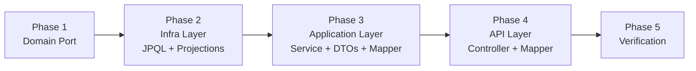

# Fanpage Statistics — Implementation Plan

> **Document Version**: 1.0.0
> **Scope**: Fanpage member (admin) dashboard statistics only. Attendee export is already implemented.
> **Status**: Ready for Implementation
> **Author**: Antigravity AI

---

## Table of Contents
1. [Scope & Exclusions](#1-scope--exclusions)
2. [What Already Exists (Don't Reinvent)](#2-what-already-exists-dont-reinvent)
3. [What We Build](#3-what-we-build)
4. [Authorization Contract](#4-authorization-contract)
5. [Data Model & Query Strategy](#5-data-model--query-strategy)
6. [REST API Specification](#6-rest-api-specification)
7. [Phase-by-Phase Implementation Tasks](#7-phase-by-phase-implementation-tasks)
8. [Anti-Patterns to Avoid](#8-anti-patterns-to-avoid)

---

## 1. Scope & Exclusions

| Included in This Plan | Excluded |
|---|---|
| `GET /fanpages/{fanpageId}/statistics/overview` | Attendee export (already implemented in `RegistrationQueryServiceImpl.exportAttendeesToCsv`) |
| `GET /fanpages/{fanpageId}/statistics/trends` | System-admin level analytics across all fanpages |
| `GET /fanpages/{fanpageId}/statistics/event-distribution` | Real-time WebSocket push of statistics |
| `GET /fanpages/{fanpageId}/statistics/top-events` | |
| `GET /fanpages/{fanpageId}/statistics/dashboard` (composite) | |

---

## 2. What Already Exists (Don't Reinvent)

Before writing a single line of code, verify these components exist and **reuse them directly**.

| Component | Location | Reuse Strategy |
|---|---|---|
| `SecurityContextPort` | `ddd-domain/.../port/security/SecurityContextPort.java` | Inject into `FanpageStatisticQueryServiceImpl` to get `currentUserId` |
| `FanpageMemberRepository.isAdminOfFanpage(fanpageId, userId)` | `ddd-domain/.../repository/FanpageMemberRepository.java:15` | Authorization guard — only admins see stats |
| `FanpageMemberRepository.isActiveMember(fanpageId, userId)` | `ddd-domain/.../repository/FanpageMemberRepository.java:25` | Available but NOT sufficient for PII access |
| `FanpageMemberJpaRepository.existsByFanpageIdAndUserIdAndIsActive(...)` | `ddd-infrastructure/.../jpaRepository/FanpageMemberJpaRepository.java:21` | Already used in `RegistrationQueryServiceImpl.verifyFanpageMember` |
| `FanpageMemberJpaRepository.findUserIdsByFanpageIdAndRole(...)` | `...FanpageMemberJpaRepository.java:32` | Count total admin members |
| `FollowingRepository.countByFanpageIdAndFolStatus(...)` | `ddd-domain/.../repository/FollowingRepository.java:13` | Total followers KPI — already implemented |
| `EventJpaRepository.findByFanpage_Id(...)` | `...EventJpaRepository.java:16` | Used by `EventRepositoryImpl.findByFanpageId` |
| `EventJpaRepository.existsByIdAndFanpageId(...)` | `...EventJpaRepository.java:30` | Cross-tenant validation, already used in export |
| `RegistrationJpaRepository.findAllByEventId(Long eventId)` | `...RegistrationJpaRepository.java:48` | Per-event registration list |
| `ServiceUtil.createPageable(...)` | `ddd-application/.../utils/ServiceUtil.java:11` | Pageable creation — do NOT write your own |
| `BaseResponse.of(...)` | `ddd-api/.../common/BaseResponse.java` | All controller methods MUST return this |
| `AuthException`, `ResourceNotFoundException`, `UnauthorizedException` | `com.ddd.domain.exception.*` | All exception throwing |

---

## 3. What We Build

### New Files Summary

```
ddd-domain/
└── src/main/java/com/ddd/domain/
    └── repository/
        └── FanpageStatisticRepository.java          ← NEW: Domain port (interface only)

ddd-infrastructure/
└── src/main/java/com/ddd/infrastructure/
    └── repository/
        ├── FanpageStatisticRepositoryImpl.java       ← NEW: JPA aggregate queries
        └── jpaRepository/
            └── FanpageStatisticJpaRepository.java   ← NEW: JPQL @Query methods

ddd-application/
└── src/main/java/com/ddd/application/
    ├── dto/statistic/
    │   ├── FanpageOverviewStatisticDto.java          ← NEW
    │   ├── FanpageMonthlyTrendDto.java               ← NEW
    │   ├── FanpageEventDistributionDto.java          ← NEW
    │   ├── FanpageTopEventDto.java                   ← NEW
    │   └── FanpageDashboardDto.java                  ← NEW (composite)
    ├── service/fanpage/
    │   ├── FanpageStatisticQueryService.java         ← NEW: Interface
    │   └── impl/
    │       └── FanpageStatisticQueryServiceImpl.java ← NEW: Implementation
    └── mapper/
        └── FanpageStatisticDtoMapper.java            ← NEW: MapStruct

ddd-api/
└── src/main/java/com/ddd/api/
    ├── dto/statistic/res/
    │   ├── FanpageOverviewStatisticResponseDto.java  ← NEW
    │   ├── FanpageMonthlyTrendResponseDto.java       ← NEW
    │   ├── FanpageEventDistributionResponseDto.java  ← NEW
    │   ├── FanpageTopEventResponseDto.java           ← NEW
    │   └── FanpageDashboardResponseDto.java          ← NEW
    ├── mapper/
    │   └── FanpageStatisticApiMapper.java            ← NEW
    └── controller/
        └── FanpageStatisticController.java           ← NEW
```

---

## 4. Authorization Contract

> [!IMPORTANT]
> **Statistics is an admin-only feature.** Only fanpage admins (role = `ADMIN` within the fanpage) or system admins (`ROLE_ADMIN`) may view statistics. Regular members (role = `MEMBER`) cannot access this data.

**Reusable guard method** — write once in `FanpageStatisticQueryServiceImpl`, call from every public method:

```java
private void assertCallerIsAdminOfFanpage(Long fanpageId) {
    Long currentUserId = securityContextPort.getCurrentUserId();
    if (currentUserId == null) {
        throw new UnauthorizedException("User is not authenticated");
    }
    boolean isSystemAdmin = securityContextPort.hasRole("ADMIN"); // ← "ADMIN", NOT "ROLE_ADMIN"
    if (isSystemAdmin) return;

    boolean isFanpageAdmin = fanpageMemberRepository.isAdminOfFanpage(fanpageId, currentUserId);
    if (!isFanpageAdmin) {
        throw new AuthException("You do not have permission to view statistics for this fanpage");
    }
}
```

---

## 5. Data Model & Query Strategy

> [!IMPORTANT]
> **Never** fetch full JPA entity collections into memory and call `.stream().count()` or `.stream().filter()`. Every count, sum, or grouping must run inside PostgreSQL as a SQL aggregate via JPQL `@Query`.

### 5.1 Metric Definitions & Correct Aggregation

| Metric | Correct Aggregation | Wrong Approach |
|---|---|---|
| `totalEvents` | `COUNT(e.id)` from `events WHERE fanpage_id = ?` and `is_active = true` | Loading all events and calling `.size()` |
| `totalFollowers` | Reuse `FollowingRepository.countByFanpageIdAndFolStatus(fanpageId, FOLLOWING)` — already exists | - |
| `totalMembers` | `COUNT(fm)` from `fanpage_members WHERE fanpage_id = ? AND is_active = true` | - |
| `totalRegistrations` | `COUNT(r)` — count registration rows, **not** `COUNT(DISTINCT r.userId)` which under-counts when one student registers for multiple events | Using DISTINCT on userId |
| `totalAttendees` | `COUNT(r) WHERE r.status IN ('CHECKED_IN', 'CHECKED_OUT')` — count rows, not distinct users | - |
| `attendanceRate` | Computed in Java: `(double) totalAttendees / totalRegistrations * 100` | In-DB division with integer truncation |

### 5.2 Required New JPQL Queries in `FanpageStatisticJpaRepository`

#### Overview KPIs
```sql
-- Total events for fanpage
SELECT COUNT(e) FROM EventJpaEntity e 
WHERE e.fanpage.id = :fanpageId AND e.isActive = true

-- Total registrations across all events of this fanpage
SELECT COUNT(r) FROM RegistrationJpaEntity r 
WHERE r.event.fanpage.id = :fanpageId AND r.event.isActive = true

-- Total attendees (checked-in or checked-out)
SELECT COUNT(r) FROM RegistrationJpaEntity r
WHERE r.event.fanpage.id = :fanpageId
  AND r.event.isActive = true
  AND r.status IN (RegistrationStatusEnum.CHECKED_IN, RegistrationStatusEnum.CHECKED_OUT)

-- Total active members
SELECT COUNT(fm) FROM FanpageMemberJpaEntity fm
WHERE fm.id.fanpageId = :fanpageId AND fm.isActive = true
```

#### Monthly Trends (last 12 months or by year)
```sql
SELECT 
    FUNCTION('TO_CHAR', e.dateHappen, 'YYYY-MM') AS monthYear,
    COUNT(DISTINCT e.id)                          AS eventCount,
    COUNT(r)                                      AS registrationCount,
    SUM(CASE WHEN r.status IN (RegistrationStatusEnum.CHECKED_IN, RegistrationStatusEnum.CHECKED_OUT) THEN 1 ELSE 0 END) AS attendeeCount
FROM EventJpaEntity e
LEFT JOIN RegistrationJpaEntity r ON r.event.id = e.id
WHERE e.fanpage.id = :fanpageId
  AND e.isActive = true
  AND (:year IS NULL OR FUNCTION('YEAR', e.dateHappen) = :year)
GROUP BY FUNCTION('TO_CHAR', e.dateHappen, 'YYYY-MM')
ORDER BY monthYear ASC
```

#### Event-Type Distribution
```sql
SELECT et.name AS eventTypeName, COUNT(e) AS eventCount
FROM EventJpaEntity e
JOIN e.eventType et
WHERE e.fanpage.id = :fanpageId AND e.isActive = true
GROUP BY et.name
ORDER BY eventCount DESC
```

#### Top Events by Attendance
```sql
SELECT e.id, e.name, e.bannerUrl, e.dateHappen, e.capacity,
       COUNT(r)   AS registrationCount,
       SUM(CASE WHEN r.status IN (RegistrationStatusEnum.CHECKED_IN, RegistrationStatusEnum.CHECKED_OUT) THEN 1 ELSE 0 END) AS attendeeCount
FROM EventJpaEntity e
LEFT JOIN RegistrationJpaEntity r ON r.event.id = e.id
WHERE e.fanpage.id = :fanpageId AND e.isActive = true
GROUP BY e.id, e.name, e.bannerUrl, e.dateHappen, e.capacity
ORDER BY attendeeCount DESC
LIMIT :limit
```

### 5.3 JPA Projections

Each JPQL multi-column aggregate query should use an interface projection or a constructor expression to avoid loading full entities:

```java
// Example projection interface
public interface MonthlyTrendProjection {
    String getMonthYear();
    Long getEventCount();
    Long getRegistrationCount();
    Long getAttendeeCount();
}
```

---

## 6. REST API Specification

All endpoints under `/fanpages/{fanpageId}/statistics`.

| Method | Endpoint | Query Params | Returns |
|---|---|---|---|
| `GET` | `.../statistics/overview` | `semesterId` *(optional)* | `FanpageOverviewStatisticResponseDto` |
| `GET` | `.../statistics/trends` | `year` *(optional, default=current year)* | `List<FanpageMonthlyTrendResponseDto>` |
| `GET` | `.../statistics/event-distribution` | — | `List<FanpageEventDistributionResponseDto>` |
| `GET` | `.../statistics/top-events` | `limit` *(default=5)* | `List<FanpageTopEventResponseDto>` |
| `GET` | `.../statistics/dashboard` | `semesterId`, `year` *(optional)* | `FanpageDashboardResponseDto` (composite) |

### Response Shapes (Application DTOs → Java Records)

```java
// FanpageOverviewStatisticDto.java
public record FanpageOverviewStatisticDto(
    long totalEvents,
    long totalFollowers,
    long totalMembers,
    long totalRegistrations,
    long totalAttendees,
    double attendanceRate       // computed: totalAttendees / totalRegistrations * 100
) {}

// FanpageMonthlyTrendDto.java
public record FanpageMonthlyTrendDto(
    String monthYear,           // "2026-09"
    long eventCount,
    long registrationCount,
    long attendeeCount
) {}

// FanpageEventDistributionDto.java
public record FanpageEventDistributionDto(
    String eventTypeName,
    long eventCount,
    double percentage
) {}

// FanpageTopEventDto.java
public record FanpageTopEventDto(
    Long eventId,
    String eventName,
    String bannerUrl,
    Instant dateHappen,
    int capacity,
    long registrationCount,
    long attendeeCount,
    double attendanceRate
) {}

// FanpageDashboardDto.java  (composite — single call for initial page load)
public record FanpageDashboardDto(
    FanpageOverviewStatisticDto overview,
    List<FanpageMonthlyTrendDto> monthlyTrends,
    List<FanpageEventDistributionDto> eventsByType,
    List<FanpageTopEventDto> topEvents
) {}
```

---

## 7. Phase-by-Phase Implementation Tasks



---

### Phase 1 — Domain Layer (`ddd-domain`)

**Package**: `com.ddd.domain.repository`

- [ ] **Create `FanpageStatisticRepository.java`**

```java
package com.ddd.domain.repository;

public interface FanpageStatisticRepository {
    long countEventsByFanpageId(Long fanpageId);
    long countTotalRegistrationsByFanpageId(Long fanpageId);
    long countTotalAttendeesByFanpageId(Long fanpageId);
    long countActiveMembersByFanpageId(Long fanpageId);
    // Trends, distribution, top-events are complex projections — handled by JPA directly in Infra
}
```

> [!NOTE]
> The domain port only declares count-level aggregates that return primitives. Complex projection queries (trends, distribution, top-events) are executed via `FanpageStatisticJpaRepository` in the infra layer, consumed directly by the application service (following the same pattern as `FanpageQueryServiceImpl` which injects `FanpageJpaRepository` directly).

---

### Phase 2 — Infrastructure Layer (`ddd-infrastructure`)

**Packages**: `com.ddd.infrastructure.repository`, `com.ddd.infrastructure.repository.jpaRepository`

- [ ] **Create `FanpageStatisticJpaRepository.java`** — Spring Data JPA interface with all `@Query` methods

```java
package com.ddd.infrastructure.repository.jpaRepository;

@Repository
public interface FanpageStatisticJpaRepository extends JpaRepository<EventJpaEntity, Long> {

    @Query("SELECT COUNT(e) FROM EventJpaEntity e WHERE e.fanpage.id = :fanpageId AND e.isActive = true")
    long countEventsByFanpageId(@Param("fanpageId") Long fanpageId);

    @Query("SELECT COUNT(r) FROM RegistrationJpaEntity r WHERE r.event.fanpage.id = :fanpageId AND r.event.isActive = true")
    long countTotalRegistrationsByFanpageId(@Param("fanpageId") Long fanpageId);

    @Query("SELECT COUNT(r) FROM RegistrationJpaEntity r WHERE r.event.fanpage.id = :fanpageId AND r.event.isActive = true AND r.status IN ('CHECKED_IN', 'CHECKED_OUT')")
    long countTotalAttendeesByFanpageId(@Param("fanpageId") Long fanpageId);

    @Query("SELECT COUNT(fm) FROM FanpageMemberJpaEntity fm WHERE fm.id.fanpageId = :fanpageId AND fm.isActive = true")
    long countActiveMembersByFanpageId(@Param("fanpageId") Long fanpageId);

    // Monthly Trends
    @Query("SELECT FUNCTION('TO_CHAR', e.dateHappen, 'YYYY-MM') AS monthYear, " +
           "COUNT(DISTINCT e.id) AS eventCount, " +
           "COUNT(r) AS registrationCount, " +
           "SUM(CASE WHEN r.status IN ('CHECKED_IN', 'CHECKED_OUT') THEN 1 ELSE 0 END) AS attendeeCount " +
           "FROM EventJpaEntity e LEFT JOIN RegistrationJpaEntity r ON r.event.id = e.id " +
           "WHERE e.fanpage.id = :fanpageId AND e.isActive = true " +
           "AND (:year IS NULL OR FUNCTION('YEAR', e.dateHappen) = :year) " +
           "GROUP BY FUNCTION('TO_CHAR', e.dateHappen, 'YYYY-MM') " +
           "ORDER BY monthYear ASC")
    List<MonthlyTrendProjection> findMonthlyTrends(@Param("fanpageId") Long fanpageId, @Param("year") Integer year);

    // Event Type Distribution
    @Query("SELECT et.name AS eventTypeName, COUNT(e) AS eventCount " +
           "FROM EventJpaEntity e JOIN e.eventType et " +
           "WHERE e.fanpage.id = :fanpageId AND e.isActive = true " +
           "GROUP BY et.name ORDER BY eventCount DESC")
    List<EventTypeDistributionProjection> findEventTypeDistribution(@Param("fanpageId") Long fanpageId);

    // Top Events
    @Query("SELECT e.id AS eventId, e.name AS eventName, e.bannerUrl AS bannerUrl, " +
           "e.dateHappen AS dateHappen, e.capacity AS capacity, " +
           "COUNT(r) AS registrationCount, " +
           "SUM(CASE WHEN r.status IN ('CHECKED_IN', 'CHECKED_OUT') THEN 1 ELSE 0 END) AS attendeeCount " +
           "FROM EventJpaEntity e LEFT JOIN RegistrationJpaEntity r ON r.event.id = e.id " +
           "WHERE e.fanpage.id = :fanpageId AND e.isActive = true " +
           "GROUP BY e.id, e.name, e.bannerUrl, e.dateHappen, e.capacity " +
           "ORDER BY attendeeCount DESC " +
           "LIMIT :limit")
    List<TopEventProjection> findTopEvents(@Param("fanpageId") Long fanpageId, @Param("limit") int limit);
}
```

- [ ] **Create projection interfaces** in `com.ddd.infrastructure.repository.projection`:
  - `MonthlyTrendProjection` — `getMonthYear()`, `getEventCount()`, `getRegistrationCount()`, `getAttendeeCount()`
  - `EventTypeDistributionProjection` — `getEventTypeName()`, `getEventCount()`
  - `TopEventProjection` — `getEventId()`, `getEventName()`, `getBannerUrl()`, `getDateHappen()`, `getCapacity()`, `getRegistrationCount()`, `getAttendeeCount()`

- [ ] **Create `FanpageStatisticRepositoryImpl.java`** — implements `FanpageStatisticRepository` port using `FanpageStatisticJpaRepository`

---

### Phase 3 — Application Layer (`ddd-application`)

**Package**: `com.ddd.application.service.fanpage`, `com.ddd.application.dto.statistic`, `com.ddd.application.mapper`

- [ ] **Create DTO records** in `com.ddd.application.dto.statistic`:
  - `FanpageOverviewStatisticDto`
  - `FanpageMonthlyTrendDto`
  - `FanpageEventDistributionDto`
  - `FanpageTopEventDto`
  - `FanpageDashboardDto`

- [ ] **Create `FanpageStatisticQueryService.java`** (interface)

```java
package com.ddd.application.service.fanpage;

public interface FanpageStatisticQueryService {
    FanpageOverviewStatisticDto getOverview(Long fanpageId);
    List<FanpageMonthlyTrendDto> getMonthlyTrends(Long fanpageId, Integer year);
    List<FanpageEventDistributionDto> getEventDistribution(Long fanpageId);
    List<FanpageTopEventDto> getTopEvents(Long fanpageId, int limit);
    FanpageDashboardDto getDashboard(Long fanpageId, Integer year);
}
```

- [ ] **Create `FanpageStatisticQueryServiceImpl.java`**

```java
@Service
@Transactional(readOnly = true)
@RequiredArgsConstructor
public class FanpageStatisticQueryServiceImpl implements FanpageStatisticQueryService {

    private final FanpageStatisticRepository fanpageStatisticRepository;
    private final FanpageStatisticJpaRepository fanpageStatisticJpaRepository;
    private final FollowingRepository followingRepository;
    private final FanpageMemberRepository fanpageMemberRepository;
    private final FanpageRepository fanpageRepository;
    private final SecurityContextPort securityContextPort;

    @Override
    public FanpageOverviewStatisticDto getOverview(Long fanpageId) {
        assertFanpageExists(fanpageId);
        assertCallerIsAdminOfFanpage(fanpageId);

        long totalEvents         = fanpageStatisticRepository.countEventsByFanpageId(fanpageId);
        long totalFollowers      = followingRepository.countByFanpageIdAndFolStatus(fanpageId, FollowingStatusEnum.FOLLOWING);
        long totalMembers        = fanpageStatisticRepository.countActiveMembersByFanpageId(fanpageId);
        long totalRegistrations  = fanpageStatisticRepository.countTotalRegistrationsByFanpageId(fanpageId);
        long totalAttendees      = fanpageStatisticRepository.countTotalAttendeesByFanpageId(fanpageId);
        double attendanceRate    = totalRegistrations == 0 ? 0.0
                                   : Math.round((double) totalAttendees / totalRegistrations * 10000.0) / 100.0;

        return new FanpageOverviewStatisticDto(totalEvents, totalFollowers, totalMembers,
                totalRegistrations, totalAttendees, attendanceRate);
    }

    @Override
    public List<FanpageMonthlyTrendDto> getMonthlyTrends(Long fanpageId, Integer year) {
        assertFanpageExists(fanpageId);
        assertCallerIsAdminOfFanpage(fanpageId);
        int resolvedYear = (year != null) ? year : LocalDate.now().getYear();
        return fanpageStatisticJpaRepository.findMonthlyTrends(fanpageId, resolvedYear)
                .stream()
                .map(p -> new FanpageMonthlyTrendDto(p.getMonthYear(), p.getEventCount(),
                        p.getRegistrationCount(), p.getAttendeeCount()))
                .toList();
    }

    @Override
    public List<FanpageEventDistributionDto> getEventDistribution(Long fanpageId) {
        assertFanpageExists(fanpageId);
        assertCallerIsAdminOfFanpage(fanpageId);
        long totalEvents = fanpageStatisticRepository.countEventsByFanpageId(fanpageId);
        return fanpageStatisticJpaRepository.findEventTypeDistribution(fanpageId)
                .stream()
                .map(p -> new FanpageEventDistributionDto(
                        p.getEventTypeName(), p.getEventCount(),
                        totalEvents == 0 ? 0.0 : Math.round((double) p.getEventCount() / totalEvents * 10000.0) / 100.0))
                .toList();
    }

    @Override
    public List<FanpageTopEventDto> getTopEvents(Long fanpageId, int limit) {
        assertFanpageExists(fanpageId);
        assertCallerIsAdminOfFanpage(fanpageId);
        return fanpageStatisticJpaRepository.findTopEvents(fanpageId, Math.min(limit, 20))
                .stream()
                .map(p -> new FanpageTopEventDto(
                        p.getEventId(), p.getEventName(), p.getBannerUrl(), p.getDateHappen(),
                        p.getCapacity(), p.getRegistrationCount(), p.getAttendeeCount(),
                        p.getRegistrationCount() == 0 ? 0.0
                            : Math.round((double) p.getAttendeeCount() / p.getRegistrationCount() * 10000.0) / 100.0))
                .toList();
    }

    @Override
    public FanpageDashboardDto getDashboard(Long fanpageId, Integer year) {
        // Calls each granular method — shared auth check in assertCallerIsAdminOfFanpage
        assertFanpageExists(fanpageId);
        assertCallerIsAdminOfFanpage(fanpageId);
        int resolvedYear = (year != null) ? year : LocalDate.now().getYear();

        FanpageOverviewStatisticDto overview     = getOverview(fanpageId);
        List<FanpageMonthlyTrendDto> trends      = getMonthlyTrends(fanpageId, resolvedYear);
        List<FanpageEventDistributionDto> dist   = getEventDistribution(fanpageId);
        List<FanpageTopEventDto> topEvents       = getTopEvents(fanpageId, 5);

        return new FanpageDashboardDto(overview, trends, dist, topEvents);
    }

    // ── Guards ──────────────────────────────────────────────────────────────

    private void assertFanpageExists(Long fanpageId) {
        if (fanpageRepository.findByIdAndIsActive(fanpageId, true).isEmpty()) {
            throw new ResourceNotFoundException("Fanpage not found with id: " + fanpageId);
        }
    }

    private void assertCallerIsAdminOfFanpage(Long fanpageId) {
        Long currentUserId = securityContextPort.getCurrentUserId();
        if (currentUserId == null) {
            throw new UnauthorizedException("User is not authenticated");
        }
        if (securityContextPort.hasRole("ADMIN")) return;  // ← "ADMIN", not "ROLE_ADMIN"
        if (!fanpageMemberRepository.isAdminOfFanpage(fanpageId, currentUserId)) {
            throw new AuthException("You do not have permission to view statistics for this fanpage");
        }
    }
}
```

- [ ] **Create `FanpageStatisticDtoMapper.java`** — MapStruct mapper. Maps projection interfaces → application DTOs (if needed for complex structures). Most mappings in Phase 3 are done inline in the service using record constructors because projections map directly.

---

### Phase 4 — API Layer (`ddd-api`)

**Package**: `com.ddd.api.dto.statistic.res`, `com.ddd.api.mapper`, `com.ddd.api.controller`

- [ ] **Create API Response DTO records** in `com.ddd.api.dto.statistic.res`:
  - `FanpageOverviewStatisticResponseDto` — mirrors application DTO fields
  - `FanpageMonthlyTrendResponseDto`
  - `FanpageEventDistributionResponseDto`
  - `FanpageTopEventResponseDto`
  - `FanpageDashboardResponseDto`

- [ ] **Create `FanpageStatisticApiMapper.java`**

```java
@Mapper(componentModel = "spring")
public interface FanpageStatisticApiMapper {
    FanpageOverviewStatisticResponseDto toResponseDto(FanpageOverviewStatisticDto dto);
    FanpageMonthlyTrendResponseDto toResponseDto(FanpageMonthlyTrendDto dto);
    FanpageEventDistributionResponseDto toResponseDto(FanpageEventDistributionDto dto);
    FanpageTopEventResponseDto toResponseDto(FanpageTopEventDto dto);
    FanpageDashboardResponseDto toResponseDto(FanpageDashboardDto dto);
    List<FanpageMonthlyTrendResponseDto> toMonthlyTrendResponseList(List<FanpageMonthlyTrendDto> dtos);
    List<FanpageEventDistributionResponseDto> toDistributionResponseList(List<FanpageEventDistributionDto> dtos);
    List<FanpageTopEventResponseDto> toTopEventResponseList(List<FanpageTopEventDto> dtos);
}
```

- [ ] **Create `FanpageStatisticController.java`**

```java
@RestController
@RequiredArgsConstructor
@RequestMapping("/fanpages/{fanpageId}/statistics")
public class FanpageStatisticController {

    private final FanpageStatisticQueryService fanpageStatisticQueryService;
    private final FanpageStatisticApiMapper fanpageStatisticApiMapper;

    @GetMapping("/overview")
    public BaseResponse<FanpageOverviewStatisticResponseDto> getOverview(@PathVariable Long fanpageId) {
        return BaseResponse.of(fanpageStatisticApiMapper.toResponseDto(
                fanpageStatisticQueryService.getOverview(fanpageId)));
    }

    @GetMapping("/trends")
    public BaseResponse<List<FanpageMonthlyTrendResponseDto>> getMonthlyTrends(
            @PathVariable Long fanpageId,
            @RequestParam(required = false) Integer year) {
        return BaseResponse.of(fanpageStatisticApiMapper.toMonthlyTrendResponseList(
                fanpageStatisticQueryService.getMonthlyTrends(fanpageId, year)));
    }

    @GetMapping("/event-distribution")
    public BaseResponse<List<FanpageEventDistributionResponseDto>> getEventDistribution(
            @PathVariable Long fanpageId) {
        return BaseResponse.of(fanpageStatisticApiMapper.toDistributionResponseList(
                fanpageStatisticQueryService.getEventDistribution(fanpageId)));
    }

    @GetMapping("/top-events")
    public BaseResponse<List<FanpageTopEventResponseDto>> getTopEvents(
            @PathVariable Long fanpageId,
            @RequestParam(defaultValue = "5") int limit) {
        return BaseResponse.of(fanpageStatisticApiMapper.toTopEventResponseList(
                fanpageStatisticQueryService.getTopEvents(fanpageId, limit)));
    }

    @GetMapping("/dashboard")
    public BaseResponse<FanpageDashboardResponseDto> getDashboard(
            @PathVariable Long fanpageId,
            @RequestParam(required = false) Integer year) {
        return BaseResponse.of(fanpageStatisticApiMapper.toResponseDto(
                fanpageStatisticQueryService.getDashboard(fanpageId, year)));
    }
}
```

---

### Phase 5 — Verification

- [ ] Run `./mvnw test-compile` — ensure no compilation errors.
- [ ] Verify MapStruct generates all mapper implementations (check `target/generated-sources`).
- [ ] Manual smoke test: Call `/fanpages/{fanpageId}/statistics/overview` as a fanpage admin → expect `200 OK` with data.
- [ ] Manual smoke test: Call `/fanpages/{fanpageId}/statistics/overview` as a non-member → expect `403` / `AuthException`.
- [ ] Manual smoke test: Call with `fanpageId` that doesn't exist → expect `404` / `ResourceNotFoundException`.
- [ ] Verify `attendanceRate` calculation: if `totalRegistrations = 0`, rate is `0.0` (no division by zero).
- [ ] (Optional) Write `FanpageStatisticQueryServiceImplTest` covering: auth guard, overview calculation, zero-registration edge case.

---

## 8. Anti-Patterns to Avoid

| Anti-Pattern | Why It's Wrong | Correct Approach |
|---|---|---|
| `securityContextPort.hasRole("ROLE_ADMIN")` | Double-prefixes to `"ROLE_ROLE_ADMIN"` — always returns `false` | `securityContextPort.hasRole("ADMIN")` |
| `isActiveMember(...)` as the authorization guard | General members would see PII-rich statistics | `isAdminOfFanpage(...)` |
| `COUNT(DISTINCT r.userId)` for `totalRegistrations` | Counts unique students, not registrations — 1 student, 5 events = 1 (wrong) | `COUNT(r)` on registration rows |
| Fetching all registrations into memory then calling `.size()` | Out-of-memory on large fanpages | `COUNT(r)` in JPQL |
| Calling `getDashboard` and having it re-execute the auth check 5 times independently | Each sub-call re-queries `isAdminOfFanpage` | Call `assertCallerIsAdminOfFanpage` once at the top of `getDashboard`, pass data to private helpers |
| Returning `ResponseEntity<X>` from controller | Bypasses `BaseResponse<T>` convention | Always return `BaseResponse.of(...)` |
| Creating `private Pageable createPageable()` helper | Already exists in `ServiceUtil` | `ServiceUtil.createPageable(...)` |
| Injecting `FanpageStatisticJpaRepository` from `ddd-infrastructure` into `ddd-domain` | Violates dependency inversion | Inject from `ddd-application` service only (application layer may use JPA repos directly) |
