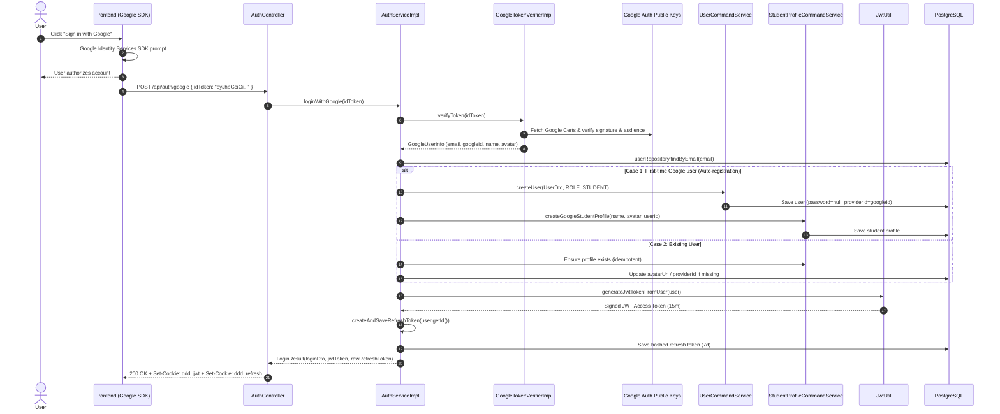
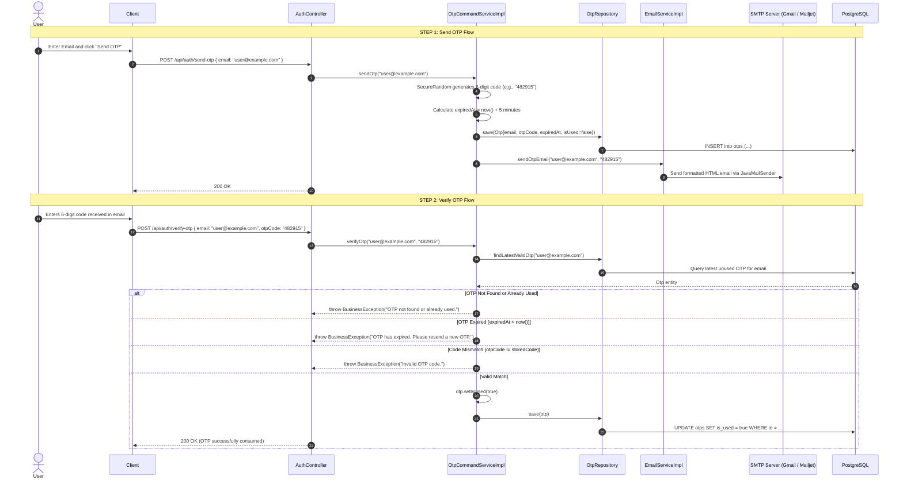

# Implementation of Google OAuth2 & OTP Verification

This document provides a detailed architectural and technical explanation of the **Google OAuth2 Login** flow and the **Email OTP Verification** flow implemented in the application.

---

## Part 1: Google OAuth2 Login Implementation

### 1. Architectural Overview & Design Pattern
Google OAuth2 is integrated using the **Token-Verification Pattern** (also called Client-Side Flow with Server-Side ID Token Validation). Instead of the traditional redirect-heavy Authorization Code flow handled entirely on the backend, the client application (Frontend/Web/Mobile) signs the user in via Google SDK, obtains a **Google ID Token (JWT)**, and sends it to our backend endpoint `POST /api/auth/google`.



---

### 2. Deep Dive: Google ID Token Verification
- **Port Interface**: `GoogleTokenVerifier` defined in `com.ddd.application.service.googleTokenVerifier`.
- **Implementation**: `GoogleTokenVerifierImpl` uses Google's official client library (`google-api-client:2.7.0`):
  ```java
  HttpTransport transport = new NetHttpTransport();
  JsonFactory jsonFactory = new GsonFactory();

  GoogleIdTokenVerifier verifier = new GoogleIdTokenVerifier.Builder(transport, jsonFactory)
          .setAudience(Collections.singletonList(clientId))
          .build();

  GoogleIdToken idToken = verifier.verify(idTokenString);
  ```
- **Security Validations Performed by the Verifier**:
  1. **Cryptographic Signature Verification**: Validates the JWT signature against Google's rotating public JSON Web Keys (JWKs).
  2. **Audience Check (`aud`)**: Ensures `aud` matches `@Value("${google.client-id}")`. This prevents a token issued for another application from being accepted by ours.
  3. **Expiration Check (`exp`)**: Ensures the token is not expired.
  4. **Issuer Check (`iss`)**: Ensures the issuer is `accounts.google.com` or `https://accounts.google.com`.

### 3. User Auto-Provisioning & Data Synchronization
When verification succeeds, `GoogleTokenVerifier` returns a `GoogleUserInfo` record containing `email`, `googleId` (Google subject claim `sub`), `firstName`, `lastName`, and `pictureUrl`.

In `AuthServiceImpl`:
- **Auto Registration**: If no `User` exists with that email, a new account is automatically created with:
  - Role: `ROLE_STUDENT`
  - Password: `null` (since authentication is delegated to Google)
  - `providerId`: set to `googleId`
  - `avatarUrl`: set to Google profile image URL
- **Profile Creation**: Creates a minimal `StudentProfile` record linked to the `userId`. Fields like `majorId` and `studentId` are initially null and can be completed later by the student.
- **Issuing Application Credentials**:
  - The domain `User` model is passed to `JwtUtil.generateJwtTokenFromUser(user)` to issue our standard 15-minute `ddd_jwt` cookie.
  - A 7-day refresh token is generated, hashed, and stored via `createAndSaveRefreshToken(user.getId())`, issuing the `ddd_refresh` cookie.
  - **Result**: The Google-authenticated session behaves identically to an email/password session from this point onwards.

---

## Part 2: Email OTP Code Verification Implementation

### 1. Architectural Overview & Workflow
The OTP system provides out-of-band email-based one-time password verification (typically used before password recovery, sensitive changes, or two-factor actions).



---

### 2. Deep Dive: Key Components & Logic

#### 2.1 Cryptographic Generation
- Uses `java.security.SecureRandom` rather than `java.util.Random` to ensure non-predictability:
  ```java
  private final SecureRandom secureRandom = new SecureRandom();
  String otpCode = String.format("%06d", secureRandom.nextInt(1_000_000));
  ```
- Produces a zero-padded 6-digit numerical string from `000000` to `999999`.

#### 2.2 Expiration & Lifecycle Window
- **TTL**: 5 minutes (`OTP_EXPIRATION_MINUTES = 5`).
- The expiration timestamp is calculated as `Instant.now().plus(Duration.ofMinutes(5))`.
- Stored in the database column `expired_at` (TIMESTAMP with timezone).

#### 2.3 Single-Use Guarantee (`isUsed`)
- Whenever an OTP is successfully validated against the input code, it is immediately marked as:
  ```java
  otp.setIsUsed(true);
  otpRepository.save(otp);
  ```
- `findLatestValidOtp(email)` only queries for OTPs where `is_used = false`.
- This ensures an OTP cannot be replayed, even if its 5-minute window has not yet elapsed.

#### 2.4 HTML Email Delivery (`EmailServiceImpl`)
- Utilizes Spring Boot's `JavaMailSender` and `MimeMessageHelper`.
- Dispatches a mobile-responsive HTML email template styled with brand colors, clear expiration warnings, and letter-spaced OTP digits for readability.
- Configured via standard Spring Mail properties (`spring.mail.host`, `spring.mail.port`, `spring.mail.username`, `spring.mail.password`).

---

## Part 3: Summary of Relevant Files & Endpoints

| Component | Layer | File Location | Purpose |
| :--- | :--- | :--- | :--- |
| **`POST /api/auth/google`** | API | `AuthController.java` | Receives Google `idToken`, initiates login/registration, returns cookies |
| **`POST /api/auth/send-otp`** | API | `AuthController.java` | Generates and sends 6-digit code to email |
| **`POST /api/auth/verify-otp`** | API | `AuthController.java` | Validates code, marks OTP as used |
| **`GoogleTokenVerifier`** | Application | `service/googleTokenVerifier/GoogleTokenVerifier.java` | Port interface for token validation |
| **`GoogleTokenVerifierImpl`** | Application | `service/googleTokenVerifier/impl/GoogleTokenVerifierImpl.java` | Google SDK verifier adapter |
| **`OtpCommandService`** | Application | `service/otp/OtpCommandService.java` | Interface for OTP send and verify commands |
| **`OtpCommandServiceImpl`** | Application | `service/otp/impl/OtpCommandServiceImpl.java` | Business logic for generation, TTL check, and consumption |
| **`EmailService`** | Infrastructure | `service/impl/EmailServiceImpl.java` | Sends HTML MIME emails via JavaMailSender |
| **`Otp`** | Domain | `domain/model/Otp.java` | Domain entity modeling OTP attributes |
| **`OtpJpaEntity`** | Infrastructure | `entity/OtpJpaEntity.java` | JPA entity mapping to table `otps` |
