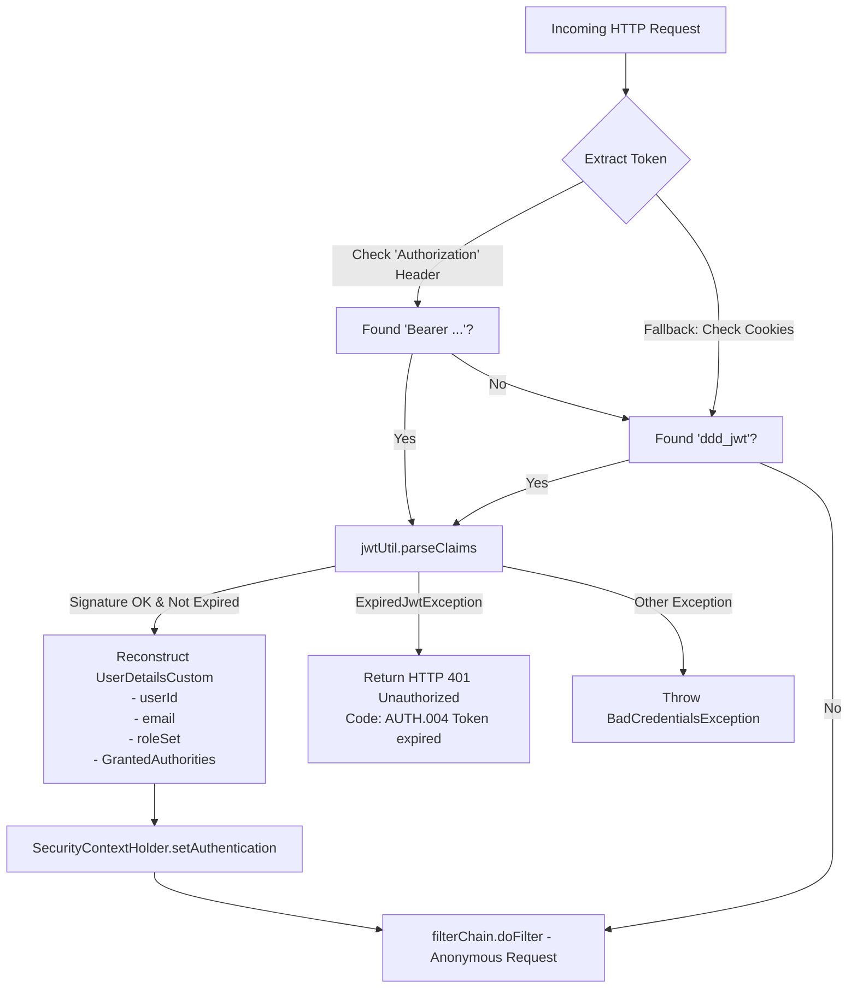
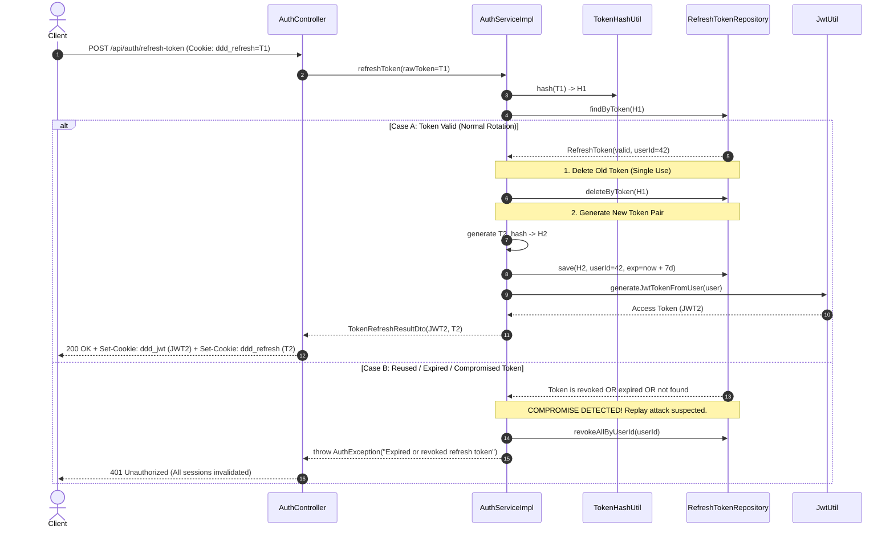

# JWT Access Token & Refresh Token Rotation Architecture

## 1. Executive Summary

This application implements a **dual-token authentication architecture** combining **stateless JWT access tokens** with **stateful, rotated refresh tokens**. The design balances performance, security, and session control:

- **Access Token (JWT)**: Short-lived, self-contained, stateless credential used by the API gateway / filter to authenticate every HTTP request without querying the database.
- **Refresh Token**: Long-lived, cryptographically secure opaque token persisted in hashed format in PostgreSQL, with strict **Single-Use Rotation (RTR)** and **Replay / Compromise Detection**.
- **Transport Security**: Delivered strictly via `HttpOnly`, `Secure` cookies with tailored scopes (`Path=/` vs `Path=/api/auth`) to defend against Cross-Site Scripting (XSS) and accidental credential leakage.

---

## 2. Token Specifications & Parameters

| Attribute | Access Token (`ddd_jwt`) | Refresh Token (`ddd_refresh`) |
| :--- | :--- | :--- |
| **Token Format** | Signed JWT (HMAC-SHA256) | Opaque Random UUID (v4) |
| **Storage Mechanism** | Client-side cookie only (Stateless) | Client cookie + SHA-256 hashed in PostgreSQL |
| **Lifetime (TTL)** | 15 minutes (`900,000 ms`) | 7 days (`604,800,000 ms`) |
| **Cookie Name** | `ddd_jwt` | `ddd_refresh` |
| **Cookie Path** | `/` (sent on every API call) | `/api/auth` (isolated to auth endpoints) |
| **Cookie Flags** | `HttpOnly=true; Secure=true; SameSite=Lax` | `HttpOnly=true; Secure=true; SameSite=Strict` |
| **Header Alternative** | `Authorization: Bearer <token>` | None (Cookie only) |

---

## 3. JWT Access Token Architecture

### 3.1 Token Payload (Claims)
The access token is constructed by `JwtUtil` using the `jjwt` library:

```json
{
  "iss": "ddd-application",
  "sub": "JWT Token",
  "username": "student@university.edu.vn",
  "userId": 42,
  "roles": "ROLE_STUDENT,ROLE_FANPAGE_ADMIN",
  "iat": 1730300000,
  "exp": 1730300900
}
```

### 3.2 Stateless Request Validation Pipeline
Every request passes through `JwtTokenValidatorFilter` (an extension of `OncePerRequestFilter`):



Database lookups are **not** performed during normal request validation. All necessary authorization details (`userId`, `username`, `roles`) are extracted directly from the signed claims into `UserDetailsCustom`.

---

## 4. Refresh Token Lifecycle & Rotation (RTR)

### 4.1 Persistence Model & Hashing
To prevent database leaks from exposing active user sessions, refresh tokens are never stored in plaintext:
1. A random UUID string is generated: `UUID.randomUUID().toString()`.
2. The raw UUID is hashed using SHA-256 via `TokenHashUtil`:
   ```java
   MessageDigest digest = MessageDigest.getInstance("SHA-256");
   String hashed = HexFormat.of().formatHex(digest.digest(rawToken.getBytes(StandardCharsets.UTF_8)));
   ```
3. The hashed string is persisted in PostgreSQL table `refresh_tokens`:
   - `token`: VARCHAR(255) PRIMARY KEY (SHA-256 hash)
   - `user_id`: BIGINT NOT NULL
   - `expires_at`: TIMESTAMP NOT NULL
   - `revoked`: BOOLEAN DEFAULT FALSE

---

### 4.2 Single-Use Rotation with Compromise Detection



#### Why Token Rotation + Compromise Detection?
- **Rotation**: A refresh token can be exchanged **only once**. An intercepted token becomes useless as soon as the legitimate client uses it.
- **Compromise Detection**: If an attacker attempts to use an already-rotated token $T_1$, the server detects that $T_1$ is no longer valid, concludes that the token was leaked, and **immediately invalidates all active sessions** for that user (`revokeAllByUserId`).

---

## 5. Security Invalidation Events

| Event | Invalidation Action | Trigger / Implementation |
| :--- | :--- | :--- |
| **User Logout** | Deletes current refresh token from DB; sets `maxAge=0` on both cookies. | `POST /api/auth/logout` |
| **Password Change** | Deletes password, updates hash, and calls `revokeAllByUserId(user.getId())`. | `POST /api/auth/change-password` |
| **Token Compromise / Replay** | Calls `revokeAllByUserId(stored.getUserId())` if invalid token presented. | `POST /api/auth/refresh-token` |
| **Scheduled Cleanup** | Background cron deletes all rows where `expires_at < NOW()`. | `RefreshTokenCleanupScheduler` |

---

## 6. Verification & End-to-End Checklist

1. **Login Flow**:
   - Call `POST /api/auth/login` or `POST /api/auth/google`.
   - Verify two `Set-Cookie` headers are returned: `ddd_jwt` (`Path=/; HttpOnly; SameSite=Lax`) and `ddd_refresh` (`Path=/api/auth; HttpOnly; SameSite=Strict`).
2. **Accessing Protected Resources**:
   - Make any request to a protected endpoint (e.g. `POST /api/events/fanpage-member`). The browser automatically supplies the `ddd_jwt` cookie.
3. **Rotating Tokens**:
   - Call `POST /api/auth/refresh-token`. Verify the response updates both cookies with fresh tokens.
   - Verify the previous refresh token is no longer present in the database.
