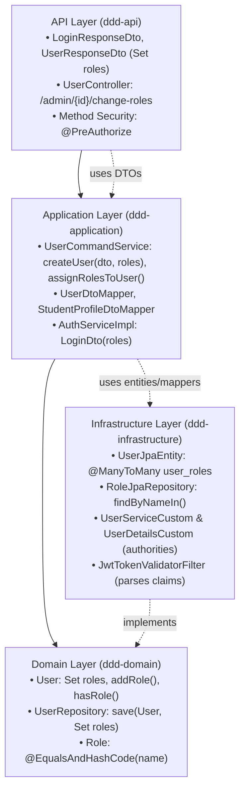

# Multi-Role Assignment & Validation Refactoring

> [!NOTE]
> This document details the refactoring performed to transition from single-role foreign-key associations (`users.role_id`) to multi-role relationships (`user_roles` join table) across all Domain-Driven Design (DDD) layers.

---

## 1. Architectural Overview

The application follows strict Domain-Driven Design (DDD) layering where inner layers (Domain) have zero knowledge of outer layers (Infrastructure, API). Multi-role assignment and validation spans across all 4 layers:



---

## 2. Layer-by-Layer Implementation

### 2.1 Domain Layer (`ddd-domain`)
Zero external dependencies to infrastructure or Spring Data.

* **[`Role.java`](file:///home/shrimp/code/ddd/ddd-domain/src/main/java/com/ddd/domain/model/Role.java)**:
  - Added `@EqualsAndHashCode(callSuper = false, of = "name")` to allow equality checks in `Set<Role>`.
* **[`User.java`](file:///home/shrimp/code/ddd/ddd-domain/src/main/java/com/ddd/domain/model/User.java)**:
  - Replaced `Long roleId` with `private Set<Role> roles = new HashSet<>();`.
  - Added domain methods:
    - `addRole(Role role)`: Safely attaches a role.
    - `removeRole(Role role)`: Safely detaches a role.
    - `hasRole(String roleName)`: Case-insensitive check whether a user possesses a role.
    - `getRoleNames()`: Extracts role names as `Set<String>`.
    - `getRoleId()`: Backward-compatible getter returning the primary/first role ID.
* **[`UserRepository.java`](file:///home/shrimp/code/ddd/ddd-domain/src/main/java/com/ddd/domain/repository/UserRepository.java)**:
  - Added `User save(User user, Set<String> roleNames);`.
  - Added default method `User save(User user, String roleName) { return save(user, Set.of(roleName)); }`.
  - Added `User save(User user);` for when roles are already attached to aggregate.
* **[`UserTest.java`](file:///home/shrimp/code/ddd/ddd-domain/src/test/java/com/ddd/domain/model/UserTest.java)**:
  - Added unit test covering addition, removal, and role checking.

---

### 2.2 Infrastructure Layer (`ddd-infrastructure`)

* **[`UserJpaEntity.java`](file:///home/shrimp/code/ddd/ddd-infrastructure/src/main/java/com/ddd/infrastructure/entity/UserJpaEntity.java)**:
  - Replaced `@ManyToOne RoleJpaEntity role` with `@ManyToMany(fetch = FetchType.LAZY)` configured with join table `user_roles`:
    ```java
    @ManyToMany(fetch = FetchType.LAZY)
    @JoinTable(
        name = "user_roles",
        joinColumns = @JoinColumn(name = "user_id"),
        inverseJoinColumns = @JoinColumn(name = "role_id")
    )
    private Set<RoleJpaEntity> roles = new HashSet<>();
    ```
* **[`RoleJpaRepository.java`](file:///home/shrimp/code/ddd/ddd-infrastructure/src/main/java/com/ddd/infrastructure/repository/jpaRepository/RoleJpaRepository.java)**:
  - Added `Set<RoleJpaEntity> findByNameIn(Collection<String> names);`.
* **[`UserJpaRepository.java`](file:///home/shrimp/code/ddd/ddd-infrastructure/src/main/java/com/ddd/infrastructure/repository/jpaRepository/UserJpaRepository.java)**:
  - Added `@EntityGraph(attributePaths = {"roles"})` on `findByEmail`, `findById`, and `findAllByIsActive` to avoid N+1 queries.
* **[`UserMapper.java`](file:///home/shrimp/code/ddd/ddd-infrastructure/src/main/java/com/ddd/infrastructure/mapper/UserMapper.java)**:
  - Added `uses = {RoleMapper.class}` so MapStruct automatically maps between `Set<RoleJpaEntity>` and `Set<Role>`.
* **[`UserRepositoryImpl.java`](file:///home/shrimp/code/ddd/ddd-infrastructure/src/main/java/com/ddd/infrastructure/repository/UserRepositoryImpl.java)**:
  - Implemented `save(User user, Set<String> roleNames)`: Queries role entities via `roleJpaRepository.findByNameIn(roleNames)` and links them before persisting.
  - Implemented `save(User user)`: Persists aggregate while syncing roles if present.
* **[`UserDetailsCustom.java`](file:///home/shrimp/code/ddd/ddd-infrastructure/src/main/java/com/ddd/infrastructure/config/security/custom/UserDetailsCustom.java)**:
  - Added `Set<String> roles` field with multi-role constructors.
  - Maintained backward-compatible `getRole()` returning the primary role.
* **[`UserServiceCustom.java`](file:///home/shrimp/code/ddd/ddd-infrastructure/src/main/java/com/ddd/infrastructure/config/security/custom/UserServiceCustom.java)**:
  - Loads all roles from `user.getRoles()`.
  - Normalizes each role with the Spring Security `ROLE_` prefix.
  - Generates `GrantedAuthority` for every assigned role.
* **[`JwtTokenValidatorFilter.java`](file:///home/shrimp/code/ddd/ddd-infrastructure/src/main/java/com/ddd/infrastructure/config/security/filter/JwtTokenValidatorFilter.java)**:
  - Parses comma-delimited `roles` claims from JWT token.
  - Sets `UsernamePasswordAuthenticationToken` with all granted authorities, enabling `@PreAuthorize("hasRole(...)")` and `@PreAuthorize("hasAnyRole(...)")`.

---

### 2.3 Application Layer (`ddd-application`)

* **[`LoginDto.java`](file:///home/shrimp/code/ddd/ddd-application/src/main/java/com/ddd/application/dto/auth/LoginDto.java)**:
  - Added `Set<String> roles` alongside backward-compatible `role`.
* **[`UserSummaryDto.java`](file:///home/shrimp/code/ddd/ddd-application/src/main/java/com/ddd/application/dto/user/UserSummaryDto.java)** & **[`StudentProfileSummaryDto.java`](file:///home/shrimp/code/ddd/ddd-application/src/main/java/com/ddd/application/dto/user/StudentProfileSummaryDto.java)**:
  - Added `Set<String> roles` alongside `String role`.
* **[`UserDtoMapper.java`](file:///home/shrimp/code/ddd/ddd-application/src/main/java/com/ddd/application/mapper/UserDtoMapper.java)** & **[`StudentProfileDtoMapper.java`](file:///home/shrimp/code/ddd/ddd-application/src/main/java/com/ddd/application/mapper/StudentProfileDtoMapper.java)**:
  - Added mapping expressions to extract `Set<String> roles` and primary `String role` from entities.
* **[`UserCommandService.java`](file:///home/shrimp/code/ddd/ddd-application/src/main/java/com/ddd/application/service/user/UserCommandService.java)** & **[`UserCommandServiceImpl.java`](file:///home/shrimp/code/ddd/ddd-application/src/main/java/com/ddd/application/service/user/impl/UserCommandServiceImpl.java)**:
  - Added `Long createUser(UserDto userDto, Set<String> roleNames)`.
  - Retained single-role overload `createUser(UserDto userDto, String roleName)`.
  - Added `void assignRolesToUser(Long userId, Set<String> roleNames)`.
* **[`AuthServiceImpl.java`](file:///home/shrimp/code/ddd/ddd-application/src/main/java/com/ddd/application/service/impl/AuthServiceImpl.java)**:
  - Initialized `LoginDto` using `fetchedUser.getRoles()`.

---

### 2.4 API Layer (`ddd-api`)

* **[`LoginResponseDto.java`](file:///home/shrimp/code/ddd/ddd-api/src/main/java/com/ddd/api/dto/auth/res/LoginResponseDto.java)**, **[`UserResponseDto.java`](file:///home/shrimp/code/ddd/ddd-api/src/main/java/com/ddd/api/dto/user/res/UserResponseDto.java)**, & **[`StudentProfileResponseDto.java`](file:///home/shrimp/code/ddd/ddd-api/src/main/java/com/ddd/api/dto/user/res/StudentProfileResponseDto.java)**:
  - Exposed `Set<String> roles` while retaining backward-compatible `String role`.
* **[`UserController.java`](file:///home/shrimp/code/ddd/ddd-api/src/main/java/com/ddd/api/controller/UserController.java)**:
  - Added `@PatchMapping("/admin/{id}/change-roles")` to accept `Set<String> roles`.
  - Updated `@PatchMapping("/admin/{id}/change-role")` to call `assignRolesToUser(id, Set.of(role))`.

---

## 3. Backward Compatibility Matrix

| Feature | Legacy Behavior | Multi-Role Behavior | Compatibility Mode |
|---|---|---|---|
| User entity role | `user.getRoleId()` | `user.getRoles()` | `getRoleId()` returns primary role ID |
| User creation | `createUser(dto, roleName)` | `createUser(dto, roleNames)` | Overload defaults to single role set |
| Repository save | `save(user, roleName)` | `save(user, roleNames)` | Default method delegating to `Set.of(roleName)` |
| Principal details | `principal.getRole()` | `principal.getRoles()` | `getRole()` returns first available role |
| Response DTOs | `res.role()` | `res.roles()`, `res.role()` | Both properties populated |

---

## 4. Verification & Build Results

1. **Compilation**: `mvn compile -DskipTests` across the entire 6-module reactor succeeded with 0 errors.
2. **Automated Tests**: Unit and integration tests in `ddd-domain`, `ddd-infrastructure`, `ddd-application`, and `ddd-api` passed (13 tests total).
