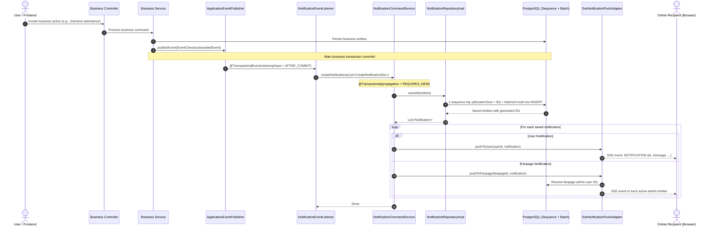
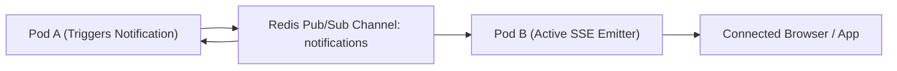

# Notification System: Architecture, End-to-End Flow & Evaluation

## 1. Executive Summary & Architecture Overview

The notification system is engineered following **Domain-Driven Design (DDD)** and **Hexagonal Architecture (Ports & Adapters)**. It supports real-time dual-recipient messaging (individual users and fanpage administrative teams) driven by decoupled domain events and persistent relational storage.

```
                              ┌────────────────────────────────────────┐
                              │            API Layer (REST)            │
                              │       NotificationController.java      │
                              └──────────────────┬─────────────────────┘
                                                 │
                                                 ▼
┌─────────────────────────┐   ┌────────────────────────────────────────┐
│   Domain Events Source   │──>│       Application Layer (CQRS)         │
│ (Events, Checkouts, etc)│   │ NotificationEventListener (Consumer)   │
└─────────────────────────┘   │ NotificationCommandServiceImpl         │
                              │ NotificationQueryServiceImpl           │
                              └───────┬────────────────────────┬───────┘
                                      │                        │
                   ┌──────────────────┘                        └──────────────────┐
                   ▼                                                              ▼
┌──────────────────────────────────────┐                       ┌──────────────────────────────────────┐
│       Domain Ports (Outbound)        │                       │       Domain Ports (Outbound)        │
│      NotificationRepository.java     │                       │       NotificationPushPort.java      │
└──────────────────┬───────────────────┘                       └──────────────────┬───────────────────┘
                   │                                                              │
                   ▼                                                              ▼
┌──────────────────────────────────────┐                       ┌──────────────────────────────────────┐
│     Infrastructure Layer (JPA)       │                       │     Infrastructure Layer (SSE)       │
│      NotificationRepositoryImpl      │                       │     SseNotificationPushAdapter       │
│      PostgreSQL (Sequence Batch)     │                       │       Client SSE Emitter Stream      │
└──────────────────────────────────────┘                       └──────────────────────────────────────┘
```

### Layered Responsibilities

| Layer | Module | Key Responsibilities |
|---|---|---|
| **Domain** | `ddd-domain` | Pure Java domain entities, enums, outbound ports (`NotificationRepository`, `NotificationPushPort`). Zero Spring/JPA dependencies. |
| **Application** | `ddd-application` | Orchestrates use cases, listens to domain events (`NotificationEventListener`), handles transactions (`REQUIRES_NEW`), maps DTOs. |
| **Infrastructure** | `ddd-infrastructure` | Adapters for persistence (`NotificationRepositoryImpl`, JPA sequence mapping) and real-time push (`SseNotificationPushAdapter` via SSE). |
| **API** | `ddd-api` | Exposes REST endpoints for querying notification feeds, marking read/unread, and streaming SSE events (`/notifications/stream`). |

---

## 2. End-to-End Notification Flow



### Detailed Lifecycle Phases:
1. **Trigger & Publish**: When a domain operation finishes (such as approving a fanpage or awarding event attendance points), the business service publishes a domain event through Spring's `ApplicationEventPublisher`.
2. **Transaction Isolation (`AFTER_COMMIT`)**: The `NotificationEventListener` captures the event strictly during the `TransactionPhase.AFTER_COMMIT`. If the primary business operation fails or rolls back, zero notifications are generated.
3. **Dedicated Transaction**: The notification service opens an independent transaction (`Propagation.REQUIRES_NEW`). A failure in notification dispatch never cascades back to roll back the core business change.
4. **Database Batching**: Entities are prepared with entity references (`entityManager.getReference()`) to prevent proxy fetch queries. Hibernate pre-allocates primary keys via the database sequence and flushes via PostgreSQL JDBC multi-row rewrite.
5. **Real-Time Push**: Real-time notifications are pushed across active `SseEmitter` instances to connected browser/mobile sessions. If a user is offline, the persistent notification remains saved in PostgreSQL for later retrieval.

---

## 3. Key Technical Implementations

### Dual-Recipient Capability
The domain model supports both individual user notifications and fanpage team notifications:
- **User Notifications (`userId != null`)**: Personal alerts such as event approvals, attendance check-outs, point awards, or invitation requests.
- **Fanpage Notifications (`fanpageId != null`)**: Shared channel notifications broadcast to all active administrators of a fanpage (e.g., membership acceptances/rejections).

### Database Sequence & Batching
- **Sequence Generator**: `notifications_id_seq` with `allocationSize = 50` pre-allocates 50 IDs in memory in a single database round-trip.
- **JDBC Batching**: `spring.jpa.properties.hibernate.jdbc.batch_size: 50`, `order_inserts: true`, and `reWriteBatchedInserts=true` enable the PostgreSQL JDBC driver to combine separate prepared statements into a single wire-level multi-row `INSERT`.
- **Proxy References**: `assignReferences()` uses `entityManager.getReference(UserJpaEntity.class, id)` instead of `findById()`, eliminating $N$ unnecessary `SELECT` queries before inserting.

### Real-Time Delivery (Server-Sent Events)
- Subscriptions via `GET /notifications/stream` produce standard `text/event-stream`.
- Thread-safe tracking with `ConcurrentHashMap<Long, CopyOnWriteArrayList<SseEmitter>>`.
- Periodic heartbeat ping (`@Scheduled(fixedRate = 45000)`) to maintain connection liveness across reverse proxies and firewalls.
- Graceful lifecycle cleanup on client timeout, disconnection, or network drop.

---

## 4. Evaluation: What Is Going Well

> [!NOTE]
> The current implementation exhibits strong software engineering patterns that keep the core codebase robust and clean.

1. **Clean Architectural Boundaries**: Domain models ([Notification.java](file:///home/shrimp/code/ddd/ddd-domain/src/main/java/com/ddd/domain/model/Notification.java)) and ports ([NotificationPushPort.java](file:///home/shrimp/code/ddd/ddd-domain/src/main/java/com/ddd/domain/model/port/notification/NotificationPushPort.java)) have zero framework baggage.
2. **Rollback Resilience**: By utilizing `@TransactionalEventListener(phase = TransactionPhase.AFTER_COMMIT)`, notifications cannot be dispatched for transactions that failed.
3. **No Foreign Key $N+1$ Select Queries**: Foreign entities (`user` and `fanpage`) are linked as Hibernate proxies via `entityManager.getReference()`, avoiding extra database round-trips.
4. **Wire-Level Batch Inserts**: Combining sequence allocation with `reWriteBatchedInserts=true` delivers optimal database batch write performance without messy raw SQL.
5. **Payload Pre-Serialization**: In `SseNotificationPushAdapter`, the SSE event builder is constructed once per notification rather than re-serialized per client emitter.

---

## 5. Evaluation: Critical Areas Needing Improvement & Action Plan

### Finding 1: Listener Executes on Tomcat's HTTP Thread (High Priority)
> [!WARNING]
> In recent runtime logs, notifications executed under `[http-nio-8080-exec-1]`.
> Although [AsyncConfig.java](file:///home/shrimp/code/ddd/ddd-infrastructure/src/main/java/com/ddd/infrastructure/config/async/AsyncConfig.java) provides a `notificationTaskExecutor`, [NotificationEventListener.java](file:///home/shrimp/code/ddd/ddd-application/src/main/java/com/ddd/application/listener/NotificationEventListener.java) is missing `@Async("notificationTaskExecutor")`.
>
> **Impact**: The user who triggered the event (e.g., student check-out or admin event creation) must wait for all notifications to be prepared, stored, and pushed before getting their HTTP response.

**Solution**:
Annotate all listener methods in `NotificationEventListener.java` with `@Async("notificationTaskExecutor")`:
```java
@Async("notificationTaskExecutor")
@TransactionalEventListener(phase = TransactionPhase.AFTER_COMMIT, fallbackExecution = true)
public void onCheckoutAwarded(EventCheckoutAwardedEvent event) { ... }
```

---

### Finding 2: `CompletableFuture.runAsync()` Defaults to Common Pool (Medium Priority)
In [SseNotificationPushAdapter.java](file:///home/shrimp/code/ddd/ddd-infrastructure/src/main/java/com/ddd/infrastructure/adapter/notification/SseNotificationPushAdapter.java#L74), SSE emitter delivery calls `CompletableFuture.runAsync()`. Without an explicit executor, it runs on Java's unmanaged `ForkJoinPool.commonPool()`. Slow client connections can saturate worker threads.

**Solution**:
Inject the configured `Executor` or `ThreadPoolTaskExecutor` and pass it directly:
```java
@Qualifier("notificationTaskExecutor")
private final Executor notificationTaskExecutor;

// Inside push loop:
CompletableFuture.runAsync(() -> {
    try {
        emitter.send(event);
    } catch (Exception e) {
        removeEmitter(userId, emitter);
    }
}, notificationTaskExecutor);
```

---

### Finding 3: In-Memory Emitter Map is Single-Instance Only (Clustering Limitation)
`userEmitters` is maintained inside a JVM-local `ConcurrentHashMap`. If the application is deployed with multiple replicas/pods behind a load balancer, an event generated on Pod A cannot push to a client connected to Pod B.

**Recommended Evolution**:
Adopt a Redis Pub/Sub backplane:


---

### Finding 4: Scheduling Verification for SSE Heartbeat
The heartbeat method in `SseNotificationPushAdapter` relies on `@Scheduled(fixedRate = 45000)`. Ensure `@EnableScheduling` is active in `StartApplication.java` or an infrastructure config class to prevent proxy timeouts (NGINX/Cloudflare 60s dropping idle SSE connections).

---

## 6. Codebase File Reference Matrix

| File | Path | Role |
|---|---|---|
| **Domain Model** | [Notification.java](file:///home/shrimp/code/ddd/ddd-domain/src/main/java/com/ddd/domain/model/Notification.java) | Core aggregate entity |
| **Notification Types** | [NotificationTypeEnum.java](file:///home/shrimp/code/ddd/ddd-domain/src/main/java/com/ddd/domain/enums/NotificationTypeEnum.java) | Categorized notification types |
| **Outbound Push Port** | [NotificationPushPort.java](file:///home/shrimp/code/ddd/ddd-domain/src/main/java/com/ddd/domain/model/port/notification/NotificationPushPort.java) | Real-time delivery interface |
| **Outbound Repo Port** | [NotificationRepository.java](file:///home/shrimp/code/ddd/ddd-domain/src/main/java/com/ddd/domain/repository/NotificationRepository.java) | Persistence interface |
| **Event Listener** | [NotificationEventListener.java](file:///home/shrimp/code/ddd/ddd-application/src/main/java/com/ddd/application/listener/NotificationEventListener.java) | Domain event consumer |
| **Command Service** | [NotificationCommandServiceImpl.java](file:///home/shrimp/code/ddd/ddd-application/src/main/java/com/ddd/application/service/notification/impl/NotificationCommandServiceImpl.java) | Transactional command handling |
| **Query Service** | [NotificationQueryServiceImpl.java](file:///home/shrimp/code/ddd/ddd-application/src/main/java/com/ddd/application/service/notification/impl/NotificationQueryServiceImpl.java) | Read queries and authorization |
| **JPA Entity** | [NotificationJpaEntity.java](file:///home/shrimp/code/ddd/ddd-infrastructure/src/main/java/com/ddd/infrastructure/entity/NotificationJpaEntity.java) | Sequence-mapped persistence entity |
| **Repo Adapter** | [NotificationRepositoryImpl.java](file:///home/shrimp/code/ddd/ddd-infrastructure/src/main/java/com/ddd/infrastructure/repository/NotificationRepositoryImpl.java) | Proxy association & batch saving |
| **SSE Push Adapter** | [SseNotificationPushAdapter.java](file:///home/shrimp/code/ddd/ddd-infrastructure/src/main/java/com/ddd/infrastructure/adapter/notification/SseNotificationPushAdapter.java) | Real-time SSE streaming adapter |
| **Async Config** | [AsyncConfig.java](file:///home/shrimp/code/ddd/ddd-infrastructure/src/main/java/com/ddd/infrastructure/config/async/AsyncConfig.java) | Thread pool executor definition |
| **REST Controller** | [NotificationController.java](file:///home/shrimp/code/ddd/ddd-api/src/main/java/com/ddd/api/controller/NotificationController.java) | REST and SSE endpoints |
| **Sequence Migration** | [notification-sequence-migration.sql](file:///home/shrimp/code/ddd/ddd-infrastructure/src/main/resources/database/migration/notification-sequence-migration.sql) | PostgreSQL sequence DDL script |
| **Configuration** | [application.yml](file:///home/shrimp/code/ddd/ddd-infrastructure/src/main/resources/application.yml) | Batch size and driver rewrite settings |
