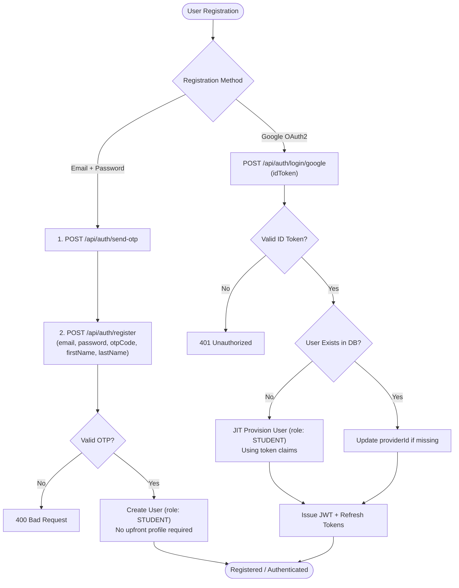
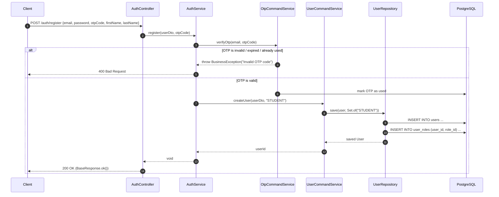
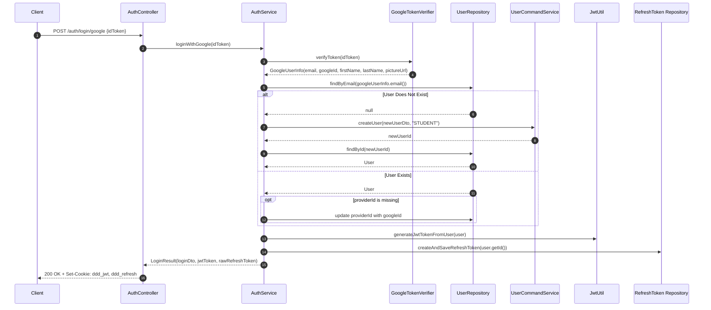
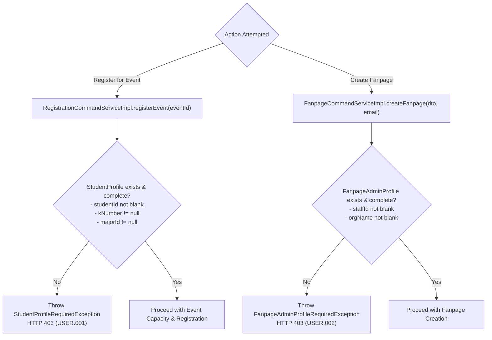

# Progressive Registration and Profile Gating Flow

This document details the progressive registration architecture, account provisioning flows, downstream profile gating guards, and the database schema resolution for role management.

---

## 1. Root Cause Analysis: `role_id` Not-Null Constraint Violation

### The Error
```
org.springframework.dao.DataIntegrityViolationException: could not execute statement 
[ERROR: null value in column "role_id" of relation "users" violates not-null constraint] 
[insert into users (avatar_url,created_at,created_by,email,first_name,gender,is_active,last_name,password,provider_id,updated_at,updated_by) values (?,?,?,?,?,?,?,?,?,?,?,?)]; 
constraint [role_id]
```

### Explanation
1. **Schema vs. Model Mismatch**:
   - In earlier iterations of the system, each user was linked to a single role via a foreign key column `users.role_id` with a `NOT NULL` constraint in the database.
   - During multi-role refactoring, the JPA entity [`UserJpaEntity`](file:///home/shrimp/code/ddd-ref-auth-api/ddd-infrastructure/src/main/java/com/ddd/infrastructure/entity/UserJpaEntity.java#L46-L52) was updated to use a `@ManyToMany` join table `user_roles`:
     ```java
     @ManyToMany(fetch = FetchType.LAZY)
     @JoinTable(
             name = "user_roles",
             joinColumns = @JoinColumn(name = "user_id"),
             inverseJoinColumns = @JoinColumn(name = "role_id")
     )
     private Set<RoleJpaEntity> roles = new HashSet<>();
     ```
2. **Why the INSERT Fails**:
   - When Hibernate inserts a new `UserJpaEntity`, it issues an `INSERT INTO users (...)` omitting `role_id` because `role_id` is no longer mapped directly on the `users` table in JPA.
   - Because the PostgreSQL table `users` still contains the legacy column `role_id NOT NULL`, the database aborts the transaction immediately.

### Required Database Migration Fix
Run the following SQL statement in PostgreSQL to drop the not-null constraint (or drop the deprecated column if all roles are read from `user_roles`):
```sql
-- Option A (Recommended): Drop NOT NULL constraint on legacy column
ALTER TABLE users ALTER COLUMN role_id DROP NOT NULL;

-- Option B (Complete Cleanup): Drop column if user_roles join table is fully adopted
ALTER TABLE users DROP COLUMN IF EXISTS role_id;
```

---

## 2. Progressive Registration Architecture Overview

The system allows users to onboard quickly without being blocked by lengthy profile forms. Profile information is collected progressively only when a user attempts actions that strictly require that identity data (event registration or fanpage creation).



---

## 3. Registration Flow Details

### Flow A: Email + Password + OTP Registration (`POST /auth/register`)

Users provide minimal personal information to establish their account credentials.



#### Request Payload
```json
{
  "email": "student@fpt.edu.vn",
  "password": "Password123!",
  "otpCode": "849201",
  "firstName": "Van Nghia",
  "lastName": "Tran"
}
```

---

### Flow B: Google OAuth2 Seamless Sign-In (`POST /auth/login/google`)

Provides single-click sign-in. If the user account does not exist yet, the application auto-provisions it just-in-time from the verified Google ID token.



---

## 4. Action-Based Profile Gating Guards

Users can browse public events and update settings without a full profile. However, downstream write actions enforce strict profile completeness gates.



### Error Responses for Profile Gating

#### Event Registration Profile Gate
- **Endpoint**: `POST /registrations/me/events/{eventId}`
- **HTTP Status**: `403 Forbidden`
- **Error Code**: `USER.001` (`STUDENT_PROFILE_REQUIRED`)
- **Response**:
```json
{
  "code": "USER.001",
  "message": "Please complete your student profile before registering for events.",
  "data": null
}
```

#### Fanpage Creation Profile Gate
- **Endpoint**: `POST /fanpages/fanpage-admin/register`
- **HTTP Status**: `403 Forbidden`
- **Error Code**: `USER.002` (`FANPAGE_ADMIN_PROFILE_REQUIRED`)
- **Response**:
```json
{
  "code": "USER.002",
  "message": "Please complete your fanpage admin profile before creating a fanpage.",
  "data": null
}
```

---

## 5. Completing Profile Later

Once gated, users can complete their profile at their convenience:

* **Student Profile Update / Creation**: `PUT /users/student-profile`
  - In [`UserCommandServiceImpl.updateStudentProfile`](file:///home/shrimp/code/ddd-ref-auth-api/ddd-application/src/main/java/com/ddd/application/service/user/impl/UserCommandServiceImpl.java#L82-L115), if the `StudentProfile` does not exist for the authenticated user, it is lazily created.
  - Once persisted, future calls to `POST /registrations/me/events/{eventId}` pass the completeness gate.
* **Fanpage Admin Profile Creation**: `POST /auth/register/fanpage-admin`
  - Populates staff ID, department/organization name, title, and contact details.
