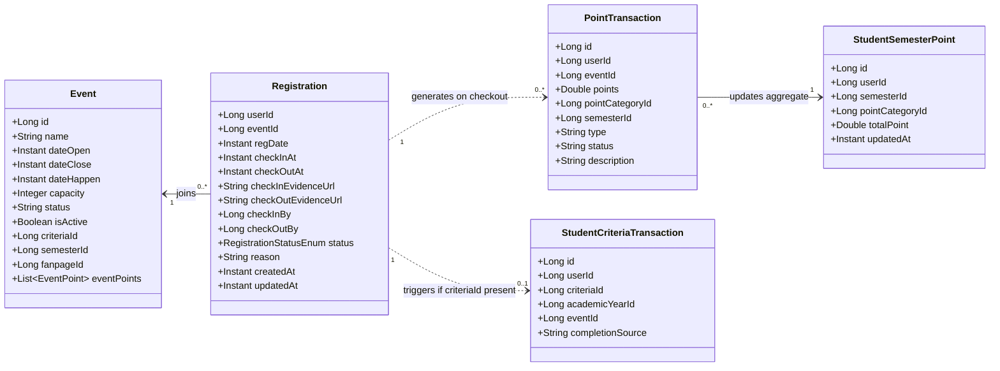
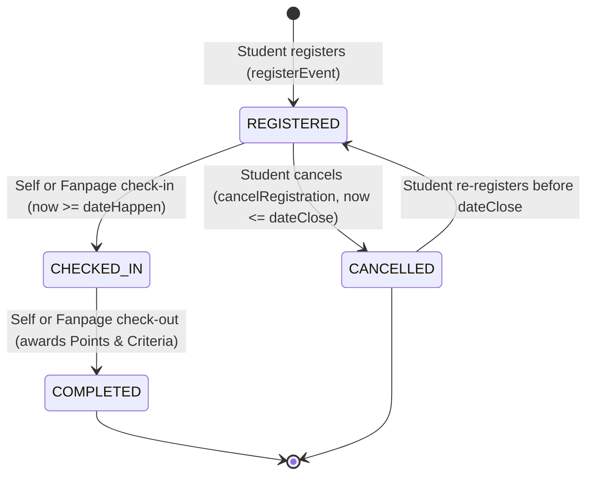
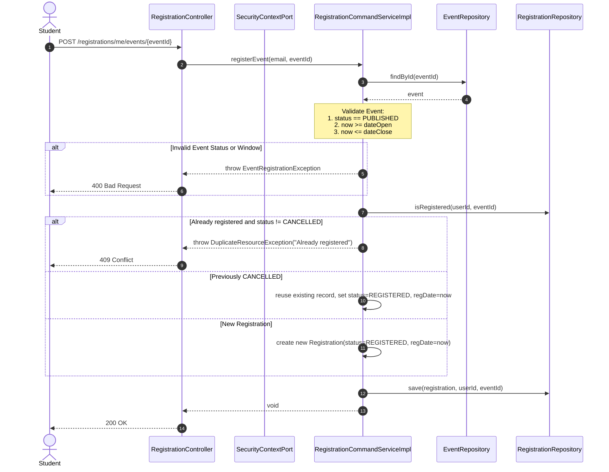
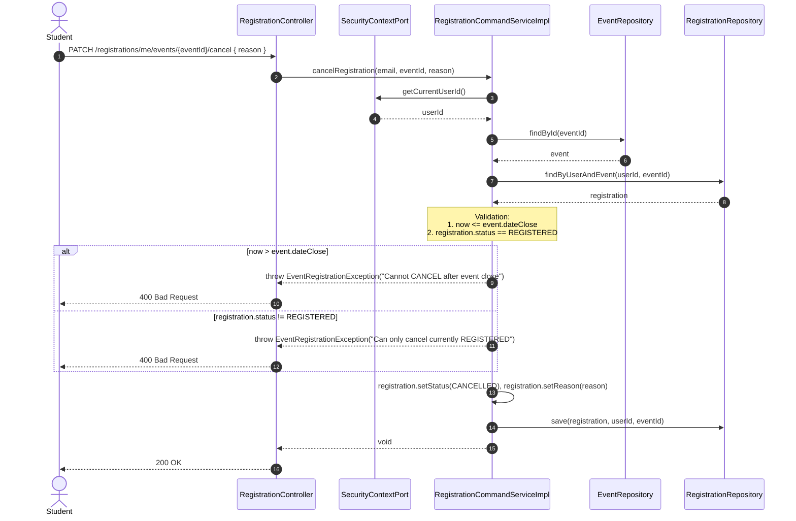
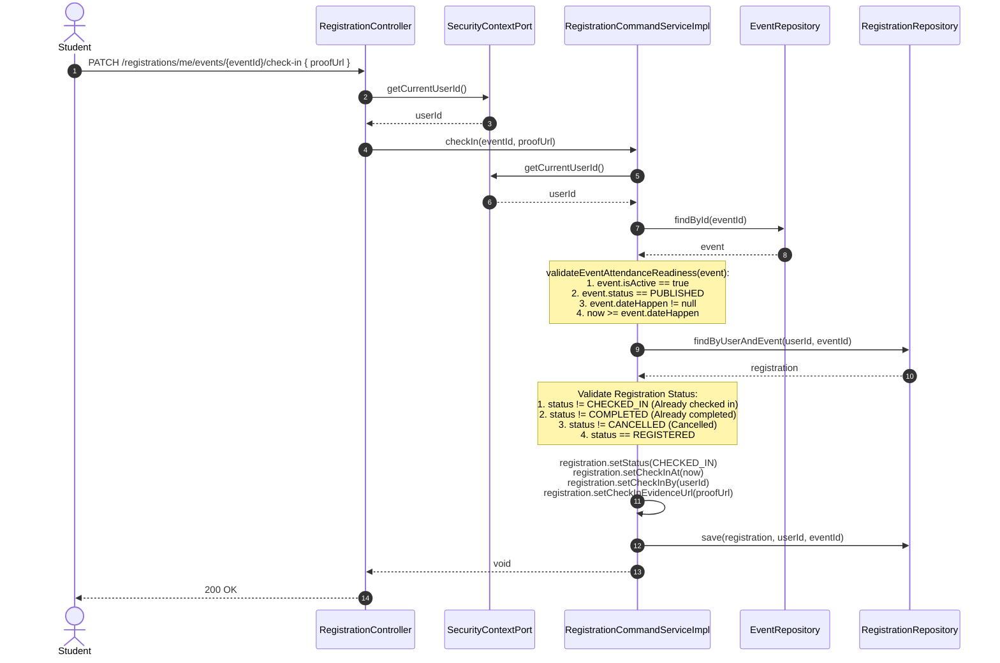
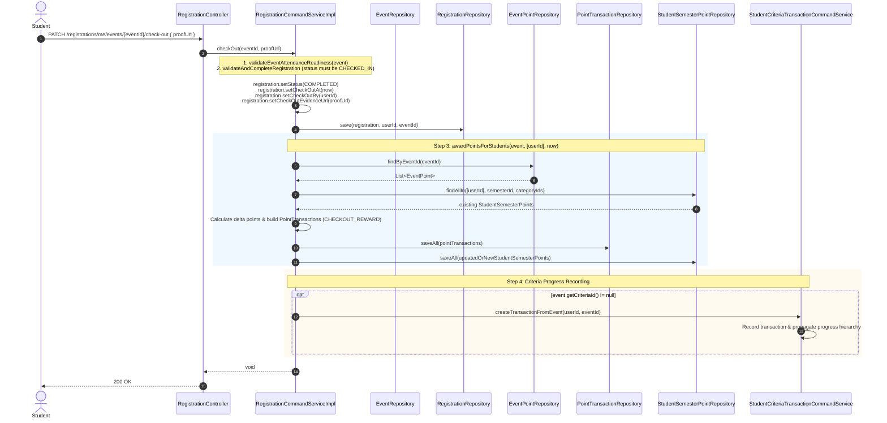
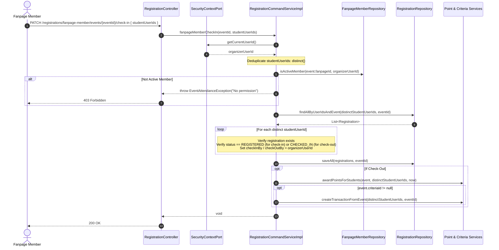

# Registration API and Process Flow Architectural Document

This document details the architectural design, domain models, lifecycle states, business validation rules, and end-to-end execution flows for the **Event Registration & Attendance Management** sub-system within the DDD platform.

---

## 1. Domain Model Architecture & Entity Relationships

The registration aggregate links a `User` (student attendee) to an `Event`, tracking the attendance state machine across registration, check-in, check-out, and reward distribution.

### Component Responsibility Matrix

| Component | Layer | Primary Responsibility |
| :--- | :--- | :--- |
| [`RegistrationController`](file:///home/shrimp/code/ddd/ddd-api/src/main/java/com/ddd/api/controller/RegistrationController.java) | API | Exposes REST endpoints for student self-service and fanpage organizer batch attendance. |
| [`RegistrationCommandService`](file:///home/shrimp/code/ddd/ddd-application/src/main/java/com/ddd/application/service/registration/RegistrationCommandService.java) | Application (Write) | Orchestrates state transitions, business validation, point reward calculation, and criteria event triggers. |
| [`RegistrationQueryService`](file:///home/shrimp/code/ddd/ddd-application/src/main/java/com/ddd/application/service/registration/RegistrationQueryService.java) | Application (Read) | Provides read models for registration history, upcoming events, and organizer attendee rosters. |
| [`RegistrationRepository`](file:///home/shrimp/code/ddd/ddd-domain/src/main/java/com/ddd/domain/repository/RegistrationRepository.java) | Domain Port | Abstraction for reading and persisting `Registration` domain models. |
| [`RegistrationRepositoryImpl`](file:///home/shrimp/code/ddd/ddd-infrastructure/src/main/java/com/ddd/infrastructure/repository/RegistrationRepositoryImpl.java) | Infrastructure Adapter | JPA persistence implementation using composite primary key [`RegistrationId`](file:///home/shrimp/code/ddd/ddd-infrastructure/src/main/java/com/ddd/infrastructure/entity/RegistrationId.java). |
| [`SecurityContextPort`](file:///home/shrimp/code/ddd/ddd-domain/src/main/java/com/ddd/domain/model/port/security/SecurityContextPort.java) | Domain Port | Provides current authenticated actor identity (`getCurrentUserId()`). |

---

## 2. Registration Lifecycle State Machine

The registration status moves through well-defined transitions governed by [`RegistrationStatusEnum`](file:///home/shrimp/code/ddd/ddd-domain/src/main/java/com/ddd/domain/enums/RegistrationStatusEnum.java):

### State Invariant Rules

1. **`REGISTERED`**:
   - Initial state when registering.
   - May be transitioned to `CANCELLED` prior to `event.dateClose`.
   - Cannot check-in unless in `REGISTERED` state.
2. **`CANCELLED`**:
   - Can transition back to `REGISTERED` if the student re-registers before `event.dateClose`.
   - Re-registration resets `regDate = Instant.now()` and clears previous cancellation state.
3. **`CHECKED_IN`**:
   - Requires `event.status == PUBLISHED`, `event.isActive == true`, and `now >= event.dateHappen`.
   - Records `checkInAt`, `checkInBy` (student ID or fanpage organizer ID), and optional `checkInEvidenceUrl`.
   - Cannot check-in again (idempotency guard).
4. **`COMPLETED`**:
   - Requires previous status to be `CHECKED_IN`.
   - Records `checkOutAt`, `checkOutBy`, and optional `checkOutEvidenceUrl`.
   - Triggers atomic point rewarding and criteria transaction creation.
   - Terminal state: cannot be checked-in, checked-out, or cancelled again.

---

## 3. Detailed Process Flows

### 3.1. Student Self-Registration Flow

Endpoint: `POST /registrations/me/events/{eventId}`

---

### 3.2. Student Cancellation Flow

Endpoint: `PATCH /registrations/me/events/{eventId}/cancel`

---

### 3.3. Student Self Check-In Flow

Endpoint: `PATCH /registrations/me/events/{eventId}/check-in`

---

### 3.4. Student Self Check-Out & Reward Flow

Endpoint: `PATCH /registrations/me/events/{eventId}/check-out`

---

### 3.5. Fanpage Organizer Batch Attendance (Check-In & Check-Out)

Organizer Endpoints:
- Check-In: `PATCH /registrations/fanpage-member/events/{eventId}/check-in`
- Check-Out: `PATCH /registrations/fanpage-member/events/{eventId}/check-out`

---

## 4. Query APIs & Read Models

The query service [`RegistrationQueryServiceImpl`](file:///home/shrimp/code/ddd/ddd-application/src/main/java/com/ddd/application/service/registration/impl/RegistrationQueryServiceImpl.java) serves read-only queries with pagination:

### 4.1. My Registration History
- **Endpoint**: `GET /registrations/me/history?page=0&size=10`
- **Logic**: Resolves student `userId` via email and queries all registrations sorted descending by `createdAt`.
- **Response**: Paginated `Page<RegistrationResponseDto>` containing event details, attendance status, and check-in/out timestamps.

### 4.2. My Upcoming Events
- **Endpoint**: `GET /registrations/me/upcoming`
- **Logic**: Retrieves registrations for the student where `event.dateHappen >= now` and status is active (`REGISTERED`).
- **Response**: `List<RegistrationResponseDto>`.

### 4.3. Organizer Attendee Roster
- **Endpoint**: `GET /registrations/fanpage-member/fanpages/{fanpageId}/events/{eventId}/attendees`
- **Parameters**: `page`, `size`, `sortBy` (default: `regDate`), `sortDir` (default: `asc`).
- **Security Check**: Verifies that the requester is an active member of `fanpageId` and that `eventId` belongs to `fanpageId`.
- **Response**: `List<AttendeeResponseDto>` including student details, registration timestamp, evidence URLs, and status.

---

## 5. Summary of Business Validation Rules

| Rule Category | Condition | Throws Exception | Error Message / HTTP Status |
| :--- | :--- | :--- | :--- |
| **Registration Window** | `now < event.dateOpen` or `now > event.dateClose` | `EventRegistrationException` | *"The event registration is not open yet or has already closed!"* (400) |
| **Event Status** | `event.status != PUBLISHED` or `!event.isActive` | `EventRegistrationException` / `EventAttendanceException` | *"The event registration is not open yet or has already closed!"* / *"Cannot attend an event that is not active or published"* (400) |
| **Duplicate Registration** | Record exists and `status != CANCELLED` | `DuplicateResourceException` | *"You have already registered for this event"* (409) |
| **Cancellation Window** | `event.dateClose != null` and `now > event.dateClose` | `EventRegistrationException` | *"You can not CANCEL registration after event close"* (400) |
| **Cancellation Status** | Existing `status != REGISTERED` | `EventRegistrationException` | *"You can only cancel a registration that is currently registered."* (400) |
| **Attendance Timing** | `now < event.dateHappen` | `EventAttendanceException` | *"This event has not started yet"* (400) |
| **Check-In Status** | Existing `status == CHECKED_IN` | `EventAttendanceException` | *"You are already checked in"* (400) |
| **Check-In Status** | Existing `status == COMPLETED` | `EventAttendanceException` | *"You have already completed attendance for this event"* (400) |
| **Check-In Status** | Existing `status == CANCELLED` | `EventAttendanceException` | *"Your registration for this event was cancelled"* (400) |
| **Check-Out Status** | Existing `status != CHECKED_IN` | `EventAttendanceException` | *"Student ID {id} has not checked in!"* (400) |
| **Fanpage Permission** | Organizer not active member of event's fanpage | `EventAttendanceException` | *"You not have permission to manage this event"* (403) |
| **Batch Attendance** | Duplicate user IDs in request body | Automatically handled | Cleaned via `.distinct()` before processing |
| **Semester Assignment** | `event.semesterId == null` on checkout reward | `BusinessException` | *"Event is not assigned to any semester"* (400) |
