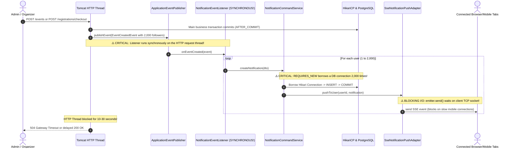
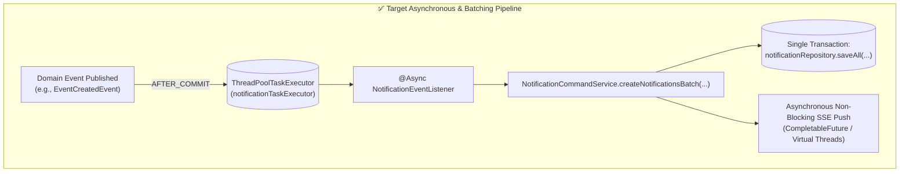
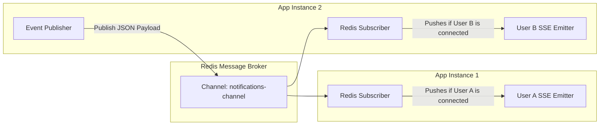

# SSE & Event Publisher/Listener Subsystem: Performance Bug Analysis & Refactoring Guide

> **Artifact Location**: `docs/artifact/sse_and_event_performance_bugs_and_refactoring_guide.md`  
> **Target Subsystem**: Real-Time Notifications, Server-Sent Events (SSE), Spring Domain Event Processing  
> **Architectural Patterns**: Event-Driven Decoupling, Asynchronous Processing, Batch Persistence, Distributed Pub/Sub  
> **Status**: Comprehensive Technical Analysis & Refactoring Blueprint  
> **Branch**: `fea/notification`

---

## 1. Executive Summary

The current implementation of the notification pipeline provides a decoupled Domain Event publishing model (`ApplicationEventPublisher` $\rightarrow$ `NotificationEventListener`) and real-time push via Server-Sent Events (`SseNotificationPushAdapter`). 

While this architecture functions well for single, low-frequency 1-to-1 events (such as approving a fanpage or sending an individual invitation), it contains **critical performance bugs and architectural bottlenecks** that will cause severe service degradation, database connection exhaustion, and HTTP gateway timeouts during 1-to-N fanout events (such as notifying thousands of fanpage followers when an event is published, or completing attendance checkout for hundreds of students).

This guide analyzes each bottleneck in detail, illustrates the failure mechanics under load, and presents concrete, production-ready refactoring blueprints.

---

## 2. Runtime Execution Mechanics & Failure Flow



---

## 3. Deep-Dive: The 6 Core Performance Bugs & Architectural Flaws

### 🔴 Bug 1: Synchronous Loop on HTTP Worker Thread
* **File Reference**: [`NotificationEventListener.java#L93-L119`](file:///home/shrimp/code/ddd/ddd-application/src/main/java/com/ddd/application/listener/NotificationEventListener.java#L93-L119)
* **Root Cause**: In Spring Framework, `@TransactionalEventListener(phase = TransactionPhase.AFTER_COMMIT)` executes **synchronously on the calling HTTP thread** unless explicitly annotated with `@Async`.
* **Code in Question**:
  ```java
  @TransactionalEventListener(phase = TransactionPhase.AFTER_COMMIT, fallbackExecution = true)
  public void onEventCreated(EventCreatedEvent event) {
      for (Long userId : event.followerUserIds()) { // Loops thousands of times synchronously!
          notificationCommandService.createNotification(...);
      }
  }
  ```
* **Failure Impact Under Load**:
  - The HTTP worker thread handling `createEvent()` or `fanpageMemberCheckOut()` remains blocked until the loop finishes for all recipients.
  - If a fanpage has 2,000 followers, the user's browser is frozen. Reverse proxies (Nginx, Cloudflare, AWS ALB) will abort the request with **HTTP 504 Gateway Timeout** after 30–60 seconds, even though the database write succeeded.
  - Tomcat's worker thread pool (`server.tomcat.threads.max`, default 200) becomes saturated, preventing other users from browsing the application.

---

### 🔴 Bug 2: Database Connection Pool Exhaustion via `Propagation.REQUIRES_NEW`
* **File Reference**: [`NotificationCommandServiceImpl.java#L37`](file:///home/shrimp/code/ddd/ddd-application/src/main/java/com/ddd/application/service/notification/impl/NotificationCommandServiceImpl.java#L37)
* **Root Cause**: `createNotification()` is annotated with `@Transactional(propagation = Propagation.REQUIRES_NEW)`. Inside the listener loop, Spring suspends the caller context, borrows a physical database connection from HikariCP, inserts a single row, commits, and returns the connection to the pool.
* **Failure Impact Under Load**:
  - For an event with $N = 1,000$ followers, the system initiates **1,000 separate database transactions sequentially**.
  - HikariCP default pool size is **10 connections** (`maximum-pool-size = 10`).
  - If two organizers publish events or check out students at the same time, the pool is completely drained. Unrelated HTTP requests (e.g., student login, course registration) freeze waiting for a connection until they crash with:
    ```
    org.springframework.dao.CannotAcquireLockException: 
    HikariPool-1 - Connection is not available, request timed out after 30000ms.
    ```

---

### 🔴 Bug 3: Lack of Batch Database Persistence ($N$ Network Round-Trips)
* **File Reference**: [`NotificationCommandServiceImpl.java#L50`](file:///home/shrimp/code/ddd/ddd-application/src/main/java/com/ddd/application/service/notification/impl/NotificationCommandServiceImpl.java#L50)
* **Root Cause**: Notifications are saved individually using `notificationRepository.save(notification)`.
* **Failure Impact Under Load**:
  - $N$ separate network round-trips between the application server and the database server.
  - Even with a low network latency of 1ms per round-trip, saving 2,000 notifications requires **2.0+ seconds of pure network idle waiting time**, in addition to high IOPS and CPU overhead on PostgreSQL.

---

### 🟠 Bug 4: Blocking Synchronous I/O in `SseNotificationPushAdapter`
* **File Reference**: [`SseNotificationPushAdapter.java#L70-L75`](file:///home/shrimp/code/ddd/ddd-infrastructure/src/main/java/com/ddd/infrastructure/adapter/notification/SseNotificationPushAdapter.java#L70-L75)
* **Root Cause**: `emitter.send(...)` is a blocking call that writes directly to the client's HTTP response output stream.
* **Code in Question**:
  ```java
  for (SseEmitter emitter : emitters) {
      try {
          emitter.send(SseEmitter.event().name("NOTIFICATION").data(notification));
      } catch (Exception e) {
          deadEmitters.add(emitter);
      }
  }
  ```
* **Failure Impact Under Load**:
  - If a recipient is on an unstable 3G/4G cellular connection or has a full TCP socket receive buffer (a "slow consumer"), `emitter.send()` blocks the execution thread waiting for TCP packet acknowledgement.
  - Because pushes execute in a sequential loop, a single slow mobile client delays notification delivery to all subsequent users in the queue.

---

### 🟠 Bug 5: Single-Threaded TaskScheduler Starvation from Scheduled Heartbeat
* **File Reference**: [`SseNotificationPushAdapter.java#L103-L122`](file:///home/shrimp/code/ddd/ddd-infrastructure/src/main/java/com/ddd/infrastructure/adapter/notification/SseNotificationPushAdapter.java#L103-L122)
* **Root Cause**: `@Scheduled(fixedRate = 45000)` runs on Spring's default `TaskScheduler`, which by default uses a **single thread (`poolSize = 1`)**.
* **Code in Question**:
  ```java
  @Scheduled(fixedRate = 45000)
  public void sendHeartbeat() {
      userEmitters.forEach((userId, emitters) -> {
          for (SseEmitter emitter : emitters) {
              emitter.send(SseEmitter.event().comment("ping")); // Blocking I/O!
          }
      });
  }
  ```
* **Failure Impact Under Load**:
  - With 2,000 connected tabs, iterating over every emitter sequentially and executing blocking writes can easily exceed 45 seconds if several client sockets stall before timing out.
  - While the scheduler thread is occupied in `sendHeartbeat()`, **all other scheduled jobs in the entire backend (e.g. token cleanup, audit sync, semester point aggregation) are blocked from running**.

---

### 🟡 Bug 6: Multi-Instance Cluster Blindness (Local Memory Map)
* **File Reference**: [`SseNotificationPushAdapter.java#L26`](file:///home/shrimp/code/ddd/ddd-infrastructure/src/main/java/com/ddd/infrastructure/adapter/notification/SseNotificationPushAdapter.java#L26)
* **Root Cause**: `userEmitters` is stored in an in-memory `ConcurrentHashMap<Long, CopyOnWriteArrayList<SseEmitter>>`.
* **Failure Impact Under Load**:
  - When the backend is scaled horizontally across multiple instances or Kubernetes pods:
    - User A connects to **Instance 1** (`/notifications/stream`).
    - An event is published on **Instance 2**.
    - Instance 2 checks its local `userEmitters` map, finds no active connection for User A, and discards the push.
    - **Result**: Real-time push is lost. User A only discovers the notification if they manually refresh their web browser.

---

## 4. Severity Summary Matrix

| Issue | Subsystem | Severity | Failure Symptom |
|---|---|:---:|---|
| **Synchronous Event Loop** | Spring Event Bus | **CRITICAL** | HTTP 504 Gateway Timeout on creating events or checking out attendees. |
| **`REQUIRES_NEW` in Loop** | Transaction Management | **CRITICAL** | HikariCP pool exhaustion (`Connection is not available`), crashing entire API. |
| **Lack of Batch Insert** | Notification Repository | **HIGH** | Thousands of single SQL queries; excessive DB CPU and network latency. |
| **Blocking `emitter.send()`** | SSE Push Adapter | **HIGH** | One slow mobile connection halts notification delivery for everyone else. |
| **Single-Thread Scheduler** | Task Scheduling | **MEDIUM** | Heartbeats block all background cron jobs across the entire application. |
| **Local In-Memory Emitter Map** | Distributed Architecture | **ARCHITECTURAL** | Real-time notifications dropped when deployed on $>1$ server instance. |

---

## 5. Concrete Refactoring Implementation Blueprints



---

### Step 1: Thread Decoupling via `@Async` and Dedicated ThreadPool

Define an isolated thread pool dedicated strictly to background notification dispatching so HTTP request threads return in $< 50$ms.

#### Configuration (`AsyncConfig.java` in `ddd-infrastructure`):
```java
package com.ddd.infrastructure.config.async;

import org.springframework.context.annotation.Bean;
import org.springframework.context.annotation.Configuration;
import org.springframework.scheduling.annotation.EnableAsync;
import org.springframework.scheduling.concurrent.ThreadPoolTaskExecutor;

import java.util.concurrent.Executor;
import java.util.concurrent.ThreadPoolExecutor;

@Configuration
@EnableAsync
public class AsyncConfig {

    @Bean(name = "notificationTaskExecutor")
    public Executor notificationTaskExecutor() {
        ThreadPoolTaskExecutor executor = new ThreadPoolTaskExecutor();
        executor.setCorePoolSize(4);
        executor.setMaxPoolSize(16);
        executor.setQueueCapacity(5000);
        executor.setThreadNamePrefix("notif-worker-");
        executor.setRejectedExecutionHandler(new ThreadPoolExecutor.CallerRunsPolicy());
        executor.initialize();
        return executor;
    }
}
```

#### Updated Event Listener (`NotificationEventListener.java`):
```java
@Async("notificationTaskExecutor")
@TransactionalEventListener(phase = TransactionPhase.AFTER_COMMIT, fallbackExecution = true)
public void onEventCreated(EventCreatedEvent event) {
    List<CreateNotificationDto> batch = event.followerUserIds().stream()
            .map(userId -> new CreateNotificationDto(
                    userId,
                    NotificationTypeEnum.EVENT_CREATED,
                    "A new event \"" + event.eventName() + "\" has been created by fanpage \"" + event.fanpageName() + "\".",
                    event.eventAvatarUrl(),
                    "" + event.eventId()
            ))
            .toList();

    notificationCommandService.createNotificationsBatch(batch);
}
```

---

### Step 2: Batch Notification Creation (`createNotificationsBatch`)

Replace loop-based single inserts with a single transaction and batch SQL persistence.

#### Interface (`NotificationCommandService.java`):
```java
void createNotificationsBatch(List<CreateNotificationDto> dtos);
```

#### Implementation (`NotificationCommandServiceImpl.java`):
```java
@Override
@Transactional(propagation = Propagation.REQUIRES_NEW)
public void createNotificationsBatch(List<CreateNotificationDto> dtos) {
    if (dtos == null || dtos.isEmpty()) {
        return;
    }

    log.info("Batch creating {} notifications", dtos.size());

    List<Notification> entities = dtos.stream().map(dto -> {
        Notification notification = new Notification();
        notification.setType(dto.type());
        notification.setMessage(dto.message());
        notification.setStatus(NotificationStatusEnum.UNREAD);
        notification.setIconUrl(dto.iconUrl());
        notification.setUrl(dto.url());
        notification.setUserId(dto.userId());
        notification.setFanpageId(dto.fanpageId());
        return notification;
    }).toList();

    // 1. Single database transaction & batch insert
    List<Notification> savedList = notificationRepository.saveAll(entities);

    // 2. Dispatch real-time pushes asynchronously without blocking
    for (Notification saved : savedList) {
        if (saved.getUserId() != null) {
            notificationPushPort.pushToUser(saved.getUserId(), saved);
        } else if (saved.getFanpageId() != null) {
            notificationPushPort.pushToFanpage(saved.getFanpageId(), saved);
        }
    }
}
```

---

### Step 3: Non-Blocking Real-Time SSE Push

Avoid thread blocking when delivering SSE messages to slow or lagging clients by offloading socket writes to non-blocking tasks.

#### Updated `SseNotificationPushAdapter.java`:
```java
@Override
public void pushToUser(Long userId, Notification notification) {
    if (userId == null || notification == null) {
        return;
    }

    List<SseEmitter> emitters = userEmitters.get(userId);
    if (emitters == null || emitters.isEmpty()) {
        return;
    }

    // Convert payload once to avoid repetitive Jackson reflection
    SseEmitter.SseEventBuilder event = SseEmitter.event()
            .id(notification.getId() != null ? String.valueOf(notification.getId()) : null)
            .name("NOTIFICATION")
            .data(notification);

    for (SseEmitter emitter : emitters) {
        CompletableFuture.runAsync(() -> {
            try {
                emitter.send(event);
            } catch (Exception e) {
                removeEmitter(userId, emitter);
            }
        });
    }
}
```

---

### Step 4: Multi-Node Scalability Blueprint with Redis Pub/Sub

When scaling beyond a single server instance, introduce a distributed broker (Redis Pub/Sub):



1. **Publish**: When `pushToUser(userId, notification)` is called on any instance, the payload is serialized and published to `notifications-channel` in Redis.
2. **Broadcast**: All running Spring Boot instances subscribe to `notifications-channel`.
3. **Local Route**: Each instance inspects its local `userEmitters` map. If the target `userId` has an open connection on that instance, it sends the SSE message; otherwise, it ignores it.
4. **Result**: Full horizontal elasticity with zero lost pushes and zero inter-node coupling.
