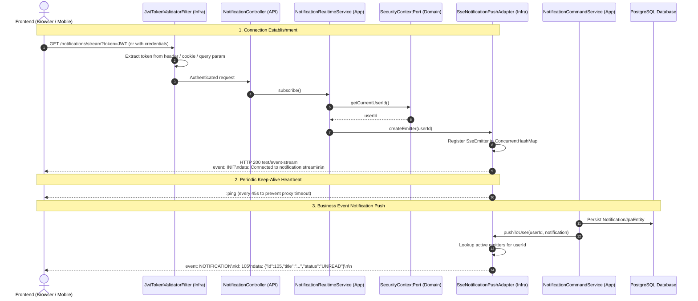

# Server-Sent Events (SSE) Real-Time Notification Architecture & Implementation

> **Artifact Location**: `docs/artifact/sse_notification_architecture_and_implementation.md`  
> **Target Subsystem**: Real-Time In-App Notifications  
> **Architectural Pattern**: Domain-Driven Design (DDD), Ports & Adapters (Hexagonal), CQRS Tier 1  
> **Branch**: `fea/notification-api`

---

## 1. Executive Summary

This document explains the technical rationale, core mechanics, architectural design, and step-by-step implementation of the **Server-Sent Events (SSE)** real-time push mechanism used in this project.

The system delivers real-time notifications to users whenever key domain lifecycle events occur (e.g., fanpage approval, club invitations, appointment of admins, event checkout points award, and event schedule reminders) without client-side polling.

---

## 2. Why Server-Sent Events (SSE)?

To deliver real-time updates to web and mobile frontends, three primary paradigms were evaluated: **Short/Long Polling**, **WebSockets**, and **Server-Sent Events (SSE)**.

### 2.1 Technology Comparison Matrix

| Dimension | Short Polling | Long Polling | WebSocket | Server-Sent Events (SSE) |
|:---|:---|:---|:---|:---|
| **Communication Direction** | Unidirectional (Client $\rightarrow$ Server) | Unidirectional (Client $\rightarrow$ Server) | Bidirectional (Full Duplex) | Unidirectional (Server $\rightarrow$ Client) |
| **Protocol** | Standard HTTP/1.1 | Standard HTTP/1.1 | Custom `ws://` / `wss://` (Upgrades HTTP) | Standard HTTP (`text/event-stream`) |
| **Server Overhead** | High (constant requests, repeated headers/auth) | Medium (connection held, reconnect loops) | Low per message, but requires stateful TCP broker / socket management | **Extremely Low** (single persistent HTTP connection per tab) |
| **Proxy / Firewall Traversal** | Trivial | Trivial | Often blocked or requires special proxy configuration (`101 Switching Protocols`) | **Native & Seamless** (standard HTTP traffic) |
| **Client Reconnection** | Manual | Manual | Requires custom reconnection logic / libraries | **Automatic & Built-in** (`EventSource` handles exponential backoff natively) |
| **Message Structure** | Arbitrary JSON | Arbitrary JSON | Binary or plain text (requires STOMP/subprotocol framing) | **Structured UTF-8 events** (`id`, `event`, `data`, comments) |
| **HTTP/2 Multiplexing** | No | No | No (bypasses HTTP/2) | **Yes** (shares same TCP connection with other HTTP requests) |

### 2.2 Why SSE is the Optimal Choice for This Project

1. **Unidirectional Match**: Notifications are inherently one-way (the backend alerts the student; the student does not send messages back through the notification socket). WebSockets would add unnecessary protocol complexity (STOMP brokers, message routing).
2. **Standard HTTP Infrastructure**: SSE uses standard HTTP streaming with MIME type `text/event-stream`. It traverses reverse proxies (Nginx), CDNs (Cloudflare), and cloud load balancers without requiring WebSocket handshake upgrades.
3. **Zero Third-Party Client Libraries**: Modern browsers support `EventSource` out of the box with automatic reconnection, heartbeat handling, and event routing.
4. **Clean Hexagonal Architecture**: In Spring WebMVC, `SseEmitter` integrates natively with asynchronous servlet threads (`DeferredResult`), allowing clean separation between domain ports and infrastructure adapters.

---

## 3. Architectural Design (DDD & Clean Architecture)

### 3.1 Layer Responsibilities

```
ddd-domain/
└── model/port/notification/NotificationPushPort.java     <- Pure Java Port Interface (Zero Frameworks)

ddd-infrastructure/
└── adapter/notification/SseNotificationPushAdapter.java  <- Spring WebMVC Adapter (SseEmitter Registry)

ddd-application/
├── service/notification/NotificationRealtimeService.java <- App Service Interface
├── service/notification/impl/NotificationRealtimeServiceImpl.java
└── service/notification/impl/NotificationCommandServiceImpl.java -> Calls NotificationPushPort

ddd-api/
└── controller/NotificationController.java                <- GET /notifications/stream
```

### 3.2 End-to-End Sequence Flow



---

## 4. Core Technical Logic & Mechanics

### 4.1 Multi-Client Session Registry (`ConcurrentHashMap`)
A user may have multiple tabs or devices active concurrently. The adapter maintains a thread-safe mapping:
```java
private final Map<Long, CopyOnWriteArrayList<SseEmitter>> userEmitters = new ConcurrentHashMap<>();
```
- `CopyOnWriteArrayList` guarantees thread-safe iterations during broadcast push events, even if another thread removes a completed emitter simultaneously.

### 4.2 Lifecycle & Resource Leak Prevention
Emitters are configured with a **30-minute timeout** (`DEFAULT_TIMEOUT = 1800000L`). When a client disconnects, navigates away, or the session expires:
1. `emitter.onCompletion(...)` $\rightarrow$ removes emitter from map.
2. `emitter.onTimeout(...)` $\rightarrow$ completes and purges emitter.
3. `emitter.onError(...)` $\rightarrow$ cleans up dead socket.
4. If an `IOException` (e.g. broken pipe) occurs during `send()`, the emitter is flagged, closed, and removed.
5. When a user has 0 remaining active connections, their `userId` key is removed from the `ConcurrentHashMap`.

### 4.3 Proxy Keep-Alive / Heartbeat Ping Strategy
Reverse proxies (Nginx, AWS ALB, Cloudflare) automatically close idle streaming connections if no bytes are transferred for 60 seconds.
- A scheduled background job runs every **45 seconds**:
  ```java
  @Scheduled(fixedRate = 45000)
  public void sendHeartbeat() {
      userEmitters.forEach((userId, emitters) -> {
          // SSE comments start with a colon ':' and are ignored by EventSource onmessage
          emitter.send(SseEmitter.event().comment("ping"));
      });
  }
  ```

### 4.4 Browser `EventSource` Authentication Workaround
Standard browser `new EventSource(url)` **cannot attach custom HTTP headers** (such as `Authorization: Bearer <token>`).
To support modern SPAs, mobile apps, and vanilla web clients alike, [`JwtUtil.extractToken()`](file:///home/shrimp/code/ddd-notification/ddd-infrastructure/src/main/java/com/ddd/infrastructure/utils/JwtUtil.java) was designed with a **3-tier extraction hierarchy**:
1. `Authorization: Bearer <token>` HTTP header.
2. `ddd_jwt` HTTP Cookie (browser automatically sends this when `withCredentials: true` is configured).
3. `?token=<jwt>` URL Query Parameter fallback for native `EventSource` clients.

---

## 5. Step-by-Step Implementation Guide

### Step 1: Define the Domain Port (`ddd-domain`)
File: [`com.ddd.domain.model.port.notification.NotificationPushPort`](file:///home/shrimp/code/ddd-notification/ddd-domain/src/main/java/com/ddd/domain/model/port/notification/NotificationPushPort.java)

The domain must never depend on Spring MVC or `SseEmitter`.
```java
package com.ddd.domain.model.port.notification;

import com.ddd.domain.model.Notification;

public interface NotificationPushPort {
    void pushToUser(Long userId, Notification notification);
}
```

---

### Step 2: Implement the Infrastructure Adapter (`ddd-infrastructure`)
File: [`com.ddd.infrastructure.adapter.notification.SseNotificationPushAdapter`](file:///home/shrimp/code/ddd-notification/ddd-infrastructure/src/main/java/com/ddd/infrastructure/adapter/notification/SseNotificationPushAdapter.java)

Manages active emitters, heartbeat pings, and dispatches JSON events:
```java
package com.ddd.infrastructure.adapter.notification;

import com.ddd.domain.model.Notification;
import com.ddd.domain.model.port.notification.NotificationPushPort;
import lombok.extern.slf4j.Slf4j;
import org.springframework.scheduling.annotation.Scheduled;
import org.springframework.stereotype.Component;
import org.springframework.web.servlet.mvc.method.annotation.SseEmitter;

import java.io.IOException;
import java.util.ArrayList;
import java.util.List;
import java.util.Map;
import java.util.concurrent.ConcurrentHashMap;
import java.util.concurrent.CopyOnWriteArrayList;

@Component
@Slf4j
public class SseNotificationPushAdapter implements NotificationPushPort {

    private static final Long DEFAULT_TIMEOUT = 30 * 60 * 1000L; // 30 minutes
    private final Map<Long, CopyOnWriteArrayList<SseEmitter>> userEmitters = new ConcurrentHashMap<>();

    public SseEmitter createEmitter(Long userId) {
        SseEmitter emitter = new SseEmitter(DEFAULT_TIMEOUT);

        userEmitters.computeIfAbsent(userId, k -> new CopyOnWriteArrayList<>()).add(emitter);

        emitter.onCompletion(() -> removeEmitter(userId, emitter));
        emitter.onTimeout(() -> {
            emitter.complete();
            removeEmitter(userId, emitter);
        });
        emitter.onError(e -> {
            log.debug("SSE error for user {}: {}", userId, e.getMessage());
            removeEmitter(userId, emitter);
        });

        // Send initial confirmation event to unblock EventSource.onopen
        try {
            emitter.send(SseEmitter.event()
                    .name("INIT")
                    .data("Connected to notification stream"));
        } catch (IOException e) {
            log.warn("Failed to send initial SSE event to user {}", userId);
            removeEmitter(userId, emitter);
        }

        return emitter;
    }

    @Override
    public void pushToUser(Long userId, Notification notification) {
        if (userId == null || notification == null) return;

        List<SseEmitter> emitters = userEmitters.get(userId);
        if (emitters == null || emitters.isEmpty()) return;

        List<SseEmitter> deadEmitters = new ArrayList<>();
        for (SseEmitter emitter : emitters) {
            try {
                emitter.send(SseEmitter.event()
                        .id(notification.getId() != null ? String.valueOf(notification.getId()) : null)
                        .name("NOTIFICATION")
                        .data(notification));
            } catch (Exception e) {
                deadEmitters.add(emitter);
            }
        }

        if (!deadEmitters.isEmpty()) {
            emitters.removeAll(deadEmitters);
        }
    }

    @Scheduled(fixedRate = 45000)
    public void sendHeartbeat() {
        if (userEmitters.isEmpty()) return;

        userEmitters.forEach((userId, emitters) -> {
            List<SseEmitter> deadEmitters = new ArrayList<>();
            for (SseEmitter emitter : emitters) {
                try {
                    emitter.send(SseEmitter.event().comment("ping"));
                } catch (Exception e) {
                    deadEmitters.add(emitter);
                }
            }
            if (!deadEmitters.isEmpty()) {
                emitters.removeAll(deadEmitters);
            }
        });
    }

    private void removeEmitter(Long userId, SseEmitter emitter) {
        List<SseEmitter> emitters = userEmitters.get(userId);
        if (emitters != null) {
            emitters.remove(emitter);
            if (emitters.isEmpty()) {
                userEmitters.remove(userId);
            }
        }
    }
}
```

---

### Step 3: Implement the Application Services (`ddd-application`)

#### 3.1 Realtime Subscription Service
File: [`com.ddd.application.service.notification.impl.NotificationRealtimeServiceImpl`](file:///home/shrimp/code/ddd-notification/ddd-application/src/main/java/com/ddd/application/service/notification/impl/NotificationRealtimeServiceImpl.java)

Resolves identity via `SecurityContextPort` and creates the emitter:
```java
@Service
@RequiredArgsConstructor
@Slf4j
public class NotificationRealtimeServiceImpl implements NotificationRealtimeService {

    private final SseNotificationPushAdapter sseNotificationPushAdapter;
    private final SecurityContextPort securityContextPort;

    @Override
    public SseEmitter subscribe() {
        Long currentUserId = securityContextPort.getCurrentUserId();
        if (currentUserId == null) {
            throw new UnauthorizedException("User not authenticated");
        }
        return sseNotificationPushAdapter.createEmitter(currentUserId);
    }
}
```

#### 3.2 Dispatching Notification from Command Service
File: [`com.ddd.application.service.notification.impl.NotificationCommandServiceImpl`](file:///home/shrimp/code/ddd-notification/ddd-application/src/main/java/com/ddd/application/service/notification/impl/NotificationCommandServiceImpl.java)

```java
@Override
public NotificationInfoDto createNotification(CreateNotificationDto dto) {
    Notification notification = new Notification();
    notification.setTitle(dto.title());
    notification.setMessage(dto.message());
    notification.setStatus(NotificationStatusEnum.UNREAD);
    notification.setIconUrl(dto.iconUrl());
    notification.setUrl(dto.url());
    notification.setUserId(dto.userId());

    Notification saved = notificationRepository.save(notification);

    // Push real-time event via port
    try {
        notificationPushPort.pushToUser(dto.userId(), saved);
    } catch (Exception e) {
        log.error("Failed to push real-time notification to user {}: {}", dto.userId(), e.getMessage());
    }

    return notificationDtoMapper.toInfoDto(saved);
}
```

---

### Step 4: Expose Controller Endpoint (`ddd-api`)
File: [`com.ddd.api.controller.NotificationController`](file:///home/shrimp/code/ddd-notification/ddd-api/src/main/java/com/ddd/api/controller/NotificationController.java)

```java
@GetMapping(value = "/stream", produces = MediaType.TEXT_EVENT_STREAM_VALUE)
public SseEmitter streamNotifications() {
    return notificationRealtimeService.subscribe();
}
```

---

### Step 5: Enable Query Parameter Authentication (`ddd-infrastructure`)
File: [`com.ddd.infrastructure.utils.JwtUtil`](file:///home/shrimp/code/ddd-notification/ddd-infrastructure/src/main/java/com/ddd/infrastructure/utils/JwtUtil.java)

```java
public String extractToken(HttpServletRequest request) {
    // 1. Authorization: Bearer <token>
    String authHeader = request.getHeader("Authorization");
    if (authHeader != null && authHeader.startsWith("Bearer ")) {
        return authHeader.substring(7).trim();
    }

    // 2. Cookie fallback
    if (request.getCookies() != null) {
        for (Cookie cookie : request.getCookies()) {
            if ("ddd_jwt".equals(cookie.getName())) {
                return cookie.getValue();
            }
        }
    }

    // 3. Query parameter fallback for SSE EventSource connections
    String queryToken = request.getParameter("token");
    if (queryToken != null && !queryToken.isBlank()) {
        return queryToken.trim();
    }

    return null;
}
```

---

## 6. Frontend Integration & Client Reference

### 6.1 Native JavaScript / React Hook Example

```typescript
import { useEffect, useState } from 'react';

export function useNotificationStream(token: string) {
    const [notifications, setNotifications] = useState<any[]>([]);

    useEffect(() => {
        if (!token) return;

        // Establish SSE connection
        const eventSource = new EventSource(`/notifications/stream?token=${encodeURIComponent(token)}`);

        // Listen for initialization
        eventSource.addEventListener('INIT', (event) => {
            console.log('Notification stream connected:', event.data);
        });

        // Listen for real-time notification events
        eventSource.addEventListener('NOTIFICATION', (event) => {
            const newNotification = JSON.parse(event.data);
            console.log('Received real-time notification:', newNotification);

            setNotifications((prev) => [newNotification, ...prev]);

            // Trigger UI toast or notification badge increment
            if (Notification.permission === 'granted') {
                new window.Notification(newNotification.title, {
                    body: newNotification.message,
                    icon: newNotification.iconUrl
                });
            }
        });

        // Error handling & auto-reconnect
        eventSource.onerror = (err) => {
            console.error('SSE connection error:', err);
        };

        return () => {
            eventSource.close();
        };
    }, [token]);

    return notifications;
}
```

---

## 7. Operational Best Practices & Scaling

1. **Horizontal Scaling (Multi-Instance)**:
   - When deploying multiple Spring Boot backend instances behind a load balancer, client SSE connections terminate on different instances.
   - For multi-instance scaling, implement **Redis Pub/Sub** or **RabbitMQ** inside `SseNotificationPushAdapter` so an event triggered on Node A is broadcast across all nodes to find the node holding the user's active `SseEmitter`.
2. **Reverse Proxy Configuration (Nginx)**:
   - When placing Nginx in front of the API, ensure buffering is disabled for the `/notifications/stream` path:
     ```nginx
     location /notifications/stream {
         proxy_pass http://backend_upstream;
         proxy_set_header Connection '';
         proxy_http_version 1.1;
         chunked_transfer_encoding off;
         proxy_buffering off;
         proxy_cache off;
     }
     ```
