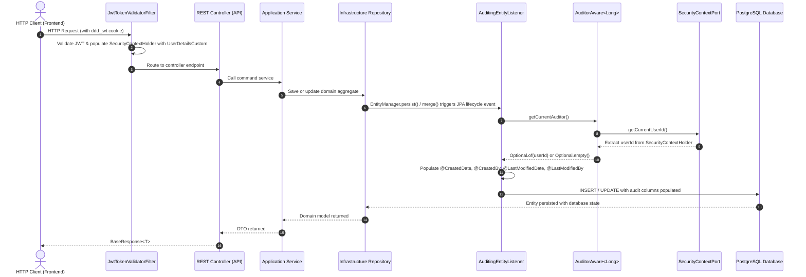

# Spring Data JPA Automated Auditing: Architecture & Implementation Guide

This guide details the step-by-step implementation of automated entity auditing (`createdAt`, `updatedAt`, `createdBy`, `updatedBy`) for this application. It adheres strictly to the **Domain-Driven Design (DDD)** dependency rule, ensuring the domain layer remains pure while the infrastructure layer leverages Spring Data JPA and Spring Security.

---

## 1. Architectural Overview & Design Pattern

### 1.1 The DDD Dependency Rule
- **`ddd-domain`**: Contains business models (such as [`BaseModel`](file:///home/shrimp/code/ddd/ddd-domain/src/main/java/com/ddd/domain/model/BaseModel.java)) and ports. The domain model defines the fields (`id`, `createdAt`, `updatedAt`, `createdBy`, `updatedBy`, `isActive`), but **must never** import or depend on JPA (`jakarta.persistence.*`), Hibernate, or Spring Framework annotations.
- **`ddd-infrastructure`**: Contains database persistence entities (such as [`BaseEntityJpa`](file:///home/shrimp/code/ddd/ddd-infrastructure/src/main/java/com/ddd/infrastructure/entity/BaseEntityJpa.java)), repository implementations, and adapter implementations. Auditing interceptors and configurations live exclusively here.
- **`ddd-application`**: Invokes domain repositories to persist aggregates. Application services do not manually populate audit timestamps or user IDs during standard mutations.

### 1.2 Auditing Flow Architecture



---

## 2. Current State Analysis

| Component | Path | Current Behavior | Target Behavior |
|:---|:---|:---|:---|
| **`BaseModel`** | `ddd-domain/src/.../model/BaseModel.java` | Has `createdAt`, `updatedAt`, `createdBy`, `updatedBy`. Pure Java POJO. | Retain as-is. Pure domain model. |
| **`BaseEntityJpa`** | `ddd-infrastructure/src/.../entity/BaseEntityJpa.java` | Uses Hibernate `@CreationTimestamp` and `@UpdateTimestamp`. `createdBy` and `updatedBy` are unannotated plain columns. | Add `@EntityListeners(AuditingEntityListener.class)`, `@CreatedDate`, `@CreatedBy`, `@LastModifiedDate`, `@LastModifiedBy`. |
| **`SecurityContextPort`** | `ddd-domain/src/.../port/security/SecurityContextPort.java` | Exposes `getCurrentUserId()`, `getCurrentUserEmail()`. | Reused by infrastructure `AuditorAware`. |
| **`SpringSecurityContextAdaptor`** | `ddd-infrastructure/src/.../adapter/security/SpringSecurityContextAdaptor.java` | Implements `SecurityContextPort` by reading `UserDetailsCustom.getUserId()`. | Injected into `AuditorAwareImpl`. |
| **JPA Auditing Config** | Not present | Spring Data JPA Auditing is disabled. | Create `JpaAuditingConfig` with `@EnableJpaAuditing`. |

---

## 3. Step-by-Step Implementation Guide

### Step 1: Create the `AuditorAware` Provider

Create a new class in the infrastructure configuration package to bridge Spring Security and Spring Data JPA.

- **File Path**: `ddd-infrastructure/src/main/java/com/ddd/infrastructure/config/audit/AuditorAwareImpl.java`

```java
package com.ddd.infrastructure.config.audit;

import com.ddd.domain.model.port.security.SecurityContextPort;
import lombok.RequiredArgsConstructor;
import lombok.extern.slf4j.Slf4j;
import org.springframework.data.domain.AuditorAware;
import org.springframework.lang.NonNull;
import org.springframework.stereotype.Component;

import java.util.Optional;

/**
 * Provides the current authenticated user's ID to Spring Data JPA Auditing.
 * Integrates with the existing SecurityContextPort to maintain DDD boundaries.
 */
@Slf4j
@Component("auditorAware")
@RequiredArgsConstructor
public class AuditorAwareImpl implements AuditorAware<Long> {

    private final SecurityContextPort securityContextPort;

    @Override
    @NonNull
    public Optional<Long> getCurrentAuditor() {
        if (!securityContextPort.isAuthenticated()) {
            return Optional.empty();
        }

        Long userId = securityContextPort.getCurrentUserId();
        return Optional.ofNullable(userId);
    }
}
```

> [!NOTE]
> When `getCurrentAuditor()` returns `Optional.empty()` (e.g. during public self-registration or background cron tasks), Spring Data JPA leaves `createdBy` and `updatedBy` as `null` instead of throwing an exception.

---

### Step 2: Configure `@EnableJpaAuditing`

Register the auditing configuration bean and enable entity listeners.

- **File Path**: `ddd-infrastructure/src/main/java/com/ddd/infrastructure/config/audit/JpaAuditingConfig.java`

```java
package com.ddd.infrastructure.config.audit;

import org.springframework.context.annotation.Configuration;
import org.springframework.data.jpa.repository.config.EnableJpaAuditing;

/**
 * Activates Spring Data JPA Auditing using the auditorAware bean.
 */
@Configuration
@EnableJpaAuditing(auditorAwareRef = "auditorAware")
public class JpaAuditingConfig {
}
```

---

### Step 3: Update `BaseEntityJpa`

Modify [`BaseEntityJpa`](file:///home/shrimp/code/ddd/ddd-infrastructure/src/main/java/com/ddd/infrastructure/entity/BaseEntityJpa.java) to register the entity listener and auditing annotations.

- **File Path**: `ddd-infrastructure/src/main/java/com/ddd/infrastructure/entity/BaseEntityJpa.java`

```java
package com.ddd.infrastructure.entity;

import jakarta.persistence.Column;
import jakarta.persistence.EntityListeners;
import jakarta.persistence.MappedSuperclass;
import lombok.Getter;
import lombok.Setter;
import org.springframework.data.annotation.CreatedBy;
import org.springframework.data.annotation.CreatedDate;
import org.springframework.data.annotation.LastModifiedBy;
import org.springframework.data.annotation.LastModifiedDate;
import org.springframework.data.jpa.domain.support.AuditingEntityListener;

import java.time.Instant;

@MappedSuperclass
@EntityListeners(AuditingEntityListener.class)
@Getter
@Setter
public abstract class BaseEntityJpa {

    @Column(name = "is_active", nullable = false)
    private Boolean isActive = true;

    @CreatedDate
    @Column(name = "created_at", nullable = false, updatable = false)
    private Instant createdAt;

    @CreatedBy
    @Column(name = "created_by", updatable = false)
    private Long createdBy;

    @LastModifiedDate
    @Column(name = "updated_at", nullable = false)
    private Instant updatedAt;

    @LastModifiedBy
    @Column(name = "updated_by")
    private Long updatedBy;
}
```

> [!IMPORTANT]
> `updatable = false` on `createdAt` and `createdBy` guarantees that subsequent updates made via `JpaRepository.save()` or merge operations will **never** overwrite or erase the original creation audit data.

---

### Step 4: Mapper & Repository Integrity (Preserving Audit Fields)

When converting between Domain Models and JPA Entities:
1. **Creation**:
   - The domain model's `createdAt`, `updatedAt`, `createdBy`, and `updatedBy` can initially be `null`.
   - When `jpaRepository.save(entity)` is called, the JPA listener populates them automatically.
   - After persistence, map the generated timestamps and user IDs back to the returned domain model.
2. **Updates**:
   - In update mapper routines (e.g., `updateEntityFromModel`), do **not** map `createdBy` or `createdAt` from incoming DTOs.
   - Example MapStruct configuration for entity mappers:
   ```java
   @Mapping(target = "createdAt", ignore = true)
   @Mapping(target = "createdBy", ignore = true)
   @Mapping(target = "updatedAt", ignore = true)
   @Mapping(target = "updatedBy", ignore = true)
   void updateEntityFromDomain(DomainModel model, @MappingTarget EntityJpa entity);
   ```

---

### Step 5: Handling Special Scenarios & Edge Cases

#### Scenario A: Self-Registration (`/auth/register`)
- **Situation**: A student or fanpage admin signs up anonymously. There is no active session in `SecurityContextHolder`.
- **Behavior**: `AuditorAwareImpl` returns `Optional.empty()`, setting `createdBy = null` initially.
- **Optional Enhancement**: In `AuthServiceImpl.createUser()`, once the user entity is persisted and assigned an ID, if desired, `userJpa.setCreatedBy(userJpa.getId())` can be explicitly set so users own their initial record.

#### Scenario B: Async Background Tasks (`@Async` / Schedulers)
- **Situation**: Scheduled cron jobs or async executors execute on worker threads where `SecurityContextHolder` is not propagated by default.
- **Solution**: Configure `DelegatingSecurityContextAsyncTaskExecutor` or let `AuditorAwareImpl` return `Optional.empty()`, which signifies a system action. Alternatively, define a system auditor fallback constant (e.g., `0L` or `SYSTEM_USER_ID = 1L`).

---

## 4. Verification and Testing

### 4.1 Unit Test for `AuditorAwareImpl`
```java
@ExtendWith(MockitoExtension.class)
class AuditorAwareImplTest {

    @Mock
    private SecurityContextPort securityContextPort;

    @InjectMocks
    private AuditorAwareImpl auditorAware;

    @Test
    void shouldReturnUserIdWhenAuthenticated() {
        when(securityContextPort.isAuthenticated()).thenReturn(true);
        when(securityContextPort.getCurrentUserId()).thenReturn(42L);

        Optional<Long> currentAuditor = auditorAware.getCurrentAuditor();

        assertTrue(currentAuditor.isPresent());
        assertEquals(42L, currentAuditor.get());
    }

    @Test
    void shouldReturnEmptyWhenUnauthenticated() {
        when(securityContextPort.isAuthenticated()).thenReturn(false);

        Optional<Long> currentAuditor = auditorAware.getCurrentAuditor();

        assertTrue(currentAuditor.isEmpty());
    }
}
```

### 4.2 Integration Verification
Run a verification query after creating or updating any resource (e.g. creating an event):
```sql
SELECT id, name, created_at, created_by, updated_at, updated_by FROM events ORDER BY id DESC LIMIT 1;
```
Verify that:
- `created_at` matches the insert timestamp.
- `created_by` matches the logged-in student/admin `userId`.
- On `PUT` or `PATCH`, `updated_at` and `updated_by` update while `created_at` and `created_by` remain unchanged.
