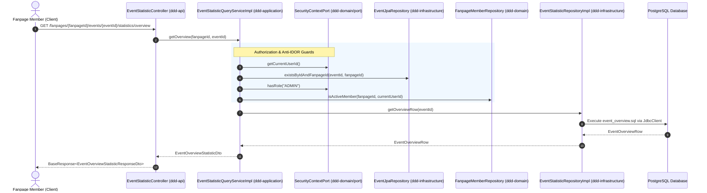

# Event Statistics Dashboard — Specific Step-by-Step Implementation Guide

> **Document Version**: 1.0.0  
> **Status**: Ready for Implementation  
> **Target Package**: `com.ddd`  
> **Storage Path**: `docs/guidelines/event-statistic-implementation-guide.md` (and mirrored in `docs/guidline/`)  
> **Specification Reference**: [docs/artifact/event_statistic_implementation_plan.md](file:///home/shrimp/code/ddd/docs/artifact/event_statistic_implementation_plan.md)  

---

## Table of Contents
1. [Overview & Scope](#1-overview--scope)
2. [DDD Layered Architecture & Request Flow](#2-ddd-layered-architecture--request-flow)
3. [Pre-Implementation Checklist](#3-pre-implementation-checklist)
4. [Step 1: Domain Layer (`ddd-domain`)](#4-step-1-domain-layer-ddd-domain)
5. [Step 2: Infrastructure Layer (`ddd-infrastructure`)](#5-step-2-infrastructure-layer-ddd-infrastructure)
   - [2.1 External SQL Files](#21-external-sql-files)
   - [2.2 JDBC Row Records](#22-jdbc-row-records)
   - [2.3 Repository Implementation](#23-repository-implementation)
6. [Step 3: Application Layer (`ddd-application`)](#6-step-3-application-layer-ddd-application)
   - [3.1 Application DTOs](#31-application-dtos)
   - [3.2 Service Interface](#32-service-interface)
   - [3.3 Service Implementation & Guards](#33-service-implementation--guards)
7. [Step 4: API Layer (`ddd-api`)](#7-step-4-api-layer-ddd-api)
   - [4.1 API Response DTOs](#41-api-response-dtos)
   - [4.2 MapStruct API Mapper](#42-mapstruct-api-mapper)
   - [4.3 REST Controller](#43-rest-controller)
8. [Step 5: Testing & Verification](#8-step-5-testing--verification)
   - [5.1 Application Service Unit Tests](#51-application-service-unit-tests)
   - [5.2 REST Controller Unit Tests](#52-rest-controller-unit-tests)
   - [5.3 Build Verification](#53-build-verification)
9. [Anti-Patterns & Architectural Guardrails](#9-anti-patterns--architectural-guardrails)

---

## 1. Overview & Scope

This guide provides concrete, copy-paste-ready implementation steps to deliver real-time operational statistics for an event when an authorized **fanpage member** accesses the Event Detail Dashboard.

### Functional Scope
1. **Capacity & Fill Rate**: Live registered count against total capacity and male/female quotas.
2. **Attendance Status Funnel**: Complete distribution of attendees across all 8 registration statuses (`REGISTERED`, `SELF_CHECKED_IN`, `CHECKED_IN`, `SPENDING_CONFIRM`, `CONFIRMED`, `COMPLETED`, `ABSENT`, `CANCELLED`).
3. **Attendee Demographics**: Demographic breakdown of registered students by Academic Cohort (`kNumber`), Major, and Gender with pre-calculated percentages.
4. **Live Check-in Timeline**: 15-minute interval binned check-in progression using PostgreSQL's `date_bin` function.
5. **Composite Dashboard**: Single aggregation endpoint consolidating all 4 sections for initial page load.

---

## 2. DDD Layered Architecture & Request Flow



---

## 3. Pre-Implementation Checklist

- [x] Spring Data JPA & `spring-jdbc` (`JdbcClient`) already available.
- [x] `SqlLoader` utility located at `ddd-infrastructure/src/main/java/com/ddd/infrastructure/util/SqlLoader.java`.
- [x] `SecurityContextPort` available at `com.ddd.domain.model.port.security.SecurityContextPort`.
- [x] `FanpageMemberRepository.isActiveMember(fanpageId, userId)` available.
- [x] `EventJpaRepository.existsByIdAndFanpageId(eventId, fanpageId)` available.

---

## 4. Step 1: Domain Layer (`ddd-domain`)

Create the repository port interface in `com.ddd.domain.repository`.

### File: `ddd-domain/src/main/java/com/ddd/domain/repository/EventStatisticRepository.java`

```java
package com.ddd.domain.repository;

public interface EventStatisticRepository {
    long countRegistrationsByEventId(Long eventId);
    long countAttendedByEventId(Long eventId);
}
```

---

## 5. Step 2: Infrastructure Layer (`ddd-infrastructure`)

### 2.1 External SQL Files

Create the following SQL files under directory:  
`ddd-infrastructure/src/main/resources/sql/statistic/`

#### 1. File: `event_overview.sql`
`ddd-infrastructure/src/main/resources/sql/statistic/event_overview.sql`
```sql
SELECT
    e.capacity                                                                                      AS capacity,
    COALESCE(e.male_quantity, 0)                                                                    AS male_quantity,
    COALESCE(e.female_quantity, 0)                                                                  AS female_quantity,
    COUNT(r.user_id)                                                                                AS total_registrations,
    COUNT(r.user_id) FILTER (
        WHERE r.status IN ('CHECKED_IN', 'SELF_CHECKED_IN', 'SPENDING_CONFIRM', 'CONFIRMED', 'COMPLETED')
    )                                                                                               AS total_attended
FROM events e
LEFT JOIN registrations r ON r.event_id = e.id
WHERE e.id = :eventId
GROUP BY e.id, e.capacity, e.male_quantity, e.female_quantity;
```

#### 2. File: `event_status_funnel.sql`
`ddd-infrastructure/src/main/resources/sql/statistic/event_status_funnel.sql`
```sql
SELECT
    COUNT(r.user_id) FILTER (WHERE r.status = 'REGISTERED')                                         AS registered_count,
    COUNT(r.user_id) FILTER (WHERE r.status = 'SELF_CHECKED_IN')                                    AS self_checked_in_count,
    COUNT(r.user_id) FILTER (WHERE r.status = 'CHECKED_IN')                                         AS checked_in_count,
    COUNT(r.user_id) FILTER (WHERE r.status = 'SPENDING_CONFIRM')                                   AS spending_confirm_count,
    COUNT(r.user_id) FILTER (WHERE r.status = 'CONFIRMED')                                          AS confirmed_count,
    COUNT(r.user_id) FILTER (WHERE r.status = 'COMPLETED')                                          AS completed_count,
    COUNT(r.user_id) FILTER (WHERE r.status = 'ABSENT')                                             AS absent_count,
    COUNT(r.user_id) FILTER (WHERE r.status = 'CANCELLED')                                          AS cancelled_count
FROM registrations r
WHERE r.event_id = :eventId;
```

#### 3. File: `event_demographics_cohort.sql`
`ddd-infrastructure/src/main/resources/sql/statistic/event_demographics_cohort.sql`
```sql
SELECT
    COALESCE(CAST(sp.k_number AS VARCHAR), 'Unknown')                                               AS label,
    COUNT(r.user_id)                                                                                AS student_count
FROM registrations r
JOIN users u ON u.id = r.user_id
LEFT JOIN student_profiles sp ON sp.user_id = u.id
WHERE r.event_id = :eventId
GROUP BY sp.k_number
ORDER BY student_count DESC;
```

#### 4. File: `event_demographics_major.sql`
`ddd-infrastructure/src/main/resources/sql/statistic/event_demographics_major.sql`
```sql
SELECT
    COALESCE(m.name, 'Other')                                                                       AS label,
    COUNT(r.user_id)                                                                                AS student_count
FROM registrations r
JOIN users u ON u.id = r.user_id
LEFT JOIN student_profiles sp ON sp.user_id = u.id
LEFT JOIN majors m ON m.id = sp.major_id
WHERE r.event_id = :eventId
GROUP BY m.name
ORDER BY student_count DESC;
```

#### 5. File: `event_demographics_gender.sql`
`ddd-infrastructure/src/main/resources/sql/statistic/event_demographics_gender.sql`
```sql
SELECT
    COALESCE(u.gender, 'UNKNOWN')                                                                   AS label,
    COUNT(r.user_id)                                                                                AS student_count
FROM registrations r
JOIN users u ON u.id = r.user_id
WHERE r.event_id = :eventId
GROUP BY u.gender
ORDER BY student_count DESC;
```

#### 6. File: `event_checkin_timeline.sql`
`ddd-infrastructure/src/main/resources/sql/statistic/event_checkin_timeline.sql`
```sql
SELECT
    TO_CHAR(date_bin('15 minutes', r.check_in_at, TIMESTAMP '2000-01-01 00:00:00'), 'YYYY-MM-DD HH24:MI') AS time_slot,
    COUNT(r.user_id)                                                                                AS check_in_count
FROM registrations r
WHERE r.event_id = :eventId
  AND r.check_in_at IS NOT NULL
GROUP BY time_slot
ORDER BY time_slot ASC;
```

---

### 2.2 JDBC Row Records

Create record classes under package: `com.ddd.infrastructure.repository.row.event`

#### File: `ddd-infrastructure/src/main/java/com/ddd/infrastructure/repository/row/event/EventOverviewRow.java`
```java
package com.ddd.infrastructure.repository.row.event;

public record EventOverviewRow(
        int capacity,
        int maleQuantity,
        int femaleQuantity,
        long totalRegistrations,
        long totalAttended
) {}
```

#### File: `ddd-infrastructure/src/main/java/com/ddd/infrastructure/repository/row/event/EventStatusFunnelRow.java`
```java
package com.ddd.infrastructure.repository.row.event;

public record EventStatusFunnelRow(
        long registeredCount,
        long selfCheckedInCount,
        long checkedInCount,
        long spendingConfirmCount,
        long confirmedCount,
        long completedCount,
        long absentCount,
        long cancelledCount
) {}
```

#### File: `ddd-infrastructure/src/main/java/com/ddd/infrastructure/repository/row/event/DemographicItemRow.java`
```java
package com.ddd.infrastructure.repository.row.event;

public record DemographicItemRow(
        String label,
        long studentCount
) {}
```

#### File: `ddd-infrastructure/src/main/java/com/ddd/infrastructure/repository/row/event/CheckInTimelineRow.java`
```java
package com.ddd.infrastructure.repository.row.event;

public record CheckInTimelineRow(
        String timeSlot,
        long checkInCount
) {}
```

---

### 2.3 Repository Implementation

#### File: `ddd-infrastructure/src/main/java/com/ddd/infrastructure/repository/EventStatisticRepositoryImpl.java`
```java
package com.ddd.infrastructure.repository;

import com.ddd.domain.repository.EventStatisticRepository;
import com.ddd.infrastructure.repository.row.event.CheckInTimelineRow;
import com.ddd.infrastructure.repository.row.event.DemographicItemRow;
import com.ddd.infrastructure.repository.row.event.EventOverviewRow;
import com.ddd.infrastructure.repository.row.event.EventStatusFunnelRow;
import com.ddd.infrastructure.util.SqlLoader;
import lombok.RequiredArgsConstructor;
import org.springframework.jdbc.core.simple.JdbcClient;
import org.springframework.stereotype.Component;

import java.util.List;
import java.util.Optional;

@Component
@RequiredArgsConstructor
public class EventStatisticRepositoryImpl implements EventStatisticRepository {

    private final JdbcClient jdbcClient;

    private static final String OVERVIEW_SQL            = SqlLoader.load("statistic/event_overview.sql");
    private static final String STATUS_FUNNEL_SQL       = SqlLoader.load("statistic/event_status_funnel.sql");
    private static final String DEMO_COHORT_SQL         = SqlLoader.load("statistic/event_demographics_cohort.sql");
    private static final String DEMO_MAJOR_SQL          = SqlLoader.load("statistic/event_demographics_major.sql");
    private static final String DEMO_GENDER_SQL         = SqlLoader.load("statistic/event_demographics_gender.sql");
    private static final String TIMELINE_SQL            = SqlLoader.load("statistic/event_checkin_timeline.sql");

    @Override
    public long countRegistrationsByEventId(Long eventId) {
        return getOverviewRow(eventId).map(EventOverviewRow::totalRegistrations).orElse(0L);
    }

    @Override
    public long countAttendedByEventId(Long eventId) {
        return getOverviewRow(eventId).map(EventOverviewRow::totalAttended).orElse(0L);
    }

    public Optional<EventOverviewRow> getOverviewRow(Long eventId) {
        return jdbcClient.sql(OVERVIEW_SQL)
                .param("eventId", eventId)
                .query(EventOverviewRow.class)
                .optional();
    }

    public EventStatusFunnelRow getStatusFunnelRow(Long eventId) {
        return jdbcClient.sql(STATUS_FUNNEL_SQL)
                .param("eventId", eventId)
                .query(EventStatusFunnelRow.class)
                .single();
    }

    public List<DemographicItemRow> getCohortDemographics(Long eventId) {
        return jdbcClient.sql(DEMO_COHORT_SQL)
                .param("eventId", eventId)
                .query(DemographicItemRow.class)
                .list();
    }

    public List<DemographicItemRow> getMajorDemographics(Long eventId) {
        return jdbcClient.sql(DEMO_MAJOR_SQL)
                .param("eventId", eventId)
                .query(DemographicItemRow.class)
                .list();
    }

    public List<DemographicItemRow> getGenderDemographics(Long eventId) {
        return jdbcClient.sql(DEMO_GENDER_SQL)
                .param("eventId", eventId)
                .query(DemographicItemRow.class)
                .list();
    }

    public List<CheckInTimelineRow> getCheckInTimeline(Long eventId) {
        return jdbcClient.sql(TIMELINE_SQL)
                .param("eventId", eventId)
                .query(CheckInTimelineRow.class)
                .list();
    }
}
```

---

## 6. Step 3: Application Layer (`ddd-application`)

### 3.1 Application DTOs

Create DTO records under: `com.ddd.application.dto.statistic.event`

#### File: `ddd-application/src/main/java/com/ddd/application/dto/statistic/event/EventOverviewStatisticDto.java`
```java
package com.ddd.application.dto.statistic.event;

public record EventOverviewStatisticDto(
        int capacity,
        int maleQuantity,
        int femaleQuantity,
        long totalRegistrations,
        int remainingCapacity,
        double capacityUtilizationRate,
        long totalAttended,
        double attendanceRate
) {}
```

#### File: `ddd-application/src/main/java/com/ddd/application/dto/statistic/event/EventStatusFunnelDto.java`
```java
package com.ddd.application.dto.statistic.event;

public record EventStatusFunnelDto(
        long registeredCount,
        long selfCheckedInCount,
        long checkedInCount,
        long spendingConfirmCount,
        long confirmedCount,
        long completedCount,
        long absentCount,
        long cancelledCount
) {}
```

#### File: `ddd-application/src/main/java/com/ddd/application/dto/statistic/event/DemographicItemDto.java`
```java
package com.ddd.application.dto.statistic.event;

public record DemographicItemDto(
        String label,
        long count,
        double percentage
) {}
```

#### File: `ddd-application/src/main/java/com/ddd/application/dto/statistic/event/EventDemographicsDto.java`
```java
package com.ddd.application.dto.statistic.event;

import java.util.List;

public record EventDemographicsDto(
        List<DemographicItemDto> cohorts,
        List<DemographicItemDto> majors,
        List<DemographicItemDto> genders
) {}
```

#### File: `ddd-application/src/main/java/com/ddd/application/dto/statistic/event/EventCheckInTimelineDto.java`
```java
package com.ddd.application.dto.statistic.event;

public record EventCheckInTimelineDto(
        String timeSlot,
        long checkInCount
) {}
```

#### File: `ddd-application/src/main/java/com/ddd/application/dto/statistic/event/EventDashboardStatisticDto.java`
```java
package com.ddd.application.dto.statistic.event;

import java.util.List;

public record EventDashboardStatisticDto(
        EventOverviewStatisticDto overview,
        EventStatusFunnelDto statusFunnel,
        EventDemographicsDto demographics,
        List<EventCheckInTimelineDto> checkInTimeline
) {}
```

---

### 3.2 Service Interface

#### File: `ddd-application/src/main/java/com/ddd/application/service/event/EventStatisticQueryService.java`
```java
package com.ddd.application.service.event;

import com.ddd.application.dto.statistic.event.*;

import java.util.List;

public interface EventStatisticQueryService {
    EventOverviewStatisticDto getOverview(Long fanpageId, Long eventId);
    EventStatusFunnelDto getStatusFunnel(Long fanpageId, Long eventId);
    EventDemographicsDto getDemographics(Long fanpageId, Long eventId);
    List<EventCheckInTimelineDto> getCheckInTimeline(Long fanpageId, Long eventId);
    EventDashboardStatisticDto getDashboard(Long fanpageId, Long eventId);
}
```

---

### 3.3 Service Implementation & Guards

#### File: `ddd-application/src/main/java/com/ddd/application/service/event/impl/EventStatisticQueryServiceImpl.java`
```java
package com.ddd.application.service.event.impl;

import com.ddd.application.dto.statistic.event.*;
import com.ddd.application.service.event.EventStatisticQueryService;
import com.ddd.domain.exception.AuthException;
import com.ddd.domain.exception.ResourceNotFoundException;
import com.ddd.domain.exception.UnauthorizedException;
import com.ddd.domain.model.port.security.SecurityContextPort;
import com.ddd.domain.repository.FanpageMemberRepository;
import com.ddd.infrastructure.repository.EventStatisticRepositoryImpl;
import com.ddd.infrastructure.repository.jpaRepository.EventJpaRepository;
import com.ddd.infrastructure.repository.row.event.CheckInTimelineRow;
import com.ddd.infrastructure.repository.row.event.DemographicItemRow;
import com.ddd.infrastructure.repository.row.event.EventOverviewRow;
import com.ddd.infrastructure.repository.row.event.EventStatusFunnelRow;
import lombok.RequiredArgsConstructor;
import org.springframework.stereotype.Service;
import org.springframework.transaction.annotation.Transactional;

import java.util.List;

@Service
@Transactional(readOnly = true)
@RequiredArgsConstructor
public class EventStatisticQueryServiceImpl implements EventStatisticQueryService {

    private final EventStatisticRepositoryImpl eventStatisticRepositoryImpl;
    private final EventJpaRepository eventJpaRepository;
    private final FanpageMemberRepository fanpageMemberRepository;
    private final SecurityContextPort securityContextPort;

    @Override
    public EventOverviewStatisticDto getOverview(Long fanpageId, Long eventId) {
        assertCallerCanViewEventStatistics(fanpageId, eventId);

        EventOverviewRow row = eventStatisticRepositoryImpl.getOverviewRow(eventId)
                .orElseThrow(() -> new ResourceNotFoundException("Event statistics not found for id: " + eventId));

        int remainingCapacity = Math.max(0, row.capacity() - (int) row.totalRegistrations());
        double utilizationRate = row.capacity() == 0 ? 0.0
                : roundRate((double) row.totalRegistrations() / row.capacity() * 100.0);
        double attendanceRate = row.totalRegistrations() == 0 ? 0.0
                : roundRate((double) row.totalAttended() / row.totalRegistrations() * 100.0);

        return new EventOverviewStatisticDto(
                row.capacity(),
                row.maleQuantity(),
                row.femaleQuantity(),
                row.totalRegistrations(),
                remainingCapacity,
                utilizationRate,
                row.totalAttended(),
                attendanceRate
        );
    }

    @Override
    public EventStatusFunnelDto getStatusFunnel(Long fanpageId, Long eventId) {
        assertCallerCanViewEventStatistics(fanpageId, eventId);

        EventStatusFunnelRow row = eventStatisticRepositoryImpl.getStatusFunnelRow(eventId);
        return new EventStatusFunnelDto(
                row.registeredCount(),
                row.selfCheckedInCount(),
                row.checkedInCount(),
                row.spendingConfirmCount(),
                row.confirmedCount(),
                row.completedCount(),
                row.absentCount(),
                row.cancelledCount()
        );
    }

    @Override
    public EventDemographicsDto getDemographics(Long fanpageId, Long eventId) {
        assertCallerCanViewEventStatistics(fanpageId, eventId);

        long totalRegistrations = eventStatisticRepositoryImpl.getOverviewRow(eventId)
                .map(EventOverviewRow::totalRegistrations)
                .orElse(0L);

        List<DemographicItemDto> cohorts = mapDemographicItems(
                eventStatisticRepositoryImpl.getCohortDemographics(eventId), totalRegistrations);
        List<DemographicItemDto> majors = mapDemographicItems(
                eventStatisticRepositoryImpl.getMajorDemographics(eventId), totalRegistrations);
        List<DemographicItemDto> genders = mapDemographicItems(
                eventStatisticRepositoryImpl.getGenderDemographics(eventId), totalRegistrations);

        return new EventDemographicsDto(cohorts, majors, genders);
    }

    @Override
    public List<EventCheckInTimelineDto> getCheckInTimeline(Long fanpageId, Long eventId) {
        assertCallerCanViewEventStatistics(fanpageId, eventId);

        List<CheckInTimelineRow> rows = eventStatisticRepositoryImpl.getCheckInTimeline(eventId);
        return rows.stream()
                .map(r -> new EventCheckInTimelineDto(r.timeSlot(), r.checkInCount()))
                .toList();
    }

    @Override
    public EventDashboardStatisticDto getDashboard(Long fanpageId, Long eventId) {
        assertCallerCanViewEventStatistics(fanpageId, eventId);

        EventOverviewStatisticDto overview = getOverview(fanpageId, eventId);
        EventStatusFunnelDto statusFunnel = getStatusFunnel(fanpageId, eventId);
        EventDemographicsDto demographics = getDemographics(fanpageId, eventId);
        List<EventCheckInTimelineDto> timeline = getCheckInTimeline(fanpageId, eventId);

        return new EventDashboardStatisticDto(overview, statusFunnel, demographics, timeline);
    }

    // ── Authorization & Helper Methods ───────────────────────────────────────

    private void assertCallerCanViewEventStatistics(Long fanpageId, Long eventId) {
        Long currentUserId = securityContextPort.getCurrentUserId();
        if (currentUserId == null) {
            throw new UnauthorizedException("User is not authenticated");
        }
        if (!eventJpaRepository.existsByIdAndFanpageId(eventId, fanpageId)) {
            throw new ResourceNotFoundException(
                    "Event not found with id " + eventId + " belonging to fanpage " + fanpageId);
        }
        if (securityContextPort.hasRole("ADMIN")) {
            return;
        }
        if (!fanpageMemberRepository.isActiveMember(fanpageId, currentUserId)) {
            throw new AuthException("You do not have permission to view statistics for this event");
        }
    }

    private List<DemographicItemDto> mapDemographicItems(List<DemographicItemRow> rows, long totalRegistrations) {
        return rows.stream()
                .map(r -> new DemographicItemDto(
                        r.label(),
                        r.studentCount(),
                        totalRegistrations == 0 ? 0.0 : roundRate((double) r.studentCount() / totalRegistrations * 100.0)
                ))
                .toList();
    }

    private double roundRate(double value) {
        return Math.round(value * 100.0) / 100.0;
    }
}
```

---

## 7. Step 4: API Layer (`ddd-api`)

### 4.1 API Response DTOs

Create response records in package: `com.ddd.api.dto.statistic.event.res`

#### File: `ddd-api/src/main/java/com/ddd/api/dto/statistic/event/res/EventOverviewStatisticResponseDto.java`
```java
package com.ddd.api.dto.statistic.event.res;

public record EventOverviewStatisticResponseDto(
        int capacity,
        int maleQuantity,
        int femaleQuantity,
        long totalRegistrations,
        int remainingCapacity,
        double capacityUtilizationRate,
        long totalAttended,
        double attendanceRate
) {}
```

#### File: `ddd-api/src/main/java/com/ddd/api/dto/statistic/event/res/EventStatusFunnelResponseDto.java`
```java
package com.ddd.api.dto.statistic.event.res;

public record EventStatusFunnelResponseDto(
        long registeredCount,
        long selfCheckedInCount,
        long checkedInCount,
        long spendingConfirmCount,
        long confirmedCount,
        long completedCount,
        long absentCount,
        long cancelledCount
) {}
```

#### File: `ddd-api/src/main/java/com/ddd/api/dto/statistic/event/res/DemographicItemResponseDto.java`
```java
package com.ddd.api.dto.statistic.event.res;

public record DemographicItemResponseDto(
        String label,
        long count,
        double percentage
) {}
```

#### File: `ddd-api/src/main/java/com/ddd/api/dto/statistic/event/res/EventDemographicsResponseDto.java`
```java
package com.ddd.api.dto.statistic.event.res;

import java.util.List;

public record EventDemographicsResponseDto(
        List<DemographicItemResponseDto> cohorts,
        List<DemographicItemResponseDto> majors,
        List<DemographicItemResponseDto> genders
) {}
```

#### File: `ddd-api/src/main/java/com/ddd/api/dto/statistic/event/res/EventCheckInTimelineResponseDto.java`
```java
package com.ddd.api.dto.statistic.event.res;

public record EventCheckInTimelineResponseDto(
        String timeSlot,
        long checkInCount
) {}
```

#### File: `ddd-api/src/main/java/com/ddd/api/dto/statistic/event/res/EventDashboardStatisticResponseDto.java`
```java
package com.ddd.api.dto.statistic.event.res;

import java.util.List;

public record EventDashboardStatisticResponseDto(
        EventOverviewStatisticResponseDto overview,
        EventStatusFunnelResponseDto statusFunnel,
        EventDemographicsResponseDto demographics,
        List<EventCheckInTimelineResponseDto> checkInTimeline
) {}
```

---

### 4.2 MapStruct API Mapper

#### File: `ddd-api/src/main/java/com/ddd/api/mapper/EventStatisticApiMapper.java`
```java
package com.ddd.api.mapper;

import com.ddd.api.dto.statistic.event.res.*;
import com.ddd.application.dto.statistic.event.*;
import org.mapstruct.Mapper;

import java.util.List;

@Mapper(componentModel = "spring")
public interface EventStatisticApiMapper {
    EventOverviewStatisticResponseDto toResponseDto(EventOverviewStatisticDto dto);
    EventStatusFunnelResponseDto toResponseDto(EventStatusFunnelDto dto);
    EventDemographicsResponseDto toResponseDto(EventDemographicsDto dto);
    EventCheckInTimelineResponseDto toResponseDto(EventCheckInTimelineDto dto);
    List<EventCheckInTimelineResponseDto> toTimelineResponseList(List<EventCheckInTimelineDto> dtos);
    EventDashboardStatisticResponseDto toResponseDto(EventDashboardStatisticDto dto);
}
```

---

### 4.3 REST Controller

#### File: `ddd-api/src/main/java/com/ddd/api/controller/EventStatisticController.java`
```java
package com.ddd.api.controller;

import com.ddd.api.common.BaseResponse;
import com.ddd.api.dto.statistic.event.res.*;
import com.ddd.api.mapper.EventStatisticApiMapper;
import com.ddd.application.service.event.EventStatisticQueryService;
import lombok.RequiredArgsConstructor;
import org.springframework.web.bind.annotation.*;

import java.util.List;

@RestController
@RequiredArgsConstructor
@RequestMapping("/fanpages/{fanpageId}/events/{eventId}/statistics")
public class EventStatisticController {

    private final EventStatisticQueryService eventStatisticQueryService;
    private final EventStatisticApiMapper eventStatisticApiMapper;

    @GetMapping("/overview")
    public BaseResponse<EventOverviewStatisticResponseDto> getOverview(
            @PathVariable Long fanpageId,
            @PathVariable Long eventId) {
        return BaseResponse.of(eventStatisticApiMapper.toResponseDto(
                eventStatisticQueryService.getOverview(fanpageId, eventId)));
    }

    @GetMapping("/status-funnel")
    public BaseResponse<EventStatusFunnelResponseDto> getStatusFunnel(
            @PathVariable Long fanpageId,
            @PathVariable Long eventId) {
        return BaseResponse.of(eventStatisticApiMapper.toResponseDto(
                eventStatisticQueryService.getStatusFunnel(fanpageId, eventId)));
    }

    @GetMapping("/demographics")
    public BaseResponse<EventDemographicsResponseDto> getDemographics(
            @PathVariable Long fanpageId,
            @PathVariable Long eventId) {
        return BaseResponse.of(eventStatisticApiMapper.toResponseDto(
                eventStatisticQueryService.getDemographics(fanpageId, eventId)));
    }

    @GetMapping("/timeline")
    public BaseResponse<List<EventCheckInTimelineResponseDto>> getTimeline(
            @PathVariable Long fanpageId,
            @PathVariable Long eventId) {
        return BaseResponse.of(eventStatisticApiMapper.toTimelineResponseList(
                eventStatisticQueryService.getCheckInTimeline(fanpageId, eventId)));
    }

    @GetMapping({"", "/dashboard"})
    public BaseResponse<EventDashboardStatisticResponseDto> getDashboard(
            @PathVariable Long fanpageId,
            @PathVariable Long eventId) {
        return BaseResponse.of(eventStatisticApiMapper.toResponseDto(
                eventStatisticQueryService.getDashboard(fanpageId, eventId)));
    }
}
```

---

## 8. Step 5: Testing & Verification

### 5.1 Application Service Unit Tests

#### File: `ddd-application/src/test/java/com/ddd/application/service/event/impl/EventStatisticQueryServiceImplTest.java`
```java
package com.ddd.application.service.event.impl;

import com.ddd.application.dto.statistic.event.*;
import com.ddd.domain.exception.AuthException;
import com.ddd.domain.exception.ResourceNotFoundException;
import com.ddd.domain.exception.UnauthorizedException;
import com.ddd.domain.model.port.security.SecurityContextPort;
import com.ddd.domain.repository.FanpageMemberRepository;
import com.ddd.infrastructure.repository.EventStatisticRepositoryImpl;
import com.ddd.infrastructure.repository.jpaRepository.EventJpaRepository;
import com.ddd.infrastructure.repository.row.event.CheckInTimelineRow;
import com.ddd.infrastructure.repository.row.event.DemographicItemRow;
import com.ddd.infrastructure.repository.row.event.EventOverviewRow;
import com.ddd.infrastructure.repository.row.event.EventStatusFunnelRow;
import org.junit.jupiter.api.DisplayName;
import org.junit.jupiter.api.Nested;
import org.junit.jupiter.api.Test;
import org.junit.jupiter.api.extension.ExtendWith;
import org.mockito.InjectMocks;
import org.mockito.Mock;
import org.mockito.junit.jupiter.MockitoExtension;

import java.util.List;
import java.util.Optional;

import static org.junit.jupiter.api.Assertions.*;
import static org.mockito.Mockito.*;

@ExtendWith(MockitoExtension.class)
public class EventStatisticQueryServiceImplTest {

    @Mock
    private EventStatisticRepositoryImpl eventStatisticRepositoryImpl;

    @Mock
    private EventJpaRepository eventJpaRepository;

    @Mock
    private FanpageMemberRepository fanpageMemberRepository;

    @Mock
    private SecurityContextPort securityContextPort;

    @InjectMocks
    private EventStatisticQueryServiceImpl service;

    private final Long fanpageId = 1L;
    private final Long eventId = 10L;
    private final Long userId = 100L;

    @Nested
    @DisplayName("Authorization and Guard Tests")
    class GuardTests {

        @Test
        @DisplayName("Should throw UnauthorizedException when unauthenticated")
        void shouldThrowWhenUnauthenticated() {
            when(securityContextPort.getCurrentUserId()).thenReturn(null);

            assertThrows(UnauthorizedException.class, () -> service.getOverview(fanpageId, eventId));
        }

        @Test
        @DisplayName("Should throw ResourceNotFoundException when event does not belong to fanpage")
        void shouldThrowWhenCrossTenantMismatch() {
            when(securityContextPort.getCurrentUserId()).thenReturn(userId);
            when(eventJpaRepository.existsByIdAndFanpageId(eventId, fanpageId)).thenReturn(false);

            assertThrows(ResourceNotFoundException.class, () -> service.getOverview(fanpageId, eventId));
        }

        @Test
        @DisplayName("Should throw AuthException when user is not an active member")
        void shouldThrowWhenNotActiveMember() {
            when(securityContextPort.getCurrentUserId()).thenReturn(userId);
            when(eventJpaRepository.existsByIdAndFanpageId(eventId, fanpageId)).thenReturn(true);
            when(securityContextPort.hasRole("ADMIN")).thenReturn(false);
            when(fanpageMemberRepository.isActiveMember(fanpageId, userId)).thenReturn(false);

            assertThrows(AuthException.class, () -> service.getOverview(fanpageId, eventId));
        }

        @Test
        @DisplayName("Should permit access when caller is active fanpage member")
        void shouldPermitActiveMember() {
            when(securityContextPort.getCurrentUserId()).thenReturn(userId);
            when(eventJpaRepository.existsByIdAndFanpageId(eventId, fanpageId)).thenReturn(true);
            when(securityContextPort.hasRole("ADMIN")).thenReturn(false);
            when(fanpageMemberRepository.isActiveMember(fanpageId, userId)).thenReturn(true);

            when(eventStatisticRepositoryImpl.getOverviewRow(eventId))
                    .thenReturn(Optional.of(new EventOverviewRow(100, 50, 50, 80, 70)));

            EventOverviewStatisticDto dto = service.getOverview(fanpageId, eventId);

            assertNotNull(dto);
            assertEquals(100, dto.capacity());
            assertEquals(20, dto.remainingCapacity());
            assertEquals(87.5, dto.attendanceRate());
        }
    }

    @Nested
    @DisplayName("Metric Calculation Tests")
    class MetricTests {

        @Test
        @DisplayName("Should handle 0 registrations without division by zero")
        void shouldHandleZeroRegistrations() {
            when(securityContextPort.getCurrentUserId()).thenReturn(userId);
            when(eventJpaRepository.existsByIdAndFanpageId(eventId, fanpageId)).thenReturn(true);
            when(securityContextPort.hasRole("ADMIN")).thenReturn(true);

            when(eventStatisticRepositoryImpl.getOverviewRow(eventId))
                    .thenReturn(Optional.of(new EventOverviewRow(100, 0, 0, 0, 0)));

            EventOverviewStatisticDto dto = service.getOverview(fanpageId, eventId);

            assertEquals(0.0, dto.attendanceRate());
            assertEquals(0.0, dto.capacityUtilizationRate());
            assertEquals(100, dto.remainingCapacity());
        }

        @Test
        @DisplayName("Should return status funnel counts")
        void shouldReturnStatusFunnel() {
            when(securityContextPort.getCurrentUserId()).thenReturn(userId);
            when(eventJpaRepository.existsByIdAndFanpageId(eventId, fanpageId)).thenReturn(true);
            when(securityContextPort.hasRole("ADMIN")).thenReturn(true);

            when(eventStatisticRepositoryImpl.getStatusFunnelRow(eventId))
                    .thenReturn(new EventStatusFunnelRow(10, 5, 20, 2, 1, 30, 4, 3));

            EventStatusFunnelDto dto = service.getStatusFunnel(fanpageId, eventId);

            assertEquals(10, dto.registeredCount());
            assertEquals(30, dto.completedCount());
            assertEquals(4, dto.absentCount());
        }

        @Test
        @DisplayName("Should return demographics with calculated percentages")
        void shouldReturnDemographics() {
            when(securityContextPort.getCurrentUserId()).thenReturn(userId);
            when(eventJpaRepository.existsByIdAndFanpageId(eventId, fanpageId)).thenReturn(true);
            when(securityContextPort.hasRole("ADMIN")).thenReturn(true);

            when(eventStatisticRepositoryImpl.getOverviewRow(eventId))
                    .thenReturn(Optional.of(new EventOverviewRow(100, 50, 50, 50, 40)));
            when(eventStatisticRepositoryImpl.getCohortDemographics(eventId))
                    .thenReturn(List.of(new DemographicItemRow("K18", 25), new DemographicItemRow("K19", 25)));
            when(eventStatisticRepositoryImpl.getMajorDemographics(eventId)).thenReturn(List.of());
            when(eventStatisticRepositoryImpl.getGenderDemographics(eventId)).thenReturn(List.of());

            EventDemographicsDto dto = service.getDemographics(fanpageId, eventId);

            assertEquals(2, dto.cohorts().size());
            assertEquals(50.0, dto.cohorts().get(0).percentage());
            assertEquals(50.0, dto.cohorts().get(1).percentage());
        }

        @Test
        @DisplayName("Should return check-in timeline")
        void shouldReturnTimeline() {
            when(securityContextPort.getCurrentUserId()).thenReturn(userId);
            when(eventJpaRepository.existsByIdAndFanpageId(eventId, fanpageId)).thenReturn(true);
            when(securityContextPort.hasRole("ADMIN")).thenReturn(true);

            when(eventStatisticRepositoryImpl.getCheckInTimeline(eventId))
                    .thenReturn(List.of(new CheckInTimelineRow("2026-11-20 08:00", 15)));

            List<EventCheckInTimelineDto> timeline = service.getCheckInTimeline(fanpageId, eventId);

            assertEquals(1, timeline.size());
            assertEquals("2026-11-20 08:00", timeline.get(0).timeSlot());
            assertEquals(15, timeline.get(0).checkInCount());
        }
    }
}
```

---

### 5.2 REST Controller Unit Tests

#### File: `ddd-api/src/test/java/com/ddd/api/controller/EventStatisticControllerTest.java`
```java
package com.ddd.api.controller;

import com.ddd.api.common.BaseResponse;
import com.ddd.api.dto.statistic.event.res.*;
import com.ddd.api.mapper.EventStatisticApiMapper;
import com.ddd.application.dto.statistic.event.*;
import com.ddd.application.service.event.EventStatisticQueryService;
import org.junit.jupiter.api.DisplayName;
import org.junit.jupiter.api.Test;
import org.junit.jupiter.api.extension.ExtendWith;
import org.mockito.InjectMocks;
import org.mockito.Mock;
import org.mockito.junit.jupiter.MockitoExtension;

import java.util.List;

import static org.junit.jupiter.api.Assertions.*;
import static org.mockito.Mockito.*;

@ExtendWith(MockitoExtension.class)
public class EventStatisticControllerTest {

    @Mock
    private EventStatisticQueryService eventStatisticQueryService;

    @Mock
    private EventStatisticApiMapper eventStatisticApiMapper;

    @InjectMocks
    private EventStatisticController controller;

    private final Long fanpageId = 1L;
    private final Long eventId = 10L;

    @Test
    @DisplayName("getOverview should return wrapped overview response")
    void getOverview() {
        EventOverviewStatisticDto appDto = new EventOverviewStatisticDto(100, 50, 50, 80, 20, 80.0, 70, 87.5);
        EventOverviewStatisticResponseDto resDto = new EventOverviewStatisticResponseDto(100, 50, 50, 80, 20, 80.0, 70, 87.5);

        when(eventStatisticQueryService.getOverview(fanpageId, eventId)).thenReturn(appDto);
        when(eventStatisticApiMapper.toResponseDto(appDto)).thenReturn(resDto);

        BaseResponse<EventOverviewStatisticResponseDto> response = controller.getOverview(fanpageId, eventId);

        assertNotNull(response);
        assertEquals(BaseResponse.SUCCESS_REQUEST_MESSAGE, response.message());
        assertEquals(resDto, response.data());
    }

    @Test
    @DisplayName("getStatusFunnel should return wrapped status funnel response")
    void getStatusFunnel() {
        EventStatusFunnelDto appDto = new EventStatusFunnelDto(10, 5, 20, 2, 1, 30, 4, 3);
        EventStatusFunnelResponseDto resDto = new EventStatusFunnelResponseDto(10, 5, 20, 2, 1, 30, 4, 3);

        when(eventStatisticQueryService.getStatusFunnel(fanpageId, eventId)).thenReturn(appDto);
        when(eventStatisticApiMapper.toResponseDto(appDto)).thenReturn(resDto);

        BaseResponse<EventStatusFunnelResponseDto> response = controller.getStatusFunnel(fanpageId, eventId);

        assertNotNull(response);
        assertEquals(resDto, response.data());
    }

    @Test
    @DisplayName("getTimeline should return wrapped check-in timeline list")
    void getTimeline() {
        List<EventCheckInTimelineDto> appList = List.of(new EventCheckInTimelineDto("2026-11-20 08:00", 15));
        List<EventCheckInTimelineResponseDto> resList = List.of(new EventCheckInTimelineResponseDto("2026-11-20 08:00", 15));

        when(eventStatisticQueryService.getCheckInTimeline(fanpageId, eventId)).thenReturn(appList);
        when(eventStatisticApiMapper.toTimelineResponseList(appList)).thenReturn(resList);

        BaseResponse<List<EventCheckInTimelineResponseDto>> response = controller.getTimeline(fanpageId, eventId);

        assertNotNull(response);
        assertEquals(1, response.data().size());
        assertEquals(15, response.data().get(0).checkInCount());
    }
}
```

---

### 5.3 Build Verification

Execute from root:
```bash
./mvnw compile
```
Ensure all modules build cleanly with `BUILD SUCCESS`.

---

## 9. Anti-Patterns & Architectural Guardrails

| Anti-Pattern | Severity | Remediation |
|---|---|---|
| Querying `registrations` in memory and looping with `.stream().filter()` | **CRITICAL** | Push all counting to PostgreSQL via `FILTER (WHERE status = '...')` in SQL. |
| Forgetting `eventJpaRepository.existsByIdAndFanpageId` | **CRITICAL** | Always guard against cross-tenant IDOR attacks. |
| Calling `securityContextPort.hasRole("ROLE_ADMIN")` | **HIGH** | Use `"ADMIN"`. The port automatically appends the `ROLE_` prefix. |
| Extracting `userId` from the HTTP Controller parameter | **HIGH** | Application services must resolve the caller via `SecurityContextPort`. |
| Unhandled division-by-zero when `capacity == 0` or `totalRegistrations == 0` | **MEDIUM** | Guard with ternary: `totalRegistrations == 0 ? 0.0 : roundRate(...)`. |
| Returning raw objects or `ResponseEntity` from Controller | **MEDIUM** | Always wrap in `BaseResponse.of(data)`. |
