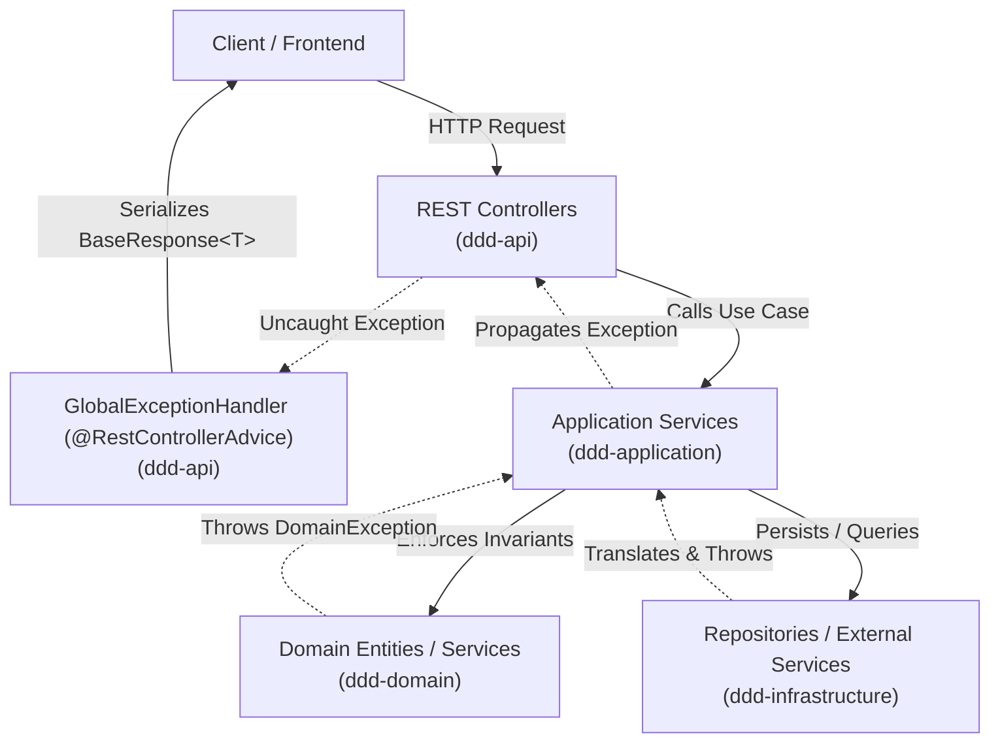

# Exception Handling Guidance

> **Scope:** Event Management Backend (DDD Architecture)  
> **Target Audience:** Backend Developers & Contributors  
> **Relevant Modules:** `ddd-domain`, `ddd-application`, `ddd-infrastructure`, `ddd-api`

---

## 1. Architectural Principles & DDD Separation

In a Domain-Driven Design (DDD) application, exception handling must respect layer boundaries and maintain clean separation of concerns.



### Layer Responsibilities

| Layer | Module | Exception Responsibilities | Permitted Dependencies | Forbidden Patterns |
| :--- | :--- | :--- | :--- | :--- |
| **Domain** | `ddd-domain` | Define pure business exceptions (`DomainException`, `BusinessException`, `ResourceNotFoundException`) representing violated invariants. | Pure Java SE (`RuntimeException`, `java.io.Serial`). | **NEVER** import `org.springframework.http.*` or use `@ResponseStatus`. |
| **Application** | `ddd-application` | Orchestrate use cases, validate input commands, trigger domain methods, and propagate domain or application exceptions. | `ddd-domain` exceptions. | Do **NOT** catch exceptions just to log and re-throw them. |
| **Infrastructure**| `ddd-infrastructure` | Catch low-level technical exceptions (SQL, Hibernate, Redis, Mail, S3, external payment gateways) and translate them into domain/system exceptions. | Spring Data, DB Drivers, third-party SDKs. | Do **NOT** leak raw SQL errors or vendor stack traces up to the API. |
| **Presentation** | `ddd-api` | Intercept all uncaught exceptions via `@RestControllerAdvice` (`GlobalExceptionHandler`), map to appropriate HTTP status codes, and serialize into `BaseResponse<T>`. | `ddd-domain`, `ddd-application`, Spring Web, Spring Security. | Do **NOT** let unhandled exceptions leak default Spring Boot white-label error pages. |

---

## 2. API Response Contract: `BaseResponse<T>`

All endpoints, both successful and erroneous, must return the standard JSON envelope defined in [`BaseResponse<T>`](file:///home/shrimp/code/ddd/ddd-api/src/main/java/com/ddd/api/common/BaseResponse.java):

```java
public record BaseResponse<T>(T data, String message, String exceptionCode) { ... }
```

### Error Response Schema

```json
{
  "data": null,
  "message": "Resource not found",
  "exceptionCode": "RESOURCE_NOT_FOUND"
}
```

For validation failures containing field-level details, the `data` field carries the errors map:

```json
{
  "data": {
    "email": "Email must be a valid email address",
    "password": "Password must be at least 8 characters"
  },
  "message": "Validation error",
  "exceptionCode": "000"
}
```

---

## 3. Error Code Catalog: `ErrorCodeEnum`

Error codes provide deterministic, machine-readable identifiers for client-side routing, internationalization (i18n), and analytics.

### Code Naming Conventions

Codes are managed in [`ErrorCodeEnum.java`](file:///home/shrimp/code/ddd/ddd-api/src/main/java/com/ddd/api/common/enums/ErrorCodeEnum.java) and implement the [`ErrorCode`](file:///home/shrimp/code/ddd/ddd-api/src/main/java/com/ddd/api/common/enums/ErrorCode.java) interface:

- **Common / System Errors (`000` - `099`)**:
  - `000` (`VALIDATION_ERROR`): 400 Bad Request
  - `001` (`UNAUTHORIZED_ERROR`): 401 Unauthorized
  - `002` (`ACCESS_DENIED_ERROR`): 403 Forbidden
  - `003` (`NOT_FOUND_ERROR`): 404 Not Found
  - `004` (`INTERNAL_SERVER_ERROR`): 500 Internal Server Error
  - `006` (`DUPLICATE_RESOURCE`): 409 Conflict
  - `007` (`RESOURCE_NOT_FOUND`): 404 Not Found
- **Domain Modules (`<MODULE>.<NUMBER>`)**:
  - `AUTH.001` to `AUTH.015`: Authentication, credentials, tokens.
  - `SEMESTER.001` to `SEMESTER.002`: Semester lifecycle errors.
  - `STUDENT.001` to `STUDENT.003`: Student profile management.
  - `EVENT.001` to `EVENT.099`: Event scheduling, registration, attendance.
  - `FANPAGE.001` to `FANPAGE.099`: Fanpage creation and moderation.

### Dynamic Message Formatting

Use `.withFormattedMessage(...)` when the error message requires contextual parameters:

```java
// Definition:
EVENT_NOT_FOUND("EVENT.001", HttpStatus.NOT_FOUND, "Event with ID %s was not found");

// Usage in Handler:
ErrorCode error = ErrorCodeEnum.EVENT_NOT_FOUND.withFormattedMessage(eventId);
```

---

## 4. End-to-End Walkthrough: Defining and Handling a New Exception

Here is the complete step-by-step workflow for creating a new business exception.

### Scenario
We want to prevent users from registering for an Event after its registration deadline has passed or when tickets are sold out.

---

### Step 1: Define the Domain Exception in `ddd-domain`

Create a clean, unchecked exception in `com.ddd.domain.exception`.

> [!IMPORTANT]
> Do NOT annotate this class with `@ResponseStatus` or import `org.springframework.http.HttpStatus`. The domain layer must remain pure Java.

File: [`ddd-domain/src/main/java/com/ddd/domain/exception/EventRegistrationException.java`](file:///home/shrimp/code/ddd/ddd-domain/src/main/java/com/ddd/domain/exception/EventRegistrationException.java)

```java
package com.ddd.domain.exception;

import java.io.Serial;

public class EventRegistrationException extends RuntimeException {
    @Serial
    private static final long serialVersionUID = 1L;

    public EventRegistrationException(String message) {
        super(message);
    }

    public EventRegistrationException(String message, Throwable cause) {
        super(message, cause);
    }
}
```

---

### Step 2: Register the Error Code in `ddd-api`

Add the error code enum entry with its associated HTTP status and human-readable default message.

File: [`ddd-api/src/main/java/com/ddd/api/common/enums/ErrorCodeEnum.java`](file:///home/shrimp/code/ddd/ddd-api/src/main/java/com/ddd/api/common/enums/ErrorCodeEnum.java)

```java
    // EVENT
    EVENT_NOT_FOUND("EVENT.001", HttpStatus.NOT_FOUND, "Event not found"),
    EVENT_REGISTRATION_CLOSED("EVENT.002", HttpStatus.BAD_REQUEST, "Event registration is closed: %s"),
    EVENT_CAPACITY_REACHED("EVENT.003", HttpStatus.CONFLICT, "Event capacity has been reached");
```

---

### Step 3: Throw the Exception from Domain Model or Application Service

Throw the exception when an invariant or business rule is violated.

File: [`ddd-application/src/main/java/com/ddd/application/service/event/impl/EventRegistrationServiceImpl.java`](file:///home/shrimp/code/ddd/ddd-application/src/main/java/com/ddd/application/service/event/impl/EventRegistrationServiceImpl.java)

```java
package com.ddd.application.service.event.impl;

import com.ddd.application.service.event.EventRegistrationService;
import com.ddd.domain.exception.EventRegistrationException;
import com.ddd.domain.exception.ResourceNotFoundException;
import com.ddd.domain.model.Event;
import com.ddd.domain.repository.EventRepository;
import lombok.RequiredArgsConstructor;
import lombok.extern.slf4j.Slf4j;
import org.springframework.stereotype.Service;
import org.springframework.transaction.annotation.Transactional;

import java.time.Instant;

@Service
@RequiredArgsConstructor
@Slf4j
public class EventRegistrationServiceImpl implements EventRegistrationService {

    private final EventRepository eventRepository;

    @Override
    @Transactional
    public void registerParticipant(Long eventId, Long userId) {
        Event event = eventRepository.findById(eventId)
                .orElseThrow(() -> new ResourceNotFoundException("Event not found with ID: " + eventId));

        // Domain rule verification
        if (event.getRegistrationDeadline().isBefore(Instant.now())) {
            throw new EventRegistrationException("Deadline passed on " + event.getRegistrationDeadline());
        }

        if (event.isCapacityFull()) {
            throw new EventRegistrationException("Event has reached maximum capacity");
        }

        event.addParticipant(userId);
        eventRepository.save(event);
        log.info("User {} registered successfully for event {}", userId, eventId);
    }
}
```

---

### Step 4: Map the Exception in `GlobalExceptionHandler` (`ddd-api`)

Map the exception to its corresponding HTTP status and `BaseResponse`.

File: [`ddd-api/src/main/java/com/ddd/api/exception/GlobalExceptionHandler.java`](file:///home/shrimp/code/ddd/ddd-api/src/main/java/com/ddd/api/exception/GlobalExceptionHandler.java)

```java
    @ExceptionHandler(EventRegistrationException.class)
    public ResponseEntity<Object> handleEventRegistrationException(
            EventRegistrationException exception, WebRequest webRequest) {
        log.warn("Event registration rejected [{}]: {}", webRequest.getDescription(false), exception.getMessage());
        return wrapWithResponse(
                ErrorCodeEnum.EVENT_REGISTRATION_CLOSED.getCode(),
                exception.getMessage() != null ? exception.getMessage() : ErrorCodeEnum.EVENT_REGISTRATION_CLOSED.getDefaultMessage(),
                ErrorCodeEnum.EVENT_REGISTRATION_CLOSED.getStatus()
        );
    }
```

---

### Step 5: Resulting Client Response

When a client attempts an invalid registration, they receive:

**HTTP Status:** `400 Bad Request`  
**Response Body:**
```json
{
  "data": null,
  "message": "Deadline passed on 2026-10-14T18:00:00Z",
  "exceptionCode": "EVENT.002"
}
```

---

## 5. Centralized `GlobalExceptionHandler` Standards

[`GlobalExceptionHandler.java`](file:///home/shrimp/code/ddd/ddd-api/src/main/java/com/ddd/api/exception/GlobalExceptionHandler.java) is annotated with `@RestControllerAdvice` and serves as the single source of truth for converting exceptions into REST responses.

### HTTP Status Code Mapping Matrix

| HTTP Status | Exception Types | ErrorCodeEnum | Log Level |
| :--- | :--- | :--- | :--- |
| **400 Bad Request** | `MethodArgumentNotValidException`<br/>`HandlerMethodValidationException`<br/>`IllegalArgumentException` | `VALIDATION_ERROR` | `log.warn` |
| **401 Unauthorized**| `UnauthorizedException`<br/>`AuthException`<br/>`BadCredentialsException` | `UNAUTHORIZED_ERROR`<br/>`AUTH_EXPIRED_REVOKED_TOKEN`<br/>`AUTH_INVALID_CREDENTIALS` | `log.warn` |
| **403 Forbidden** | `AccessDeniedException` | `ACCESS_DENIED_ERROR` | `log.warn` |
| **404 Not Found** | `ResourceNotFoundException`<br/>`NoResourceFoundException` | `RESOURCE_NOT_FOUND`<br/>`NOT_FOUND_ERROR` | `log.warn` |
| **409 Conflict** | `DuplicateResourceException`<br/>`ConcurrentModificationException` | `DUPLICATE_RESOURCE`<br/>`CONCURRENT_MODIFICATION` | `log.warn` |
| **422 Unprocessable**| `BusinessException` | Specific Domain Code or `VALIDATION_ERROR` | `log.warn` |
| **500 Internal Error**| `Exception.class` (Catch-all) | `INTERNAL_SERVER_ERROR` | `log.error` (with stack trace) |

### Logging Policy

- **4xx Errors (Client Fault)**:
  - Log with `log.warn("Description [{}]: {}", webRequest.getDescription(false), exception.getMessage())`.
  - **Do NOT** include full stack traces unless debugging a complex validation failure. This keeps log files clean and performant.
- **5xx Errors (Server Fault)**:
  - Log with `log.error("Unexpected error [{}]", webRequest.getDescription(false), exception)`.
  - **ALWAYS** include the `Throwable` to capture the complete stack trace for root-cause diagnosis.
  - Never return internal details or SQL exceptions to the client:
    ```java
    return wrapWithResponse(
        ErrorCodeEnum.INTERNAL_SERVER_ERROR.getCode(),
        ErrorCodeEnum.INTERNAL_SERVER_ERROR.getDefaultMessage(),
        HttpStatus.INTERNAL_SERVER_ERROR
    );
    ```

---

## 6. Spring Security Filter Chain Exception Interception

> [!WARNING]
> Exceptions occurring inside Spring Security filters (such as `JwtAuthenticationFilter` or URL authorization checks) occur **before** the request reaches the `DispatcherServlet`.  
> Consequently, `@RestControllerAdvice` **cannot** intercept them.

To ensure uniform `BaseResponse<T>` formatting during authentication and authorization failures in the filter chain, configure custom security entry points:

### `CustomAuthenticationEntryPoint` (401 Unauthorized)

```java
package com.ddd.infrastructure.config.security.handler;

import com.ddd.api.common.BaseResponse;
import com.ddd.api.common.enums.ErrorCodeEnum;
import com.fasterxml.jackson.databind.ObjectMapper;
import jakarta.servlet.http.HttpServletRequest;
import jakarta.servlet.http.HttpServletResponse;
import lombok.RequiredArgsConstructor;
import lombok.extern.slf4j.Slf4j;
import org.springframework.http.MediaType;
import org.springframework.security.core.AuthenticationException;
import org.springframework.security.web.AuthenticationEntryPoint;
import org.springframework.stereotype.Component;

import java.io.IOException;

@Component
@RequiredArgsConstructor
@Slf4j
public class CustomAuthenticationEntryPoint implements AuthenticationEntryPoint {

    private final ObjectMapper objectMapper;

    @Override
    public void commence(HttpServletRequest request,
                         HttpServletResponse response,
                         AuthenticationException authException) throws IOException {
        log.warn("Unauthorized filter access to URI: {}", request.getRequestURI());

        response.setStatus(HttpServletResponse.SC_UNAUTHORIZED);
        response.setContentType(MediaType.APPLICATION_JSON_VALUE);

        BaseResponse<Object> errorResponse = BaseResponse.error(
                ErrorCodeEnum.UNAUTHORIZED_ERROR.getCode(),
                ErrorCodeEnum.UNAUTHORIZED_ERROR.getDefaultMessage()
        );

        response.getWriter().write(objectMapper.writeValueAsString(errorResponse));
    }
}
```

### `CustomAccessDeniedHandler` (403 Forbidden)

```java
package com.ddd.infrastructure.config.security.handler;

import com.ddd.api.common.BaseResponse;
import com.ddd.api.common.enums.ErrorCodeEnum;
import com.fasterxml.jackson.databind.ObjectMapper;
import jakarta.servlet.http.HttpServletRequest;
import jakarta.servlet.http.HttpServletResponse;
import lombok.RequiredArgsConstructor;
import lombok.extern.slf4j.Slf4j;
import org.springframework.http.MediaType;
import org.springframework.security.access.AccessDeniedException;
import org.springframework.security.web.access.AccessDeniedHandler;
import org.springframework.stereotype.Component;

import java.io.IOException;

@Component
@RequiredArgsConstructor
@Slf4j
public class CustomAccessDeniedHandler implements AccessDeniedHandler {

    private final ObjectMapper objectMapper;

    @Override
    public void handle(HttpServletRequest request,
                       HttpServletResponse response,
                       AccessDeniedException accessDeniedException) throws IOException {
        log.warn("Access denied to URI: {}", request.getRequestURI());

        response.setStatus(HttpServletResponse.SC_FORBIDDEN);
        response.setContentType(MediaType.APPLICATION_JSON_VALUE);

        BaseResponse<Object> errorResponse = BaseResponse.error(
                ErrorCodeEnum.ACCESS_DENIED_ERROR.getCode(),
                ErrorCodeEnum.ACCESS_DENIED_ERROR.getDefaultMessage()
        );

        response.getWriter().write(objectMapper.writeValueAsString(errorResponse));
    }
}
```

Register both in your `SecurityFilterChain`:

```java
http.exceptionHandling(ex -> ex
    .authenticationEntryPoint(customAuthenticationEntryPoint)
    .accessDeniedHandler(customAccessDeniedHandler)
);
```

---

## 7. Developer Cheat Sheet & Best Practices

### Common Recipes

#### 1. Entity Query Not Found
```java
User user = userRepository.findById(userId)
        .orElseThrow(() -> new ResourceNotFoundException("User not found with id: " + userId));
```

#### 2. Duplicate Resource Guard
```java
if (fanpageRepository.existsByName(dto.name())) {
    throw new DuplicateResourceException("Fanpage name already exists: " + dto.name());
}
```

#### 3. Invariant / Business Rule Violation
```java
if (!fanpageMemberRepository.isAdminOfFanpage(fanpageId, adminUserId)) {
    throw new BusinessException("User is not authorized as an admin of fanpage: " + fanpageId);
}
```

---

### Anti-Patterns Checklist

| Anti-Pattern | Why It Breaks DDD / Clean Code | Correct Approach |
| :--- | :--- | :--- |
| **`@ResponseStatus` in `ddd-domain`** | Couples the domain layer to the presentation framework (Spring Web). | Keep domain exceptions pure Java. Map status codes in `GlobalExceptionHandler`. |
| **Returning `null` or boolean flag on error** | Caller can easily forget to check for null, leading to `NullPointerException`. | Throw a descriptive domain exception immediately. |
| **Swallowing Exceptions (`catch (Exception e) {}`)** | Hides critical system bugs and fails silently without audit or debugging trail. | If caught, either recover cleanly or wrap and re-throw. |
| **Logging and Re-throwing** | Causes duplicate stack traces across multiple log layers. | Log at the boundary (`GlobalExceptionHandler`) only. |
| **Leaking SQL / Hibernate errors to clients** | Exposes database table names, constraint details, and security vulnerabilities. | Intercept `DataIntegrityViolationException` and return sanitized messages. |
| **Checked Exceptions for Business Logic** | Forces verbose `throws` signatures across interfaces and breaks transactional rollback by default. | Extend `RuntimeException` for all domain and application exceptions. |
