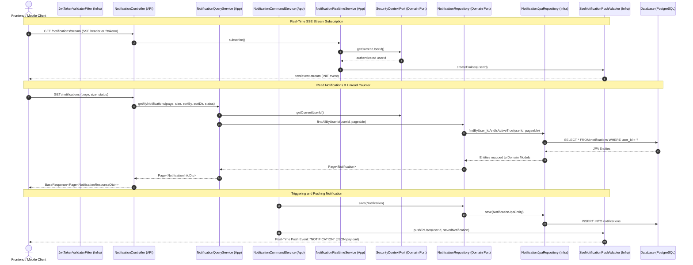
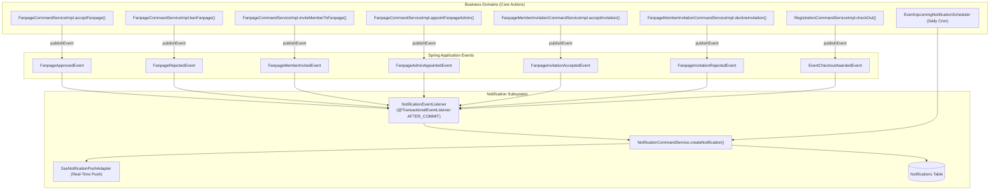

# Notification System: Implementation & Domain Trigger Guide

> **Document Status**: Active  
> **Branch**: `fea/notification-api`  
> **Architecture Standard**: Domain-Driven Design (DDD), CQRS Tier 1, Ports & Adapters, Event-Driven Decoupling  
> **Source of Truth Reference**: [`architecture_conventions.md`](file:///home/shrimp/code/ddd/architecture_conventions.md)

---

## 1. What Has Been Implemented (Notification API & Real-Time Engine)

The foundation of the Notification subsystem is implemented and verified across all modules in the `fea/notification-api` branch.

### 1.1 Architecture & Flow Diagram



---

### 1.2 Implemented Artifacts Matrix

| Module | Component | File Path | Description |
|:---|:---|:---|:---|
| **`ddd-domain`** | **Enum** | [`NotificationStatusEnum.java`](file:///home/shrimp/code/ddd-notification/ddd-domain/src/main/java/com/ddd/domain/enums/NotificationStatusEnum.java) | `UNREAD`, `READ`, `ARCHIVED`, `SENT`. |
| | **Model** | [`Notification.java`](file:///home/shrimp/code/ddd-notification/ddd-domain/src/main/java/com/ddd/domain/model/Notification.java) | Pure Java domain model extending `BaseModel`. Has `markAsRead()` and `isUnread()`. |
| | **Port** | [`NotificationPushPort.java`](file:///home/shrimp/code/ddd-notification/ddd-domain/src/main/java/com/ddd/domain/model/port/notification/NotificationPushPort.java) | Interface contract: `pushToUser(Long userId, Notification notification)`. |
| | **Repository** | [`NotificationRepository.java`](file:///home/shrimp/code/ddd-notification/ddd-domain/src/main/java/com/ddd/domain/repository/NotificationRepository.java) | Pure domain repository interface for CRUD, status toggling, and pagination. |
| **`ddd-infrastructure`**| **Entity** | [`NotificationJpaEntity.java`](file:///home/shrimp/code/ddd-notification/ddd-infrastructure/src/main/java/com/ddd/infrastructure/entity/NotificationJpaEntity.java) | Extends `BaseEntityJpa`. Indexed on `(user_id, status)` and `(user_id, created_at)`. |
| | **JPA Repo** | [`NotificationJpaRepository.java`](file:///home/shrimp/code/ddd-notification/ddd-infrastructure/src/main/java/com/ddd/infrastructure/repository/jpaRepository/NotificationJpaRepository.java) | Spring Data JPA with `@Modifying` queries for bulk read updates and soft delete. |
| | **Repo Impl** | [`NotificationRepositoryImpl.java`](file:///home/shrimp/code/ddd-notification/ddd-infrastructure/src/main/java/com/ddd/infrastructure/repository/NotificationRepositoryImpl.java) | Bridges domain contract to JPA. Uses `EntityManager.getReference` for zero-overhead user FK resolution. |
| | **Mapper** | [`NotificationMapper.java`](file:///home/shrimp/code/ddd-notification/ddd-infrastructure/src/main/java/com/ddd/infrastructure/mapper/NotificationMapper.java) | MapStruct: `NotificationJpaEntity` $\leftrightarrow$ `Notification`. Ignores audit fields on updates. |
| | **SSE Adapter** | [`SseNotificationPushAdapter.java`](file:///home/shrimp/code/ddd-notification/ddd-infrastructure/src/main/java/com/ddd/infrastructure/adapter/notification/SseNotificationPushAdapter.java) | Implements `NotificationPushPort`. Thread-safe multi-client emitter pool (`ConcurrentHashMap<Long, CopyOnWriteArrayList<SseEmitter>>`), automatic dead client cleanup, and heartbeat pings. |
| | **Security** | [`JwtUtil.java`](file:///home/shrimp/code/ddd-notification/ddd-infrastructure/src/main/java/com/ddd/infrastructure/utils/JwtUtil.java) | Added fallback query parameter support (`?token=`) in `extractToken` so standard browser `EventSource` connections authenticate seamlessly. |
| **`ddd-application`** | **DTOs** | [`NotificationInfoDto.java`](file:///home/shrimp/code/ddd-notification/ddd-application/src/main/java/com/ddd/application/dto/notification/NotificationInfoDto.java)<br>[`CreateNotificationDto.java`](file:///home/shrimp/code/ddd-notification/ddd-application/src/main/java/com/ddd/application/dto/notification/CreateNotificationDto.java) | Rich read model record and internal creation command record. |
| | **Mapper** | [`NotificationDtoMapper.java`](file:///home/shrimp/code/ddd-notification/ddd-application/src/main/java/com/ddd/application/mapper/NotificationDtoMapper.java) | MapStruct: `Notification` $\rightarrow$ `NotificationInfoDto`. |
| | **Command Service**| [`NotificationCommandService.java`](file:///home/shrimp/code/ddd-notification/ddd-application/src/main/java/com/ddd/application/service/notification/NotificationCommandService.java)<br>[`NotificationCommandServiceImpl.java`](file:///home/shrimp/code/ddd-notification/ddd-application/src/main/java/com/ddd/application/service/notification/impl/NotificationCommandServiceImpl.java) | `@Transactional`. Injects `SecurityContextPort` to securely verify ownership before mutations (`markAsRead`, `markAllAsRead`, `deleteNotification`). Dispatches real-time push. |
| | **Query Service** | [`NotificationQueryService.java`](file:///home/shrimp/code/ddd-notification/ddd-application/src/main/java/com/ddd/application/service/notification/NotificationQueryService.java)<br>[`NotificationQueryServiceImpl.java`](file:///home/shrimp/code/ddd-notification/ddd-application/src/main/java/com/ddd/application/service/notification/impl/NotificationQueryServiceImpl.java) | `@Transactional(readOnly = true)`. Injects `SecurityContextPort` and uses shared [`ServiceUtil.createPageable`](file:///home/shrimp/code/ddd-notification/ddd-application/src/main/java/com/ddd/application/utils/ServiceUtil.java). |
| | **Realtime Service**| [`NotificationRealtimeService.java`](file:///home/shrimp/code/ddd-notification/ddd-application/src/main/java/com/ddd/application/service/notification/NotificationRealtimeService.java)<br>[`NotificationRealtimeServiceImpl.java`](file:///home/shrimp/code/ddd-notification/ddd-application/src/main/java/com/ddd/application/service/notification/impl/NotificationRealtimeServiceImpl.java) | Subscribes authenticated clients to SSE streams. |
| **`ddd-api`** | **DTOs** | [`NotificationResponseDto.java`](file:///home/shrimp/code/ddd-notification/ddd-api/src/main/java/com/ddd/api/dto/notification/res/NotificationResponseDto.java)<br>[`UnreadCountResponseDto.java`](file:///home/shrimp/code/ddd-notification/ddd-api/src/main/java/com/ddd/api/dto/notification/res/UnreadCountResponseDto.java) | API output records. |
| | **Mapper** | [`NotificationApiMapper.java`](file:///home/shrimp/code/ddd-notification/ddd-api/src/main/java/com/ddd/api/mapper/NotificationApiMapper.java) | MapStruct: `NotificationInfoDto` $\rightarrow$ `NotificationResponseDto`. |
| | **Controller** | [`NotificationController.java`](file:///home/shrimp/code/ddd-notification/ddd-api/src/main/java/com/ddd/api/controller/NotificationController.java) | Exposes REST endpoints wrapped in `BaseResponse<T>` and the SSE streaming endpoint. |

---

### 1.3 Verified Test Suite (16/16 Unit Tests Passing)

1. **[`NotificationCommandServiceImplTest`](file:///home/shrimp/code/ddd-notification/ddd-application/src/test/java/com/ddd/application/service/notification/impl/NotificationCommandServiceImplTest.java)**:
   - `createNotification_success`: Verifies database persistence and SSE push delegation.
   - `markAsRead_success`: Verifies ownership check and single status update.
   - `markAsRead_whenNotOwner_shouldThrow`: Verifies security isolation (`ResourceNotFoundException`).
   - `markAsRead_whenUnauthenticated_shouldThrow`: Verifies `UnauthorizedException`.
   - `markAllAsRead_success`: Verifies bulk update for current user.
   - `deleteNotification_success`: Verifies soft delete ownership enforcement.
2. **[`NotificationQueryServiceImplTest`](file:///home/shrimp/code/ddd-notification/ddd-application/src/test/java/com/ddd/application/service/notification/impl/NotificationQueryServiceImplTest.java)**:
   - `getMyNotifications_withoutStatus`: Paginated list retrieval.
   - `getMyNotifications_withStatus`: Status-filtered list retrieval.
   - `getMyUnreadCount_success`: Aggregated unread count.
   - `getMyUnreadCount_unauthenticated`: Security verification.
3. **[`NotificationControllerTest`](file:///home/shrimp/code/ddd-notification/ddd-api/src/test/java/com/ddd/api/controller/NotificationControllerTest.java)**:
   - Verifies all REST routes, HTTP response wrapping with `BaseResponse<T>`, and `SseEmitter` streaming.

---

### 1.4 REST & SSE API Reference

| Method | Endpoint | Query / Path Params | Response Body | Description |
|:---|:---|:---|:---|:---|
| **GET** | `/notifications/stream` | `?token=<jwt>` (optional) | `text/event-stream` | Connects to real-time SSE stream. Emits `"INIT"` on open, `"ping"` heartbeats, and `"NOTIFICATION"` events. |
| **GET** | `/notifications` | `page` (default 0), `size` (default 10), `sortBy` (default "createdAt"), `sortDir` (default "desc"), `status` (optional: `UNREAD`, `READ`) | `BaseResponse<Page<NotificationResponseDto>>` | Retrieves paginated notifications for authenticated user. |
| **GET** | `/notifications/unread-count` | None | `BaseResponse<UnreadCountResponseDto>` | Returns `{ "unreadCount": 5 }`. |
| **PATCH**| `/notifications/{id}/read`| `id` (path) | `BaseResponse<Void>` | Marks notification as `READ`. |
| **PATCH**| `/notifications/read-all` | None | `BaseResponse<Void>` | Marks all unread notifications for current user as `READ`. |
| **DELETE**| `/notifications/{id}` | `id` (path) | `BaseResponse<Void>` | Soft deletes notification (`isActive = false`). |

#### Frontend Connection Example (JavaScript)
```javascript
// Native EventSource automatically supports reconnection and receives real-time notifications
const eventSource = new EventSource('/notifications/stream');

eventSource.addEventListener('INIT', (e) => {
    console.log('SSE Stream established:', e.data);
});

eventSource.addEventListener('NOTIFICATION', (e) => {
    const notification = JSON.parse(e.data);
    console.log('New notification arrived:', notification.type, notification.message);
    // Display in-app toast, increment unread badge, etc.
});

eventSource.onerror = (err) => {
    console.error('SSE connection error:', err);
};
```

---

## 2. Step-by-Step Implementation Guide for Domain Triggers

This section outlines how to wire notifications into business flows cleanly using **Domain Events** so caller services never depend directly on the notification service.



---

### Step 1: Define Domain Events (`ddd-domain`)

Create the event records in package `com.ddd.domain.event`:

#### 1.1 Fanpage Registration Events
```java
package com.ddd.domain.event;

public record FanpageApprovedEvent(Long fanpageId, String fanpageName, Long adminUserId) {}
public record FanpageRejectedEvent(Long fanpageId, String fanpageName, Long adminUserId) {}
```

#### 1.2 Fanpage Membership & Appointment Events
```java
package com.ddd.domain.event;

public record FanpageMemberInvitedEvent(Long fanpageId, String fanpageName, Long invitedUserId, String inviterName) {}
public record FanpageInvitationAcceptedEvent(Long fanpageId, String fanpageName, Long adminUserId, String memberName) {}
public record FanpageInvitationRejectedEvent(Long fanpageId, String fanpageName, Long adminUserId, String memberName) {}
public record FanpageAdminAppointedEvent(Long fanpageId, String fanpageName, Long appointedUserId) {}
```

#### 1.3 Event Checkout & Award Event
```java
package com.ddd.domain.event;

import java.util.List;

public record EventCheckoutAwardedEvent(Long eventId, String eventName, List<Long> userIds) {}
```

---

### Step 2: Create the Event Listener (`ddd-application`)

File: `com.ddd.application.listener.NotificationEventListener`

```java
package com.ddd.application.listener;

import com.ddd.application.dto.notification.CreateNotificationDto;
import com.ddd.application.service.notification.NotificationCommandService;
import com.ddd.domain.event.*;
import lombok.RequiredArgsConstructor;
import lombok.extern.slf4j.Slf4j;
import org.springframework.stereotype.Component;
import org.springframework.transaction.event.TransactionPhase;
import org.springframework.transaction.event.TransactionalEventListener;

@Component
@RequiredArgsConstructor
@Slf4j
public class NotificationEventListener {

    private final NotificationCommandService notificationCommandService;

    // 1. Fanpage Registration: Approved
    @TransactionalEventListener(phase = TransactionPhase.AFTER_COMMIT)
    public void onFanpageApproved(FanpageApprovedEvent event) {
        notificationCommandService.createNotification(new CreateNotificationDto(
                event.adminUserId(),
                "Fanpage Approved",
                "Your fanpage \"" + event.fanpageName() + "\" has been approved by the university admin!",
                null,
                "/fanpages/" + event.fanpageId()
        ));
    }

    // 1. Fanpage Registration: Rejected / Banned
    @TransactionalEventListener(phase = TransactionPhase.AFTER_COMMIT)
    public void onFanpageRejected(FanpageRejectedEvent event) {
        notificationCommandService.createNotification(new CreateNotificationDto(
                event.adminUserId(),
                "Fanpage Status Update",
                "Your fanpage \"" + event.fanpageName() + "\" was rejected or suspended.",
                null,
                "/fanpages/" + event.fanpageId()
        ));
    }

    // 2. Member Invited
    @TransactionalEventListener(phase = TransactionPhase.AFTER_COMMIT)
    public void onMemberInvited(FanpageMemberInvitedEvent event) {
        notificationCommandService.createNotification(new CreateNotificationDto(
                event.invitedUserId(),
                "Club Invitation",
                event.inviterName() + " invited you to join \"" + event.fanpageName() + "\".",
                null,
                "/invitations"
        ));
    }

    // 2. Member Accepted Invitation -> Notify Fanpage Admin
    @TransactionalEventListener(phase = TransactionPhase.AFTER_COMMIT)
    public void onInvitationAccepted(FanpageInvitationAcceptedEvent event) {
        notificationCommandService.createNotification(new CreateNotificationDto(
                event.adminUserId(),
                "New Club Member",
                event.memberName() + " accepted the invitation to join \"" + event.fanpageName() + "\".",
                null,
                "/fanpages/" + event.fanpageId() + "/members"
        ));
    }

    // 2. Member Declined Invitation -> Notify Fanpage Admin
    @TransactionalEventListener(phase = TransactionPhase.AFTER_COMMIT)
    public void onInvitationRejected(FanpageInvitationRejectedEvent event) {
        notificationCommandService.createNotification(new CreateNotificationDto(
                event.adminUserId(),
                "Invitation Declined",
                event.memberName() + " declined the invitation to join \"" + event.fanpageName() + "\".",
                null,
                "/fanpages/" + event.fanpageId() + "/members"
        ));
    }

    // 2. Fanpage Admin Appointment
    @TransactionalEventListener(phase = TransactionPhase.AFTER_COMMIT)
    public void onAdminAppointed(FanpageAdminAppointedEvent event) {
        notificationCommandService.createNotification(new CreateNotificationDto(
                event.appointedUserId(),
                "Role Promoted",
                "You have been appointed as Admin of \"" + event.fanpageName() + "\".",
                null,
                "/fanpages/" + event.fanpageId()
        ));
    }

    // 3. Checkout Completed & Awarded
    @TransactionalEventListener(phase = TransactionPhase.AFTER_COMMIT)
    public void onCheckoutAwarded(EventCheckoutAwardedEvent event) {
        for (Long userId : event.userIds()) {
            notificationCommandService.createNotification(new CreateNotificationDto(
                    userId,
                    "Event Completed & Points Awarded",
                    "Congratulations! You completed attendance for \"" + event.eventName() + "\" and your criteria points have been awarded.",
                    null,
                    "/events/" + event.eventId()
            ));
        }
    }
}
```

---

### Step 3: Publish Events from Core Services

Inject `ApplicationEventPublisher` into existing services:

#### 3.1 Fanpage Moderation & Member Actions
In [`FanpageCommandServiceImpl.java`](file:///home/shrimp/code/ddd-notification/ddd-application/src/main/java/com/ddd/application/service/fanpage/impl/FanpageCommandServiceImpl.java):
```java
// Inside acceptFanpage(Long fanpageId)
eventPublisher.publishEvent(new FanpageApprovedEvent(fanpageId, fanpage.getName(), fanpage.getCreatedBy()));

// Inside banFanpage(Long fanpageId)
eventPublisher.publishEvent(new FanpageRejectedEvent(fanpageId, fanpage.getName(), fanpage.getCreatedBy()));

// Inside inviteMemberToFanpage(Long fanpageId, String memberEmail)
eventPublisher.publishEvent(new FanpageMemberInvitedEvent(fanpageId, fanpage.getName(), member.getId(), inviterName));

// Inside appointFanpageAdmin(Long fanpageId, String memberEmail)
eventPublisher.publishEvent(new FanpageAdminAppointedEvent(fanpageId, fanpage.getName(), member.getId()));
```

#### 3.2 Member Invitation Decisions
In [`FanpageMemberInvitationCommandServiceImpl.java`](file:///home/shrimp/code/ddd-notification/ddd-application/src/main/java/com/ddd/application/service/fanpage/impl/FanpageMemberInvitationCommandServiceImpl.java):
```java
// Inside acceptInvitation(Long invitationId, String userEmail)
User member = userRepository.findById(userId).orElseThrow();
Long adminId = fanpageMemberRepository.findAdminIdByFanpageId(invitation.getFanpageId());
eventPublisher.publishEvent(new FanpageInvitationAcceptedEvent(invitation.getFanpageId(), fanpage.getName(), adminId, member.getFullName()));

// Inside declineInvitation(Long invitationId, String userEmail)
Long adminId = fanpageMemberRepository.findAdminIdByFanpageId(invitation.getFanpageId());
eventPublisher.publishEvent(new FanpageInvitationRejectedEvent(invitation.getFanpageId(), fanpage.getName(), adminId, user.getFullName()));
```

#### 3.3 Event Checkout Points Award
In [`RegistrationCommandServiceImpl.java`](file:///home/shrimp/code/ddd-notification/ddd-application/src/main/java/com/ddd/application/service/registration/impl/RegistrationCommandServiceImpl.java):
```java
// Inside checkOut(Long eventId, String proofUrl)
eventPublisher.publishEvent(new EventCheckoutAwardedEvent(eventId, event.getName(), List.of(userId)));

// Inside fanpageMemberCheckOut(Long eventId, List<Long> studentUserIds)
eventPublisher.publishEvent(new EventCheckoutAwardedEvent(eventId, event.getName(), distinctStudentUserIds));
```

---

### Step 4: Scheduled Upcoming Event Notifications (Happening Today)

#### 4.1 Infrastructure Query in `EventJpaRepository`
File: [`EventJpaRepository.java`](file:///home/shrimp/code/ddd-notification/ddd-infrastructure/src/main/java/com/ddd/infrastructure/repository/jpaRepository/EventJpaRepository.java)
```java
@Query("SELECT e FROM EventJpaEntity e WHERE e.status = :status AND e.isActive = true AND e.dateHappen BETWEEN :startOfDay AND :endOfDay")
List<EventJpaEntity> findEventsHappeningBetween(
        @Param("status") EventStatusEnum status,
        @Param("startOfDay") Instant startOfDay,
        @Param("endOfDay") Instant endOfDay
);
```

#### 4.2 Application Scheduler
File: `com.ddd.application.scheduler.EventUpcomingNotificationScheduler`
```java
package com.ddd.application.scheduler;

import com.ddd.application.dto.notification.CreateNotificationDto;
import com.ddd.application.service.notification.NotificationCommandService;
import com.ddd.domain.enums.EventStatusEnum;
import com.ddd.domain.enums.RegistrationStatusEnum;
import com.ddd.domain.model.Registration;
import com.ddd.domain.repository.RegistrationRepository;
import com.ddd.infrastructure.entity.EventJpaEntity;
import com.ddd.infrastructure.repository.jpaRepository.EventJpaRepository;
import lombok.RequiredArgsConstructor;
import lombok.extern.slf4j.Slf4j;
import org.springframework.scheduling.annotation.Scheduled;
import org.springframework.stereotype.Component;

import java.time.Instant;
import java.time.LocalDate;
import java.time.ZoneId;
import java.util.List;

@Component
@RequiredArgsConstructor
@Slf4j
public class EventUpcomingNotificationScheduler {

    private final EventJpaRepository eventJpaRepository;
    private final RegistrationRepository registrationRepository;
    private final NotificationCommandService notificationCommandService;

    // Runs every day at 07:00 AM
    @Scheduled(cron = "0 0 7 * * *")
    public void notifyUpcomingEventsToday() {
        ZoneId zone = ZoneId.systemDefault();
        Instant startOfDay = LocalDate.now(zone).atStartOfDay(zone).toInstant();
        Instant endOfDay = LocalDate.now(zone).plusDays(1).atStartOfDay(zone).minusNanos(1).toInstant();

        List<EventJpaEntity> todayEvents = eventJpaRepository.findEventsHappeningBetween(
                EventStatusEnum.PUBLISHED, startOfDay, endOfDay
        );

        log.info("Found {} events happening today", todayEvents.size());

        for (EventJpaEntity event : todayEvents) {
            List<Registration> registrations = registrationRepository.findAllByEventId(event.getId());

            for (Registration reg : registrations) {
                if (reg.getStatus() == RegistrationStatusEnum.REGISTERED) {
                    notificationCommandService.createNotification(new CreateNotificationDto(
                            reg.getUserId(),
                            "Reminder: Event Happening Today!",
                            "The event \"" + event.getName() + "\" you registered for is happening today. Be prepared!",
                            event.getBannerUrl(),
                            "/events/" + event.getId()
                    ));
                }
            }
        }
    }
}
```

---

### Step 5: Verification & Testing Strategy

1. **Unit Tests for `NotificationEventListener`**:
   - Mock `NotificationCommandService`.
   - Dispatch each event (`FanpageApprovedEvent`, `FanpageMemberInvitedEvent`, etc.).
   - Assert `createNotification` is invoked with expected user ID, message, and target URL.
2. **Unit Tests for Scheduler**:
   - Mock `EventJpaRepository` to return sample events for today.
   - Verify registered students receive upcoming event notifications.
3. **Integration Verification via SSE**:
   - Connect frontend or curl/Postman to `GET /notifications/stream`.
   - Trigger checkout or fanpage approval.
   - Verify the SSE client instantly receives the JSON event without polling.
