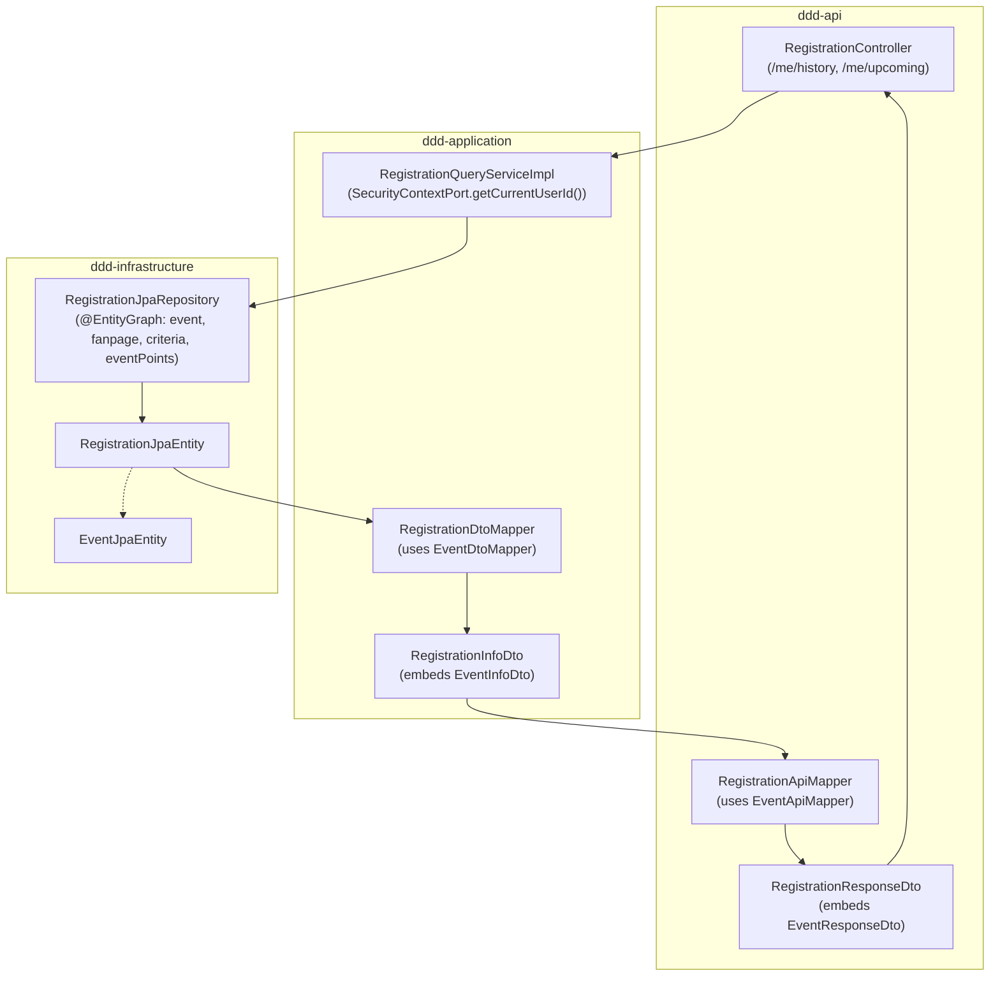

# Refactoring Registration DTO: Embedded EventInfoDto & Query Optimization Guide

This guide details the architectural decisions, design trade-offs, and step-by-step implementation plan for transitioning from the legacy flat `RegistrationDto` to an embedded `RegistrationInfoDto` containing `EventInfoDto`.

---

## 1. Motivation & Architectural Objectives

### 1.1 The Legacy Problem
In the original flat `RegistrationDto`:
1. **Property Collision (`status`)**: Both `Registration` and `Event` possess a `status` field. In the flat DTO, registration status (`REGISTERED`, `CHECKED_IN`, etc.) masked the event status (`PUBLISHED`, `CLOSED`), preventing users from knowing whether an event is still open or has ended.
2. **Mapper Duplication**: Flattening forced `RegistrationDtoMapper` to duplicate 15+ `@Mapping` annotations already handled by `EventDtoMapper`.
3. **Ambiguous Evidence URL**: A single `evidenceUrl` field conflated check-in proof with check-out proof.
4. **N+1 Query Inefficiencies**: When loading user registration history or upcoming events, accessing event, fanpage, criteria, and event points without an EntityGraph triggered up to 4 additional queries per registration row.
5. **Anti-Pattern Compliance**: `RegistrationQueryService.getHistory(email)` and `getUpcoming(email)` took `String email` from the controller instead of obtaining `userId` from `SecurityContextPort` as mandated by Section 7 of [`architecture_conventions.md`](file:///home/shrimp/code/ddd/architecture_conventions.md).

### 1.2 Target Architecture



---

## 2. DTO Design Specifications

### 2.1 Application Layer DTO (`RegistrationInfoDto`)
**File**: `ddd-application/src/main/java/com/ddd/application/dto/registration/RegistrationInfoDto.java`

```java
package com.ddd.application.dto.registration;

import com.ddd.application.dto.event.EventInfoDto;
import java.time.Instant;

public record RegistrationInfoDto(
        Instant regDate,
        String status,
        String reason,
        Instant checkInAt,
        Instant checkOutAt,
        String checkInEvidenceUrl,
        String checkOutEvidenceUrl,
        EventInfoDto event
) {
}
```

### 2.2 API Layer DTO (`RegistrationResponseDto`)
**File**: `ddd-api/src/main/java/com/ddd/api/dto/registration/res/RegistrationResponseDto.java`

```java
package com.ddd.api.dto.registration.res;

import com.ddd.api.dto.event.res.EventResponseDto;
import com.ddd.domain.enums.RegistrationStatusEnum;
import java.time.Instant;

public record RegistrationResponseDto(
        Instant regDate,
        RegistrationStatusEnum status,
        String reason,
        Instant checkInAt,
        Instant checkOutAt,
        String checkInEvidenceUrl,
        String checkOutEvidenceUrl,
        EventResponseDto event
) {
}
```

---

## 3. Step-by-Step Implementation Plan

### Step 1: Create `RegistrationInfoDto`
- **Location**: `ddd-application/src/main/java/com/ddd/application/dto/registration/RegistrationInfoDto.java`
- **Details**: Declare record with registration-specific audit fields (`regDate`, `status`, `reason`, `checkInAt`, `checkOutAt`, `checkInEvidenceUrl`, `checkOutEvidenceUrl`) and the embedded `EventInfoDto event`.

---

### Step 2: Configure `RegistrationDtoMapper`
- **Location**: `ddd-application/src/main/java/com/ddd/application/mapper/RegistrationDtoMapper.java`
- **Details**:
  - Add `uses = {EventDtoMapper.class}` to `@Mapper`.
  - Add method:
    ```java
    @Mapping(target = "event", source = "event")
    RegistrationInfoDto toInfoDto(RegistrationJpaEntity entity);
    ```
  - MapStruct will automatically delegate the `event` mapping to `EventDtoMapper.toEventInfoDto(EventJpaEntity)`.

---

### Step 3: Optimize JPA Queries in `RegistrationJpaRepository`
- **Location**: `ddd-infrastructure/src/main/java/com/ddd/infrastructure/repository/jpaRepository/RegistrationJpaRepository.java`
- **Details**:
  Add `@EntityGraph` to fetch the complete event aggregate in one database roundtrip:
  ```java
  @EntityGraph(attributePaths = {
          "event",
          "event.eventType",
          "event.criteria",
          "event.fanpage",
          "event.semester",
          "event.eventPoints"
  })
  Page<RegistrationJpaEntity> findAllByUserId(Long userId, Pageable pageable);

  @EntityGraph(attributePaths = {
          "event",
          "event.eventType",
          "event.criteria",
          "event.fanpage",
          "event.semester",
          "event.eventPoints"
  })
  @Query("SELECT r FROM RegistrationJpaEntity r " +
         "WHERE r.user.id = :userId " +
         "AND r.status = com.ddd.domain.enums.RegistrationStatusEnum.REGISTERED " +
         "AND r.event.dateHappen > CURRENT_TIMESTAMP")
  List<RegistrationJpaEntity> findUpcomingRegisteredEvents(@Param("userId") Long userId);
  ```

---

### Step 4: Update `RegistrationQueryService` & Implementation
- **Location**:
  - `ddd-application/src/main/java/com/ddd/application/service/registration/RegistrationQueryService.java`
  - `ddd-application/src/main/java/com/ddd/application/service/registration/impl/RegistrationQueryServiceImpl.java`
- **Details**:
  - Refactor method signatures to eliminate dead `email` parameters per Section 7 of `architecture_conventions.md`:
    ```java
    Page<RegistrationInfoDto> getHistory(int page, int size);
    List<RegistrationInfoDto> getUpcoming();
    ```
  - In `RegistrationQueryServiceImpl`, inject `SecurityContextPort` and fetch user registrations using `securityContextPort.getCurrentUserId()`.
  - Map results using `registrationDtoMapper::toInfoDto`.

---

### Step 5: Update `RegistrationResponseDto` & `RegistrationApiMapper`
- **Location**:
  - `ddd-api/src/main/java/com/ddd/api/dto/registration/res/RegistrationResponseDto.java`
  - `ddd-api/src/main/java/com/ddd/api/mapper/RegistrationApiMapper.java`
- **Details**:
  - Embed `EventResponseDto event` inside `RegistrationResponseDto`.
  - Add `uses = {EventApiMapper.class}` to `RegistrationApiMapper`.
  - Update mapping signature:
    ```java
    RegistrationResponseDto toResponseDto(RegistrationInfoDto registrationInfoDto);
    ```

---

### Step 6: Update `RegistrationController`
- **Location**: `ddd-api/src/main/java/com/ddd/api/controller/RegistrationController.java`
- **Details**:
  - Update `getHistory` and `getUpcoming` endpoints to delegate directly to `registrationQueryService.getHistory(page, size)` and `registrationQueryService.getUpcoming()` without extracting `Authentication authentication`.

---

### Step 7: Deprecate or Remove Legacy `RegistrationDto`
- **Location**: `ddd-application/src/main/java/com/ddd/application/dto/registration/RegistrationDto.java`
- **Details**: Once all callers are migrated to `RegistrationInfoDto`, remove `RegistrationDto` (requesting explicit user permission before deletion per IDE constraints).

---

## 4. Verification & Testing Checklist

1. **Compilation**: Run `mvn clean compile` across all 6 modules.
2. **Query Performance Verification**: Verify with Hibernate SQL logging that calling `getHistory` or `getUpcoming` executes exactly **1 query** with `LEFT JOIN` on events, fanpages, criteria, and semesters, avoiding N+1 queries.
3. **API Contract Verification**:
   - `GET /registrations/me/history` returns the registration timeline with embedded `event` object.
   - `registration.status()` correctly reflects registration progress (`REGISTERED`, `CHECKED_IN`, `COMPLETED`).
   - `registration.event().status()` correctly reflects event lifecycle (`PUBLISHED`, `CLOSED`).
