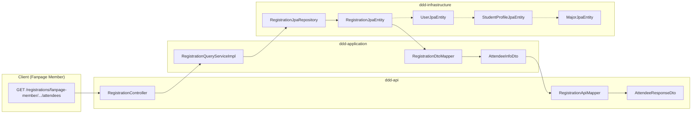
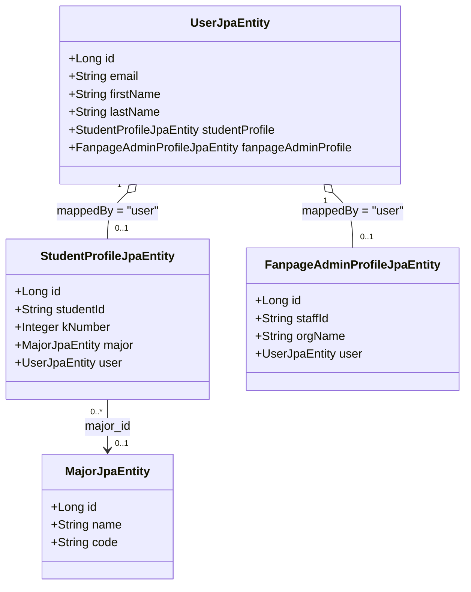

# Retrieving Attendee Student Profile Information: Architecture & Implementation Guide

This guide details the architectural rationale and step-by-step implementation for retrieving student profile information (`studentId`, `kNumber`, `majorName`) alongside attendee registration records in `getAttendeesOfEvent`.

---

## 1. Architectural Overview & Context

In an event registration management system, event organizers and fanpage members managing an event need to see attendee identity details when checking the attendee list.



### Module Responsibilities:
- **`ddd-infrastructure`**: Manages JPA persistence entities, foreign key relationships, and database query optimization via `@EntityGraph`.
- **`ddd-application`**: Houses read-only query service (`RegistrationQueryServiceImpl`) and application DTOs (`AttendeeInfoDto`). Keeps query flows clean and free from unnecessary manual stitching.
- **`ddd-api`**: Exposes REST endpoints, validates inputs, and maps application DTOs into API response records (`AttendeeResponseDto`).

---

## 2. Current State & Problem Analysis

1. **Commented-Out Fields in DTOs**:
   Both [`AttendeeInfoDto.java`](file:///home/shrimp/code/ddd/ddd-application/src/main/java/com/ddd/application/dto/fanpage/AttendeeInfoDto.java#L14-L16) and [`AttendeeResponseDto.java`](file:///home/shrimp/code/ddd/ddd-api/src/main/java/com/ddd/api/dto/registration/res/AttendeeResponseDto.java#L14-L16) have student profile attributes commented out:
   ```java
   // String studentId,
   // int KNumber,
   // String majorName
   ```
2. **One-Way Foreign Key in Database/JPA**:
   [`StudentProfileJpaEntity`](file:///home/shrimp/code/ddd/ddd-infrastructure/src/main/java/com/ddd/infrastructure/entity/StudentProfileJpaEntity.java#L33-L37) and [`FanpageAdminProfileJpaEntity`](file:///home/shrimp/code/ddd/ddd-infrastructure/src/main/java/com/ddd/infrastructure/entity/FanpageAdminProfileJpaEntity.java#L43-L47) each declare a `@OneToOne` with `@JoinColumn(name = "user_id")` pointing to [`UserJpaEntity`](file:///home/shrimp/code/ddd/ddd-infrastructure/src/main/java/com/ddd/infrastructure/entity/UserJpaEntity.java).
   However, `UserJpaEntity` does not declare inverse `@OneToOne(mappedBy = "user")` associations.
3. **Registration Navigation**:
   [`RegistrationJpaEntity`](file:///home/shrimp/code/ddd/ddd-infrastructure/src/main/java/com/ddd/infrastructure/entity/RegistrationJpaEntity.java#L28-L30) references `UserJpaEntity` (`@ManyToOne private UserJpaEntity user;`). Without the inverse association on `UserJpaEntity`, MapStruct cannot traverse `registration.getUser().getStudentProfile()`.

---

## 3. Why Declarative JPA & `@EntityGraph` (Approach 1) Is Optimal

### 3.1 Handling Multi-Profile Users (Student, Fanpage Admin, Both, or Neither)
In this system, a `User` can have:
- Only a `StudentProfile` (standard student attendee)
- Only a `FanpageAdminProfile` (staff/manager)
- **Both** `StudentProfile` AND `FanpageAdminProfile` (a student who also administers a fanpage club)
- Neither (newly registered OAuth user whose profile is not yet completed)



Because `student_profiles` and `fanpage_admin_profiles` are separate tables with independent foreign keys, declaring both `@OneToOne(mappedBy = "user")` on `UserJpaEntity` is completely decoupled:

| User Profile Composition | `user.getStudentProfile()` | `user.getFanpageAdminProfile()` | Behavior in `getAttendeesOfEvent` |
|---|---|---|---|
| **Student only** | Populated | `null` | `studentId`, `kNumber`, `majorName` populated |
| **Both (Student + Admin)** | Populated | Populated | `studentId`, `kNumber`, `majorName` populated |
| **Fanpage Admin only** | `null` | Populated | Profile attributes safely default to `null` |
| **No profile** | `null` | `null` | Profile attributes safely default to `null` |

### 3.2 Single SQL Query via `LEFT OUTER JOIN` (Zero N+1)
Using `@EntityGraph(attributePaths = {"user", "user.studentProfile", "user.studentProfile.major"})`:
- Spring Data JPA generates a single SQL query with `LEFT OUTER JOIN users`, `LEFT OUTER JOIN student_profiles`, and `LEFT OUTER JOIN majors`.
- If an attendee does not have a student profile, the `LEFT OUTER JOIN` leaves those columns as `NULL`, and the attendee is **not dropped** from pagination results.
- Zero extra queries are executed per attendee row.

### 3.3 Automatic Null-Safe Mapping with MapStruct
MapStruct automatically evaluates null chains for nested paths:
```java
// Generated by MapStruct in RegistrationDtoMapperImpl
if ( entity != null && entity.getUser() != null && entity.getUser().getStudentProfile() != null ) {
    attendeeInfoDto.setStudentId( entity.getUser().getStudentProfile().getStudentId() );
    attendeeInfoDto.setKNumber( entity.getUser().getStudentProfile().getKNumber() );
    if ( entity.getUser().getStudentProfile().getMajor() != null ) {
        attendeeInfoDto.setMajorName( entity.getUser().getStudentProfile().getMajor().getName() );
    }
}
```
No manual null checks or boilerplate `Optional` wrapping required in application services.

---

## 4. Step-by-Step Implementation Guide

### Step 1: Add Inverse `@OneToOne` Associations on `UserJpaEntity`
**File**: `ddd-infrastructure/src/main/java/com/ddd/infrastructure/entity/UserJpaEntity.java`

Add the inverse one-to-one fields for both profiles:
```java
    @OneToOne(mappedBy = "user", fetch = FetchType.LAZY)
    private StudentProfileJpaEntity studentProfile;

    @OneToOne(mappedBy = "user", fetch = FetchType.LAZY)
    private FanpageAdminProfileJpaEntity fanpageAdminProfile;
```

> [!NOTE]
> Adding `fanpageAdminProfile` alongside `studentProfile` ensures architectural symmetry and allows future queries to traverse the admin profile if needed.

---

### Step 2: Configure `@EntityGraph` on `RegistrationJpaRepository`
**File**: `ddd-infrastructure/src/main/java/com/ddd/infrastructure/repository/jpaRepository/RegistrationJpaRepository.java`

Update the `findAllByEventId` method to fetch `user`, `user.studentProfile`, and `user.studentProfile.major`:

```java
    @EntityGraph(attributePaths = {
            "user",
            "user.studentProfile",
            "user.studentProfile.major"
    })
    Page<RegistrationJpaEntity> findAllByEventId(Long eventId, Pageable pageable);
```

---

### Step 3: Enable Student Profile Fields in `AttendeeInfoDto`
**File**: `ddd-application/src/main/java/com/ddd/application/dto/fanpage/AttendeeInfoDto.java`

Uncomment and update the record components. Use `Integer kNumber` (wrapper object) instead of primitive `int` to allow null values for non-student attendees:

```java
package com.ddd.application.dto.fanpage;

import java.time.Instant;

public record AttendeeInfoDto(
        Long userId,
        String status,
        Instant regDate,
        String email,
        String firstName,
        String lastName,
        String gender,
        String avatarUrl,
        String studentId,
        Integer kNumber,
        String majorName
) {
}
```

---

### Step 4: Configure MapStruct in `RegistrationDtoMapper`
**File**: `ddd-application/src/main/java/com/ddd/application/mapper/RegistrationDtoMapper.java`

Add explicit `@Mapping` annotations for the nested student profile attributes:

```java
    @Mapping(target = "userId", source = "user.id")
    @Mapping(target = "firstName", source = "user.firstName")
    @Mapping(target = "lastName", source = "user.lastName")
    @Mapping(target = "email", source = "user.email")
    @Mapping(target = "gender", source = "user.gender")
    @Mapping(target = "avatarUrl", source = "user.avatarUrl")
    @Mapping(target = "studentId", source = "user.studentProfile.studentId")
    @Mapping(target = "kNumber", source = "user.studentProfile.KNumber")
    @Mapping(target = "majorName", source = "user.studentProfile.major.name")
    AttendeeInfoDto toAttendeeInfoDto(RegistrationJpaEntity entity);
```

> [!IMPORTANT]
> In [`StudentProfileJpaEntity.java`](file:///home/shrimp/code/ddd/ddd-infrastructure/src/main/java/com/ddd/infrastructure/entity/StudentProfileJpaEntity.java#L25-L26), the getter is named `getKNumber()` (capital 'K'). MapStruct accommodates this when specifying `source = "user.studentProfile.KNumber"`.

---

### Step 5: Enable Student Profile Fields in `AttendeeResponseDto`
**File**: `ddd-api/src/main/java/com/ddd/api/dto/registration/res/AttendeeResponseDto.java`

Uncomment and match the record components with `Integer kNumber`:

```java
package com.ddd.api.dto.registration.res;

import java.time.Instant;

public record AttendeeResponseDto(
        Long userId,
        String status,
        Instant regDate,
        String email,
        String firstName,
        String lastName,
        String gender,
        String avatarUrl,
        String studentId,
        Integer kNumber,
        String majorName
) {
}
```

---

### Step 6: Verify `RegistrationApiMapper`
**File**: `ddd-api/src/main/java/com/ddd/api/mapper/RegistrationApiMapper.java`

Confirm the method signature:
```java
AttendeeResponseDto toAttendeeResponseDto(AttendeeInfoDto attendeeInfoDto);
```
Since record component names and types match identically (`studentId`, `kNumber`, `majorName`), MapStruct maps them automatically without extra configuration.

---

### Step 7: Clean Up Legacy Dead Parameter in Query Service
**Files**:
- `ddd-application/src/main/java/com/ddd/application/service/registration/RegistrationQueryService.java`
- `ddd-application/src/main/java/com/ddd/application/service/registration/impl/RegistrationQueryServiceImpl.java`
- `ddd-api/src/main/java/com/ddd/api/controller/RegistrationController.java`

Per Section 7 of [`architecture_conventions.md`](file:///home/shrimp/code/ddd/architecture_conventions.md), application services must rely on `SecurityContextPort` rather than accepting authenticated user credentials (`fanpageMemberEmail`) from the controller:

```java
// RegistrationQueryService interface:
Page<AttendeeInfoDto> getAttendeesOfEvent(Long fanpageId, Long eventId,
                                          int page, int size, String sortBy, String sortDir);

// RegistrationQueryServiceImpl:
@Override
public Page<AttendeeInfoDto> getAttendeesOfEvent(Long fanpageId, Long eventId,
                                                 int page, int size, String sortBy, String sortDir) {
    verifyFanpageMember(fanpageId, eventId);
    ...
}
```

In `RegistrationController`:
```java
Page<AttendeeInfoDto> attendees = registrationQueryService.getAttendeesOfEvent(
        fanpageId, eventId, page, size, sortBy, sortDir);
```

---

## 5. Verification & Testing Checklist

1. **Compilation**: Run `mvn clean compile` across all 6 modules.
2. **Generated MapStruct Code**: Check `target/generated-sources/annotations/.../RegistrationDtoMapperImpl.java` to ensure safe nested property traversal:
   - `entity.getUser()` null check.
   - `entity.getUser().getStudentProfile()` null check.
   - `entity.getUser().getStudentProfile().getMajor()` null check.
3. **Execution Verification**:
   - Send `GET /registrations/fanpage-member/fanpages/{fanpageId}/events/{eventId}/attendees`.
   - Verify attendees with a `StudentProfile` show populated `studentId`, `kNumber`, and `majorName`.
   - Verify attendees without a `StudentProfile` show `null` for those fields and do not crash the endpoint.
