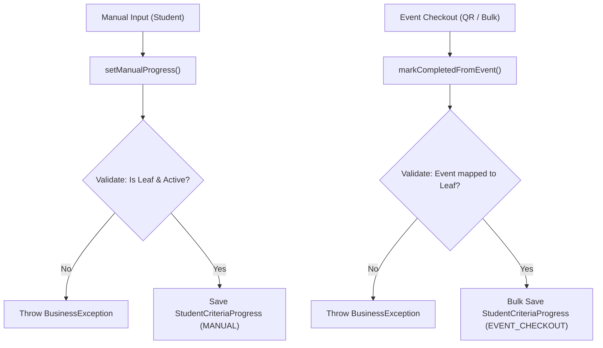
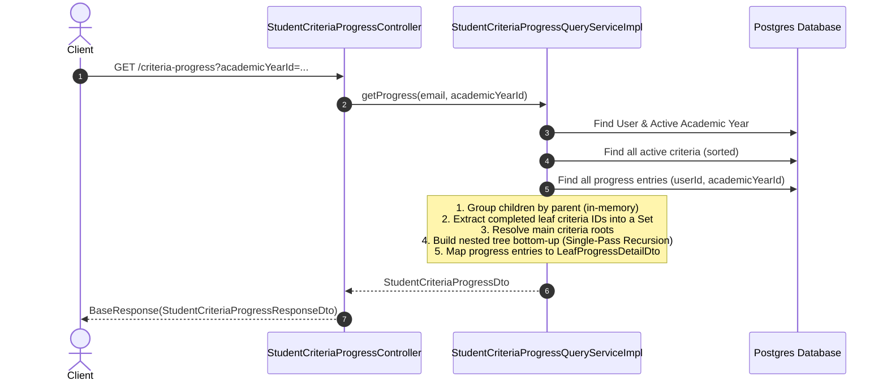
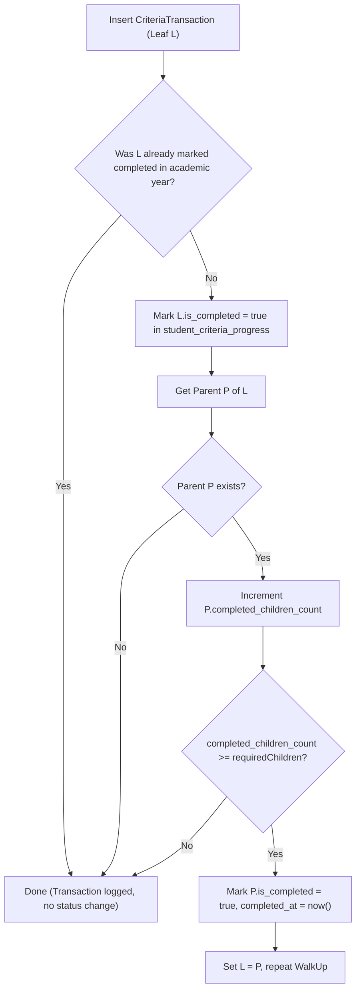

# Student Criteria Progress: Architecture, Current Logic & Future Refactoring Proposal

This document outlines the architecture, current execution logic of both Command and Query services for Student Criteria Progress, analyzes current scalability limits, and presents a comprehensive proposal for refactoring into a **Transaction Ledger + Materialized Progress State** pattern.

---

## 1. Current Architecture & Logic

The criteria progress feature tracks whether university students satisfy criteria frameworks (such as the "Sinh viên 5 tốt" 5-Virtue Student evaluation) during an academic year. Criteria are organized hierarchically as a multi-level tree (University Root $\rightarrow$ Main Categories $\rightarrow$ Sub-criteria $\rightarrow$ Leaf Activities).

```
               [Root: Sinh viên 5 tốt]
                     /          \
        [Main 1: Đạo đức tốt]  [Main 2: Học tập tốt]
              /         \
    [Sub-crit 1.1]   [Sub-crit 1.2]
       (Leaf)            (Leaf)
```

---

### 1.1 Command Flow: [`StudentCriteriaProgressCommandServiceImpl`](file:///home/shrimp/code/ddd/ddd-application/src/main/java/com/ddd/application/service/criteria/impl/StudentCriteriaProgressCommandServiceImpl.java#L36)

The command service is responsible for recording progress completions.



#### Key Rules & Operations
1. **Leaf-Only Enforcement**: Progress can **only** be directly awarded to leaf nodes (`!hasChildren`). Parent criteria cannot be manually marked as completed.
2. **Multiple Entries Allowed**: Multiple events or actions can contribute toward the same criterion in the same academic year (e.g., attending 3 different qualifying charity events).
3. **Current Write Model**:
   - Writes are essentially append-only log entries storing: `(userId, criteriaId, academicYearId, eventId, completionSource, note)`.
   - **Notice**: No evaluation of parent criteria occurs at write time.

---

### 1.2 Query Flow: [`StudentCriteriaProgressQueryServiceImpl`](file:///home/shrimp/code/ddd/ddd-application/src/main/java/com/ddd/application/service/criteria/impl/StudentCriteriaProgressQueryServiceImpl.java#L35)

The query service computes the student's progress and returns a nested tree response with status and progress history.



#### Evaluation Algorithm (Single-Pass Bottom-Up Recursion)
- **Leaves**:
  $$\text{isCompleted} = (\text{criteriaId} \in \text{completedCriteriaIds})$$
- **Parents**:
  $$\text{completedChildrenCount} = \sum_{c \in \text{children}} (\text{if } c.\text{isCompleted then } 1 \text{ else } 0)$$
  $$\text{required} = \text{criteria.requiredChildren} \neq \text{null } ? \text{ criteria.requiredChildren} : |\text{children}|$$
  $$\text{isCompleted} = (\text{completedChildrenCount} \ge \text{required})$$

---

## 2. Limitations of the Current Approach

While the single-pass in-memory evaluation runs in $\mathcal{O}(N)$ memory time:

1. **Repeated Recalculation Overhead**:
   Every time any student opens the app or views their dashboard, the system loads the complete criteria list and re-traverses the entire tree from scratch—even if the student hasn't had any new activity for months.
2. **Scalability under High Concurrency**:
   During peak periods (e.g. end-of-semester certification periods when thousands of students view their progress simultaneously), CPU and GC pressure spike due to repeated tree instantiation.
3. **Semantic Conflation of "Progress"**:
   The entity `StudentCriteriaProgress` is currently acting as **both**:
   - An **audit log / event record** (e.g., student attended event X at time T), AND
   - The **status determination** (whether the criterion is achieved).

---

## 3. Recommended Architectural Evolution: Transaction Ledger + Materialized State

To eliminate recalculation and cleanly separate concerns according to DDD principles, we introduce two distinct concepts:

```
[Events / Actions]
       │
       ▼
[CriteriaTransaction]   ◄── Append-only ledger of historical completions
       │
   (Triggers)
       ▼
[StudentCriteriaProgress] ◄── Materialized read state per student per academic year
       │
   (Direct Read)
       ▼
[Dashboard / Query API]   ◄── O(1) instantaneous lookup, zero recalculation
```

---

### 3.1 Domain Model Separation

#### A. `CriteriaTransaction` (Append-Only Event Ledger)
Represents a factual event that contributed toward a criterion.

```
Table: criteria_transactions
├── id (PK)
├── user_id (FK)
├── criteria_id (FK)
├── academic_year_id (FK)
├── event_id (FK, nullable)
├── completion_source (MANUAL, EVENT_CHECKOUT, CERTIFICATE, SYSTEM)
├── note
└── created_at
```

#### B. `StudentCriteriaProgress` (Materialized Snapshot State)
Represents the current completion status of a criteria node (both leaves and parents) for a given student in an academic year.

```
Table: student_criteria_progress
├── id (PK)
├── user_id (FK)
├── criteria_id (FK)
├── academic_year_id (FK)
├── is_completed (BOOLEAN)
├── completed_children_count (INT)
├── completed_at (TIMESTAMP, nullable)
├── updated_at (TIMESTAMP)
└── UNIQUE (user_id, criteria_id, academic_year_id)
```

---

### 3.2 Rollup & State Evaluation Approaches

There are two primary approaches to update the materialized state:

#### Approach 1: Synchronous Write-Time Rollup (Recommended for immediate consistency)

When a student checks out of an event or manual progress is approved:



**Pros**:
- Reads are instantaneous: `SELECT * FROM student_criteria_progress WHERE user_id = :uid AND academic_year_id = :ayid` returns pre-calculated status for all nodes.
- When an ancestor reaches `is_completed = true`, its state is persisted and never calculated again.
- Bubble-up traversal is shallow (typically only 2–3 levels up).

**Cons**:
- Slightly more work during write transactions (though bounded by tree depth $D \le 4$).

---

#### Approach 2: Event-Driven Asynchronous Rollup (For high-volume bulk event checkouts)

When 5,000 students check out of a mega-event simultaneously:
1. Command service inserts `CriteriaTransaction` records in batch.
2. Publishes a Spring Application Event or Message Queue message: `CriteriaCompletedEvent(userId, criteriaId, academicYearId)`.
3. An asynchronous worker rolls up the parent hierarchy.

---

### 3.3 Query Performance Comparison

| Metric | Current In-Memory On-Demand | Proposed Materialized State |
| :--- | :--- | :--- |
| **Query Strategy** | Load all active criteria + all transactions + compute tree recursion | Single query on `student_criteria_progress` table joined with criteria hierarchy |
| **CPU Time per Request** | $\sim 2 - 5\text{ ms}$ (scales with criteria count) | $\sim 0.2 - 0.5\text{ ms}$ (direct indexed read) |
| **Subtree Re-calculation** | Re-computed on every single API hit | **Zero** if `is_completed == true` |
| **History & Audit** | Mixed with progress checks | Cleanly isolated in `criteria_transactions` |

---

## 4. Suggested Implementation Roadmap

1. **Phase 1: Table & Model Setup**
   - Rename / migrate current `student_criteria_progress` table to `criteria_transactions`.
   - Create new `student_criteria_progress` table with unique constraint on `(user_id, criteria_id, academic_year_id)`.
2. **Phase 2: Write-Time Rollup Service**
   - Implement `CriteriaProgressRollupService` that accepts a completed leaf event and traverses upwards to update parent states.
3. **Phase 3: Backfill Migration**
   - Run a one-time migration script calculating initial state from existing historical records.
4. **Phase 4: Query Service Switchover**
   - Update `StudentCriteriaProgressQueryServiceImpl` to hydrate DTOs directly from `student_criteria_progress` with zero tree recursion.

The completion of a criteria is marked, and then progress is propagated upwards in the hierarchy, with a check to prevent unnecessar...
Here is the detailed, step-by-step implementation roadmap (without functional code) structured across each DDD layer:                
──────
### Stage 1: Database Schema & Migration Setup

• Step 1.1: Database Schema Inspection                                                                                               
• Check current Liquibase / Flyway or Hibernate DDL configuration to identify the established migration standard in the          
repository.                                                                                                                      
• Step 1.2: Create Table criteria_transactions                                                                                       
• Define the immutable event ledger table (id, user_id, criteria_id, academic_year_id, event_id, completion_source, note,        
created_at, created_by, updated_at, updated_by, is_active).                                                                      
• Add foreign keys to users, criterias, academic_years, and events.                                                              
• Create an index on (user_id, academic_year_id) for quick transaction history queries.                                          
• Step 1.3: Create / Alter Table student_criteria_progress                                                                           
• Structure this table as the materialized read-state snapshot (id, user_id, criteria_id, academic_year_id, is_completed,        
completed_children_count, completed_at, audit columns).                                                                          
• Add a strict unique constraint on (user_id, criteria_id, academic_year_id) to prevent duplicate state records.                 
• Create a composite lookup index on (user_id, academic_year_id) for O(1) state retrieval.                                       
• Step 1.4: Historical Data Backfill Migration                                                                                       
• Migrate existing records from legacy student_criteria_progress into criteria_transactions.                                     
• Run a one-time migration to populate the new student_criteria_progress state table (marking leaf criteria as completed and     
bubbling up initial completion to parents).

──────
### Stage 2: Domain Layer Modelling (ddd-domain)

• Step 2.1: Define CriteriaTransaction Domain Model                                                                                  
• Create CriteriaTransaction extending BaseModel.                                                                                
• Model it as an immutable event with properties: userId, criteriaId, academicYearId, eventId, completionSource, note.           
• Step 2.2: Refactor StudentCriteriaProgress Domain Aggregate                                                                        
• Refactor StudentCriteriaProgress to represent materialized state.                                                              
• Encapsulate state transition logic:                                                                                            
• markCompleted(Instant completedAt)                                                                                         
• updateCompletedChildrenCount(int count, Integer requiredChildren)

• Step 2.3: Declare Repository Interfaces in Domain                                                                                  
• Create CriteriaTransactionRepository:                                                                                          
• save(CriteriaTransaction transaction)                                                                                      
• saveAll(List<CriteriaTransaction> transactions)                                                                            
• findByUserIdAndAcademicYearId(Long userId, Long academicYearId)                                                            
• Refactor StudentCriteriaProgressRepository:                                                                                    
• findByUserIdAndAcademicYearId(Long userId, Long academicYearId)                                                            
• findByUserIdAndCriteriaIdAndAcademicYearId(Long userId, Long criteriaId, Long academicYearId)                              
• save(StudentCriteriaProgress progress)                                                                                     
• saveAll(List<StudentCriteriaProgress> progresses)


──────
### Stage 3: Infrastructure Layer Implementation (ddd-infrastructure)

• Step 3.1: JPA Entities                                                                                                             
• Create CriteriaTransactionJpaEntity mapped to table criteria_transactions.                                                     
• Update StudentCriteriaProgressJpaEntity mapped to table student_criteria_progress with isCompleted, completedChildrenCount,    
completedAt, and the unique constraint.                                                                                          
• Step 3.2: Spring Data JPA Repositories                                                                                             
• Implement CriteriaTransactionJpaRepository for ledger queries.                                                                 
• Update StudentCriteriaProgressJpaRepository for state queries and batch updates.                                               
• Step 3.3: Entity-to-Domain MapStruct Mappers                                                                                       
• Create CriteriaTransactionMapper for bidirectional translation between JPA entities and domain models.                         
• Update StudentCriteriaProgressMapper to reflect the new state attributes.                                                      
• Step 3.4: Repository Adapter Implementations                                                                                       
• Create CriteriaTransactionRepositoryImpl implementing CriteriaTransactionRepository.                                           
• Update StudentCriteriaProgressRepositoryImpl implementing StudentCriteriaProgressRepository.

──────
### Stage 4: Rollup Service (ddd-application)

• Step 4.1: Create CriteriaProgressRollupService                                                                                     
• Define the contract and service responsible for synchronizing ancestor state whenever a criterion status changes.              
• Step 4.2: Implement Rollup Algorithm                                                                                               
• Leaf Check: When a leaf criterion L is completed for (userId, academicYearId):                                                 
• Fetch or initialize L's StudentCriteriaProgress state.                                                                     
• If L is already completed, terminate immediately (idempotent, no changes needed).                                          
• If not completed, set isCompleted = true, completedAt = now(), and persist.                                                
• Upward Bubble-Up:                                                                                                              
• Identify L's parent P. If P == null (root reached), stop.                                                                  
• Fetch or initialize P's StudentCriteriaProgress state.                                                                     
• Count how many direct children of P currently have isCompleted = true in student_criteria_progress.                        
• Update P.completedChildrenCount.
• Check if P satisfies completion (completedChildrenCount ≥ requiredChildren).
• If satisfied and P was not already completed:
• Mark P.isCompleted = true, completedAt = now().
• Recurse upward to P's parent.
• If not satisfied or already completed, persist P and stop.


──────
### Stage 5: Command Service Refactoring (ddd-application)

• Step 5.1: Refactor setManualProgress
• Validate that the targeted criterion is an active leaf node.
• Create and save a new CriteriaTransaction record (completionSource = MANUAL).
• Call CriteriaProgressRollupService.rollup(userId, criteriaId, academicYearId).
• Step 5.2: Refactor markCompletedFromEvent
• Validate that the event's criteria is an active leaf node.
• Bulk save CriteriaTransaction records (completionSource = EVENT_CHECKOUT).
• For each distinct userId, invoke CriteriaProgressRollupService.rollup(userId, criteriaId, academicYearId).

──────
### Stage 6: Query Service Simplification (ddd-application)

• Step 6.1: Load Criteria Hierarchy
• Fetch active criteria list and group child IDs by parent (single query).
• Step 6.2: Retrieve Materialized State and Transaction History
• Fetch student_criteria_progress records for (userId, academicYearId) → map into Map<criteriaId, StudentCriteriaProgress>.      
• Fetch criteria_transactions records for (userId, academicYearId) → map directly to LeafProgressDetailDto (with eventName, note,
completionSource).
• Step 6.3: Direct Tree Hydration (Zero Recalculation)
• For each node in the criteria tree, directly read from the materialized state map:
• isCompleted = state != null && state.isCompleted()
• completedChildrenCount = state != null ? state.getCompletedChildrenCount() : 0
• Traverse once to assemble the response DTO hierarchy.
• Step 6.4: Assemble Output
• Return StudentCriteriaProgressDto with instantaneous response times.

──────
### Stage 7: Build & Verification

• Step 7.1: Maven Module Verification
• Run ./mvnw compile -pl ddd-domain,ddd-infrastructure,ddd-application,ddd-api to ensure zero compilation breaks.
• Step 7.2: Architectural Dependency Rule Check
• Verify domain models and repository interfaces maintain zero outgoing dependencies toward infrastructure or database packages. 
