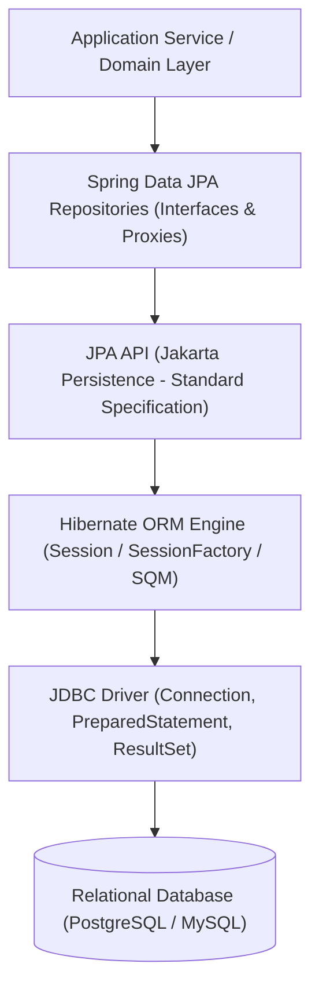
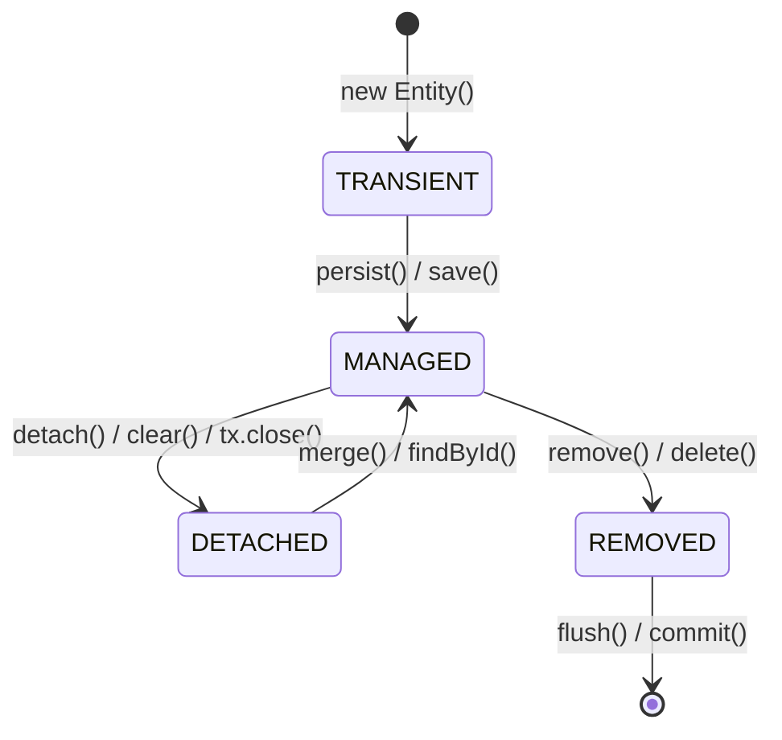
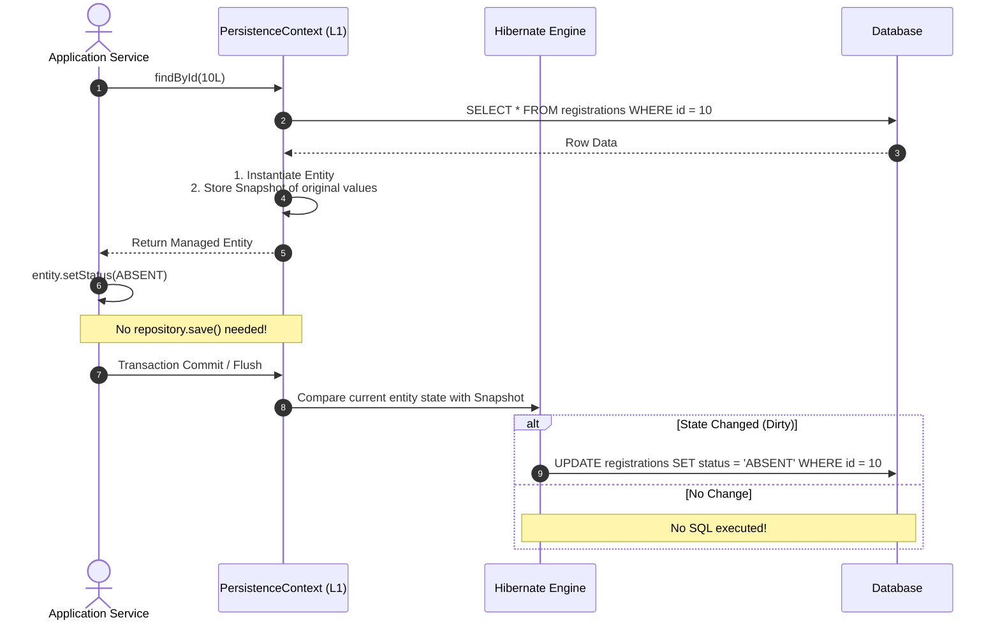
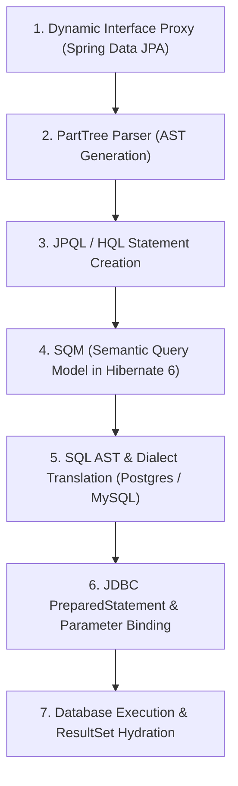
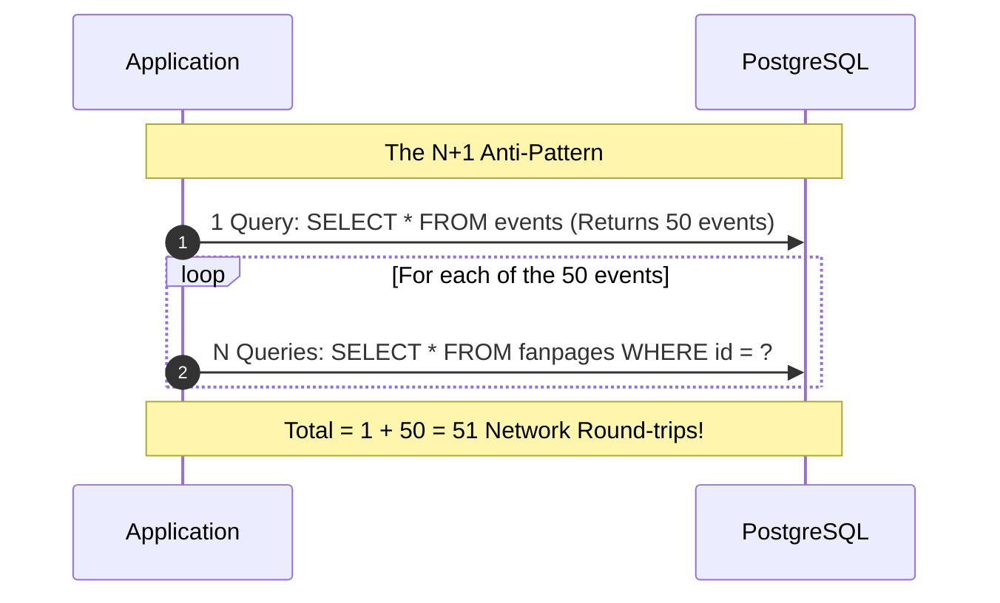

# Mastering Spring Data JPA & Hibernate: Architecture, Internals & Performance Optimization

This guide provides an in-depth exploration of how **Spring Data JPA** and **Hibernate** operate under the hood, how repository methods are translated and executed by the database engine, and what techniques are required to optimize database performance in production enterprise applications.

---

## 1. The Abstraction Stack: Spring Data JPA vs. JPA vs. Hibernate

It is common to conflate Spring Data JPA, JPA, and Hibernate, but they occupy distinct layers of the application architecture:



| Layer | Type | Role & Responsibilities | Key Classes / Interfaces |
|---|---|---|---|
| **Spring Data JPA** | Framework Abstraction | Eliminates boilerplate DAO code. Generates runtime repository proxy implementations, pagination, and derived query parsing. | `JpaRepository<T, ID>`, `RepositoryFactorySupport`, `SimpleJpaRepository` |
| **JPA (Jakarta Persistence)** | API Specification | Standard Java specification defining ORM annotations, lifecycle states, and persistence contracts. Contains **no implementation code**. | `EntityManager`, `EntityTransaction`, `@Entity`, `@Table`, `@Id` |
| **Hibernate** | Implementation / ORM Engine | The concrete engine implementing JPA. Translates object operations to SQL, handles entity caching, dirty checking, proxy interception, and dialect-specific execution. | `SessionFactory`, `SessionImpl`, `PersistenceContext`, `ByteBuddyInterceptor` |
| **JDBC** | Low-Level Driver | Executes raw SQL over network sockets, manages physical connections, and handles low-level serialization/deserialization. | `DataSource`, `Connection`, `PreparedStatement`, `ResultSet` |

---

## 2. Behind the Scenes: The Hibernate Core Engine

### 2.1 The Persistence Context & First-Level (L1) Cache

The **Persistence Context** is an in-memory storage area where Hibernate manages entities during a unit of work (typically bound to an active `@Transactional` method).



#### Key Rules of the First-Level Cache:
1. **Transaction-Scoped Identity Map**: Within the same transaction, querying the same entity by its primary key multiple times (`findById(1L)`) hits the database **only once**. Subsequent calls return the exact same object reference (`e1 == e2`) from the L1 cache.
2. **Entity Isolation**: The L1 cache prevents the application from holding conflicting in-memory representations of the same database row during a single transaction.
3. **Automatic Eviction**: When the transaction ends, the Persistence Context is closed, and all entities transition to the **DETACHED** state.

---

### 2.2 Dirty Checking (Automatic Change Detection)

Hibernate eliminates manual `UPDATE` statements using **dirty checking**:



> [!NOTE]
> When Hibernate loads an entity, it stores a **read-only snapshot copy** of the entity's properties. At flush time, it compares the current entity state against this snapshot. If any attribute changed, an `UPDATE` statement is automatically generated and added to the execution queue.

---

### 2.3 Flushing vs. Committing

* **Flush (`Session.flush()`)**: Translates in-memory entity changes into database statements (`INSERT`, `UPDATE`, `DELETE`) and sends them over JDBC to the database transaction buffer. **The transaction is NOT committed yet.**
* **Commit (`Transaction.commit()`)**: Issues the database `COMMIT` command, writing the buffer permanently to WAL/disk and releasing database locks.

#### When Does Hibernate Flush Automatically (`FlushModeType.AUTO`)?
1. Before executing any JPQL / Native Query that might touch overlapping tables (to prevent stale reads).
2. Right before the transaction commits.
3. When `entityManager.flush()` is manually invoked.

---

### 2.4 Dynamic Proxies and Lazy Loading

Hibernate uses **ByteBuddy** to create dynamic proxy subclasses of your entities for `@ManyToOne(fetch = FetchType.LAZY)` or `@OneToOne(fetch = FetchType.LAZY)` relationships.

```java
// Hibernate doesn't load UserJpaEntity from DB yet:
RegistrationJpaEntity reg = em.find(RegistrationJpaEntity.class, id);
UserJpaEntity userProxy = reg.getUser(); // userProxy is a ByteBuddy proxy class

// Only when a property is accessed does it trigger a SELECT query:
String email = userProxy.getEmail(); // Fires: SELECT * FROM users WHERE id = ?
```

> [!WARNING]
> If you access an uninitialized lazy property after the transaction has closed (e.g., inside a controller or serialization filter), Hibernate throws:
> `org.hibernate.LazyInitializationException: could not initialize proxy - no Session`

---

## 3. How Repository Query Methods Are Executed

When you write an interface method like:
```java
List<RegistrationJpaEntity> findByEventIdAndStatus(Long eventId, RegistrationStatusEnum status);
```
Here is the step-by-step pipeline Spring and Hibernate execute:



### Step 1: Interface Invocation via Dynamic Proxy
Spring Data does not write code to disk. At application startup, `RepositoryFactorySupport` creates a JDK dynamic proxy for your repository interface and routes all invocations to `QueryExecutorMethodInterceptor`.

### Step 2: PartTree Method Parsing
Spring inspects the method name `findByEventIdAndStatus`:
1. Strips prefix: `findBy`
2. Identifies properties: `EventId` (navigates `event.id` or `id.eventId`) and `Status`
3. Identifies operators: `And`, `Equal`
4. Produces a semantic abstract syntax tree (AST).

### Step 3: JPQL Construction
Spring translates the AST into a JPQL string:
```sql
SELECT r FROM RegistrationJpaEntity r WHERE r.event.id = :eventId AND r.status = :status
```

### Step 4: Semantic Query Model (SQM) Translation
Hibernate 6 parses the JPQL into its internal **Semantic Query Model (SQM)**:
- Validates entity names against Hibernate metadata.
- Resolves association paths (`r.event.id`).
- Checks query plan cache to avoid re-parsing on subsequent runs.

### Step 5: Dialect-Specific SQL Translation
Hibernate's SQL AST engine converts SQM into physical SQL using the configured dialect (`PostgreSQLDialect`):
```sql
SELECT r1_0.event_id, r1_0.user_id, r1_0.status, r1_0.reg_date 
FROM registrations r1_0 
WHERE r1_0.event_id = ? AND r1_0.status = ?
```

### Step 6: JDBC Execution & Parameter Binding
Hibernate borrows a pooled connection, creates a JDBC `PreparedStatement`, binds parameters (`?`), and invokes `ps.executeQuery()`.

### Step 7: Entity Hydration
Hibernate iterates over the `ResultSet`:
1. Reads row primary key.
2. Checks L1 Cache: If the entity already exists in the `PersistenceContext`, Hibernate reuses the existing instance.
3. If not in L1 Cache, it instantiates the entity via reflection, populates fields, stores an internal snapshot, and registers it as **MANAGED**.

---

## 4. Production Performance Playbook: Optimizing Database Operations

### 4.1 Defeating the N+1 Query Problem

The N+1 problem occurs when fetching 1 parent record causes Hibernate to issue N separate queries for its child records.



#### Solution 1: Use `@EntityGraph` (Recommended)
`@EntityGraph` dynamically transforms `FetchType.LAZY` associations into a `LEFT OUTER JOIN` for that specific query without permanently changing entity mapping:

```java
// Executes in EXACTLY 1 SQL query with LEFT JOINs
@EntityGraph(attributePaths = {"user", "user.studentProfile", "user.studentProfile.major"})
@Query("SELECT r FROM RegistrationJpaEntity r WHERE r.event.id = :eventId")
List<RegistrationJpaEntity> findAllByEventIdWithDetails(@Param("eventId") Long eventId);
```

#### Solution 2: Batch Fetching (`default_batch_fetch_size`)
If you have collections that cannot be easily joined without creating a Cartesian product, configure Hibernate batch fetching:

```yaml
# In application.yml:
spring:
  jpa:
    properties:
      hibernate:
        default_batch_fetch_size: 50
```
Instead of 50 individual queries, Hibernate batches the IDs using `IN`:
```sql
SELECT * FROM fanpages WHERE id IN (?, ?, ?, ..., ?) -- 1 query instead of 50!
```

---

### 4.2 Optimizing Batch Updates and Inserts

#### The `GenerationType.IDENTITY` Trap
```java
@Id
@GeneratedValue(strategy = GenerationType.IDENTITY)
private Long id;
```
> [!CAUTION]
> `GenerationType.IDENTITY` forces Hibernate to execute immediate `INSERT` statements one-by-one to get the generated ID. **JDBC batching is completely disabled by Hibernate for IDENTITY inserts!**

To enable true batch inserts:
* Use `@GeneratedValue(strategy = GenerationType.SEQUENCE)` with an allocation size (`allocationSize = 50`), OR
* Use composite keys (`@EmbeddedId`), OR
* Use application-assigned IDs (e.g. UUID / TSID).

#### Enabling JDBC Batching in Spring Boot
In `application.yml`:
```yaml
spring:
  jpa:
    properties:
      hibernate:
        jdbc:
          batch_size: 50
          order_inserts: true
          order_updates: true
```
* `batch_size: 50`: Groups up to 50 statements into a single JDBC network transmission (`PreparedStatement.executeBatch()`).
* `order_inserts` / `order_updates`: Groups statements by table so the JDBC driver does not break batches prematurely.

#### Bulk Updates via `@Modifying`
When updating thousands of records (e.g., mark 500 attendees absent), loading 500 entities into memory is wasteful. Use a bulk JPQL query:

```java
@Modifying(clearAutomatically = true)
@Query("UPDATE RegistrationJpaEntity r SET r.status = :status, r.updatedAt = CURRENT_TIMESTAMP " +
       "WHERE r.event.id = :eventId AND r.user.id IN :studentUserIds")
int batchUpdateStatus(
        @Param("eventId") Long eventId,
        @Param("studentUserIds") Collection<Long> studentUserIds,
        @Param("status") RegistrationStatusEnum status);
```
> [!TIP]
> `clearAutomatically = true` clears the PersistenceContext after the query executes, preventing stale entity snapshots from staying in L1 cache.

---

### 4.3 Zero-Query Foreign Key Linking via `entityManager.getReference()`

When creating a child entity that points to an existing parent, do **not** use `findById()` to load the parent:

````carousel
```java
// ❌ ANTI-PATTERN: Fires a SELECT query to fetch the User row
UserJpaEntity user = userJpaRepository.findById(userId)
        .orElseThrow(() -> new ResourceNotFoundException("User not found"));

RegistrationJpaEntity reg = new RegistrationJpaEntity();
reg.setUser(user);
registrationJpaRepository.save(reg);
// Result: 1 SELECT query + 1 INSERT query
```
<!-- slide -->
```java
// ✅ OPTIMIZED: Fires ZERO queries for User
// Returns an uninitialized ByteBuddy proxy holding only the ID
UserJpaEntity userRef = entityManager.getReference(UserJpaEntity.class, userId);

RegistrationJpaEntity reg = new RegistrationJpaEntity();
reg.setUser(userRef);
registrationJpaRepository.save(reg);
// Result: 0 SELECT queries + 1 INSERT query (50% reduction in DB operations)
```
````

---

### 4.4 DTO Projections for Read-Heavy Queries

Loading full `@Entity` instances incurs dirty-checking tracking, snapshot creation, and proxy overhead. For read-only views (dashboards, tables, exports), project directly into a Java record:

```java
public record AttendeeExportDto(
    String studentId,
    String fullName,
    String email,
    RegistrationStatusEnum status
) {}
```

```java
// In your Repository:
@Query("SELECT new com.ddd.application.dto.export.AttendeeExportDto(" +
       "sp.studentId, CONCAT(u.firstName, ' ', u.lastName), u.email, r.status) " +
       "FROM RegistrationJpaEntity r " +
       "JOIN r.user u " +
       "LEFT JOIN u.studentProfile sp " +
       "WHERE r.event.id = :eventId")
List<AttendeeExportDto> findAttendeesForExport(@Param("eventId") Long eventId);
```
* **Benefits**:
  * Hibernate does **not** create dirty-checking snapshots.
  * Queries only the exact columns specified in `SELECT`.
  * Significant memory reduction when processing thousands of rows.

---

### 4.5 Tuning Read-Only Transactions

For query service implementations, always annotate the class or method with `@Transactional(readOnly = true)`:

```java
@Service
@Transactional(readOnly = true)
@RequiredArgsConstructor
public class RegistrationQueryServiceImpl implements RegistrationQueryService { ... }
```

#### What happens behind the scenes:
1. **Hibernate Snapshot Optimization**: Hibernate disables dirty-checking snapshot creation, cutting memory allocation per entity in half.
2. **JDBC Driver Optimization**: Spring sets the JDBC connection mode to read-only (`connection.setReadOnly(true)`), allowing PostgreSQL to route queries to read replicas and avoid transaction lock allocations.
3. **Flush Elimination**: Prevents Hibernate from executing accidental flush checks before queries.

---

### 4.6 Safe Pagination with Joins

> [!CAUTION]
> If you combine a collection join (`@OneToMany`) with `Pageable` in JPQL:
> ```java
> @Query("SELECT e FROM EventJpaEntity e JOIN FETCH e.eventPoints")
> Page<EventJpaEntity> findAllEvents(Pageable pageable);
> ```
> Hibernate will log a severe warning:
> `HHH000104: firstResult/maxResults specified with collection fetch; applying in memory!`
> It will **fetch ALL rows from the database** into RAM and paginate in Java memory, causing OutOfMemory errors in production!

#### Correct Approaches:
1. Paginate the root entity first, then fetch collections in batches via `default_batch_fetch_size: 50`.
2. Or use two separate queries: one to retrieve paginated IDs, and another to fetch entity graphs matching those IDs.

---

## 5. Summary Checklist for High-Performance JPA

| Area | Best Practice | Anti-Pattern |
|---|---|---|
| **Association Fetching** | Default all associations to `FetchType.LAZY`; fetch selectively with `@EntityGraph` | `FetchType.EAGER` anywhere in entity definitions |
| **New Entity Relationships** | `entityManager.getReference(Class, id)` | `repository.findById(id)` before linking |
| **Read Operations** | `@Transactional(readOnly = true)` + DTO records | Default read-write transactions returning full entities |
| **Batch Operations** | `@Modifying` queries or `batch_size: 50` + `order_updates: true` | Calling `save()` inside a `for` loop |
| **Composite Keys** | Use `@EmbeddedId` and match repository ID type `JpaRepository<Entity, IdClass>` | `JpaRepository<Entity, Long>` on composite-key entities |
| **Identity Generation** | Use sequence or composite keys for batching | `GenerationType.IDENTITY` for bulk-inserted entities |
| **Change Tracking** | Modify managed entities in-place (let dirty checking generate SQL) | Explicitly re-calling `save()` on already managed entities |
